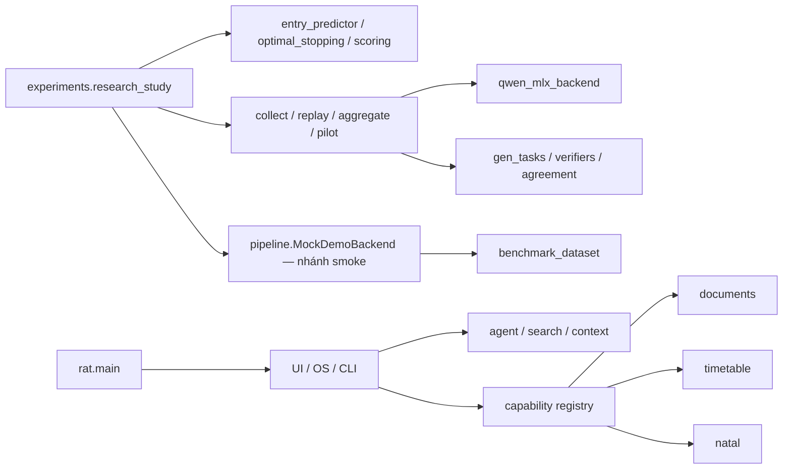

# Codebase và phạm vi NCKH — 14/10/2026

Đây là audit tĩnh và đề xuất thu gọn **phạm vi công việc**, không thay đổi code sản phẩm, research protocol, gate, dependencies hay dữ liệu. Không xóa file và không chạy mô hình.

## Kết quả đo

- 978 file nguồn, 256,516 dòng không trống; gồm comments/docstrings, tests và source upstream.
- Spider upstream: 123,868 dòng, khoảng 48.3% tổng. Con số toàn repo không đại diện lượng code nhóm tự viết hoặc phải làm tiếp.
- Cụm import có thể đi tới từ `python -m experiments.research_study`: 26 file / 9,551 dòng; không có file RAT.
- Thêm các tests nghiên cứu import trực tiếp cụm trên và dependencies của chúng: 74 file / 18,300 dòng, gồm 33 test files; vẫn không có file RAT.
- Source RAT (không tính tests/scripts): 31,845 dòng. `rat/ui/omnibar.py` riêng có 3,890 dòng không trống. Độ dài là dấu hiệu chi phí đọc/chỉnh sửa, chưa phải kết luận code lỗi.
- Nội dung source trùng byte ở file từ 30 dòng trở lên: 11,277 dòng của các bản bổ sung; 10,974 nằm trong EVRP. Đây chủ yếu là footprint của module khóa học riêng, không phải điểm cần refactor trước để hoàn thành NCKH.
- Có 19 file `.pyc` đang được Git track; nên xử lý hygiene ở lượt riêng, không ưu tiên hơn dữ liệu/thực nghiệm.

### Thành phần

| Cụm mã | File nguồn | Dòng không trống | Dòng tests |
| --- | ---: | ---: | ---: |
| Spider · upstream Rust | 269 | 123,868 | 9,007 |
| EVRP · khóa học riêng | 247 | 26,903 | 1,789 |
| Snapshot trong audit | 57 | 25,613 | 2,060 |
| RAT · giao diện | 28 | 15,217 | 0 |
| Tests RAT | 68 | 9,851 | 9,851 |
| Scripts nghiên cứu | 41 | 9,044 | 0 |
| RAT · engine / agent | 33 | 8,874 | 0 |
| Thí nghiệm headless | 13 | 6,663 | 0 |
| DocAI · module riêng | 54 | 5,400 | 982 |
| Tests nghiên cứu | 40 | 5,139 | 5,139 |
| Legacy / scratch | 28 | 4,890 | 1,097 |
| Scripts RAT / demo | 24 | 3,965 | 0 |
| RAT · indexing | 11 | 2,426 | 0 |
| Reasoning lõi / MLX | 16 | 2,346 | 0 |
| RAT · OS / CLI | 14 | 2,008 | 0 |
| RAT · capability kernel | 10 | 1,583 | 0 |
| RAT · lịch học | 4 | 1,159 | 0 |
| Rep watch bot · riêng | 14 | 985 | 151 |
| RAT · astrology | 6 | 578 | 0 |
| Mã khác / cấu hình build | 1 | 4 | 0 |

### File lớn đang dùng ngoài upstream/module riêng/lịch sử

- `rat/ui/omnibar.py`: 3,890 dòng không trống.
- `experiments/cot_restart_pilot.py`: 1,536 dòng không trống.
- `rat/ui/schedule_window.py`: 1,536 dòng không trống.
- `rat/engine/assistant_runtime.py`: 1,062 dòng không trống.
- `rat/engine/completion.py`: 1,031 dòng không trống.
- `rat/ui/claude_widget.py`: 984 dòng không trống.
- `rat/ui/chat_stream.py`: 909 dòng không trống.
- `rat/ui/spotlight_window.py`: 877 dòng không trống.

## Bản đồ phụ thuộc và điểm cắt

Đây là sơ đồ khái quát sau khi đọc code; không phải call trace runtime. Danh sách edges Python đo bằng AST có trong `audit/codebase_scope_20261014/inventory.json`. Import tĩnh của entry point không đi qua RAT, DocAI hoặc watch bot. Tìm chuỗi path/call trong code không thấy RAT hoặc entry nghiên cứu tích hợp Spider/EVRP; từ “spider” xuất hiện ở bộ từ đồng nghĩa, không phải import thư viện.

Không xóa `pipeline.py` chỉ vì README gọi nó exploratory: nhánh smoke vẫn import `MockDemoBackend` từ đó. Không tắt mỗi registry entry rồi xóa lịch/natal: default registry đang import/register chúng, và các view factories còn nối tới UI. Một demo rút gọn trong tương lai cần profile/lazy registration cùng kiểm tra phù hợp.

## Thu gọn đề xuất

1. **Ngay bây giờ — freeze backlog NCKH:** tập trung một câu hỏi nghiên cứu và một campaign có protocol; ngừng bổ sung UI, animation, lịch/natal, integration DocAI/Spider, hoặc mở nhiều campaign cùng lúc. Lựa chọn campaign phải được GVHD và protocol hiện hành chốt; bản đồ không tự chọn hay mở thí nghiệm.
2. **Ổn định đường chạy — giữ core và kiểm chứng:** dùng entry point headless, dữ liệu/labels được review, grouped splits, baseline/ablation cần thiết, scoring, token accounting, artifacts và tests liên quan. Giữ nguyên Stage 0. Không cắt controls/replication để đổi lấy tiến độ.
3. **Chỉ làm demo nếu thực sự cần cho xét duyệt:** một flow nhập bài → kết quả/trace/chi phí đủ rõ. Giữ demo RAT hiện có ở mức giới hạn; phần demo không thay bằng chứng chất lượng model.
4. **Sau khi có kết quả reviewed — mới dọn cấu trúc:** cân nhắc tách upstream/module khóa học thành dependency hoặc workspace riêng, tách `omnibar` theo trách nhiệm và thu hồi helpers cũ sau khi kiểm references/tests. Bảo toàn raw artifacts, backups và worktrees.

### Ưu tiên việc cần xử lý

Các điểm impact/risk/effort dưới đây là đánh giá định tính của audit, không phải metric phần mềm hay ước lượng chắc chắn về thời gian. Theo framework: priority = (impact + risk) × (6 − effort).

| Việc | Impact | Risk | Effort | Priority | Căn cứ / tiêu chí xong |
| --- | ---: | ---: | ---: | ---: | --- |
| Freeze một backlog/campaign NCKH | 5 | 4 | 1 | 45 | AGENTS ưu tiên bài và pipeline; scope được GVHD duyệt |
| Environment nghiên cứu riêng, đúng dependencies | 4 | 4 | 1 | 40 | `--help` chạy thành công; offline smoke khi được lựa chọn; chưa là model-quality evidence |
| Giữ review data/scoring/cost/gates trên critical path | 5 | 5 | 3 | 30 | Protocol/artifact review; không mở test hoặc fit tùy tiện |
| Profile demo tối thiểu nếu phải trình bày app | 3 | 3 | 3 | 18 | Không tải capabilities không dùng; regressions liên quan đạt |
| Tách UI lớn và dọn source trùng/upstream | 2 | 2 | 4 | 8 | Sau evidence, preserve provenance/recovery và dependency audit |

## Kiểm tra và giới hạn

Scanner chỉ dùng Git read-only, file reads, AST và SHA-256. Parse được toàn bộ 459 Python source files trong snapshot, không có syntax error. Scope includes mọi branch import: conservative upper bound, không chứng minh tất cả file được import trong một lần chạy. File/config/model/resource bằng path và subprocess không nằm đủ trong graph. Files không có edge từ entry point vẫn có thể là CLI riêng hoặc resource cần giữ.

Inventory dùng `git ls-files --cached --others --exclude-standard` và file tồn tại; loại `work/` của lượt audit, `.migration-backups/`, thư viện `wwwroot/lib` và `.min.js/.min.css` khỏi source count. Không đo toàn bộ disk usage, ignored virtual environments, build outputs hoặc model caches. 126 MB Git-visible file content không phải tổng dung lượng repo.

Hai startup checks read-only thất bại: `.venv/bin/python -m experiments.research_study --help` thiếu `sklearn`; Python hệ thống thiếu `gymnasium`. Không cài/sửa environment trong lượt audit. Đây là lỗi setup cần xử lý trước khi chạy pipeline, không phải bằng chứng harness sai hoặc model kém.

Deadline chưa chốt nên không hứa “kịp”. Đề xuất cắt phạm vi trên có thể làm ngay mà không xóa code; thời gian tới buổi xét duyệt còn phụ thuộc survey, chốt RQ, human review và compute/analysis.

Nguồn nội bộ: `AGENTS.md`, `README.md`, `docs/research_plan.md`, `docs/research_protocol.md`, registry/entry points và source đã hash trong inventory. Có working-tree changes từ các công việc khác; audit giữ nguyên chúng.
