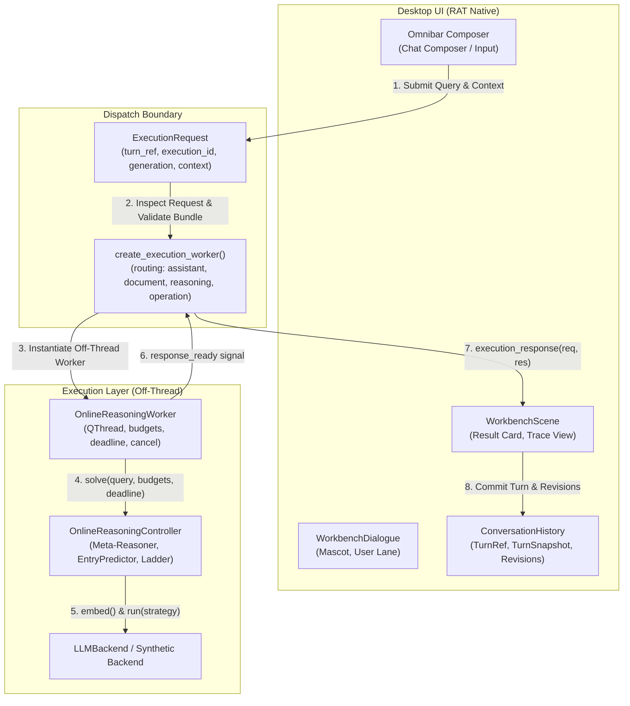
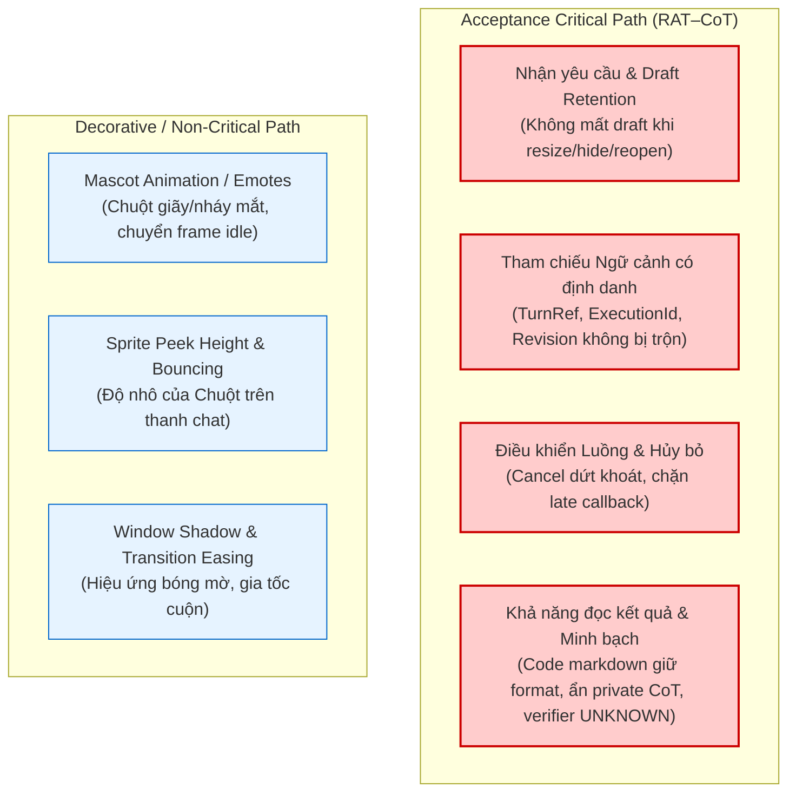

# Báo cáo chuẩn bị: Hoàn thiện luồng RAT–CoT xuyên suốt

**Ngày**: 2026-10-22 (Asia/Saigon)  
**Mục tiêu**: Chuẩn bị độc lập source map, ma trận assertions 7 bước và phân loại UI failure cho luồng RAT–CoT nhiều lượt; bảo đảm không đụng độ các file runtime/bundle đang được sửa đồng thời.  
**Nguyên tắc**: RAT và CoT là một hệ thống thống nhất. Ngân sách model thật = 0. Giữ nguyên Stage 0 gate và research protocol. Không tạo màn hình DSA hoặc controller thứ hai.

---

## 1. Source Map & Đánh giá hiện trạng 5 điểm nối



### Chi tiết trạng thái 5 điểm nối

| Điểm nối | Trạng thái hiện tại | Lỗ hổng / Điểm cần hoàn thiện | Hành động thực hiện sau khi Anti xong core |
| :--- | :--- | :--- | :--- |
| **1. Composer → Request** | Omnibar tạo `ExecutionRequest` với `turn_ref`, `execution_id`, `generation`, `history_messages`, `turn_references`, `task_state`. | `request.context` chưa được reasoning worker sử dụng; query gửi đi chỉ là chuỗi đơn lẻ. | Chuẩn bị input snapshot adapter giữ nguyên `request.query` để hiển thị trên UI, đồng thời đóng gói ngữ cảnh cho backend. |
| **2. Request → Worker** | `create_execution_worker` route sang `OnlineReasoningWorker` khi `lane="reasoning"` hoặc `auto`. Kiểm tra bundle bằng `validate_policy_bundle`. | Production chưa có composition host loader chính thức, hiện chỉ đọc property `ratReasoningEngine` của `QApplication`. | Định nghĩa composition host chuẩn trong app startup: dev mode nhận synthetic có nhãn; prod chỉ nhận approved bundle. |
| **3. Worker → Controller** | `OnlineReasoningWorker` chạy off-thread, chuyển budgets (`max_strategy_invocations`, `max_underlying_requests`, `max_generated_tokens`), deadline, cancel. | `OnlineReasoningWorker` chỉ chuyển `request.query` mà bỏ qua `request.context`. | Chuyển input snapshot (prompt + historical facts/turn references) qua worker vào `engine.solve()`. |
| **4. Controller → Cuộc trò chuyện** | `execution_response` chuyển đổi kết quả thành `AgentResponse`, đối chiếu `execution_id`/`generation`, chuyển telemetry và cost ledger. | Cần chứng minh tính toàn vẹn qua nhiều lượt: tạo revision mới, không ghi đè dữ liệu cũ, từ chối callback muộn sau cancel. | Kiểm tra bằng kịch bản 7 bước trên chính UI container của RAT. |
| **5. Composer → Policy → Result** | Đã có test 1 lượt đơn lẻ trong `tests/test_flow_interaction.py` (`test_composer_reaches_composed_policy_and_returns_to_same_conversation`). | Chưa có test kiểm tra chuỗi tương tác nhiều lượt (multi-turn), sửa đổi dữ kiện và xử lý budget/lỗi. | Mở rộng test fixture mô phỏng trọn vẹn 7 bước DSA. |

---

## 2. Kịch bản chấp nhận 7 bước & Ma trận Assertions

Kịch bản sử dụng ví dụ Binary Search theo kế hoạch hội thoại đã thống nhất. Fixture kiểm chứng cấu trúc, routing, ngữ cảnh và lifecycle mà không suy diễn rằng model hiểu thuật toán.

```mermaid
sequenceDiagram
    autonumber
    actor User as Người dùng
    participant UI as Omnibar / Workbench
    participant Session as ConversationHistory
    participant Worker as OnlineReasoningWorker
    participant Engine as MetaReasoner / Controller

    Note over User,Engine: Bước 1: Khởi đầu (Giải thích khái niệm)
    User->>UI: "Giải thích binary search bằng ví dụ nhỏ, chưa đưa code"
    UI->>Session: begin_turn(turn-1)
    UI->>Worker: OnlineReasoningWorker(Turn 1)
    Worker->>Engine: solve(query_1)
    Engine-->>Worker: MetaReasoningResult(status="completed", verifier="UNKNOWN")
    Worker-->>UI: AgentResponse (Turn 1)
    UI->>Session: complete_turn(turn-1)

    Note over User,Engine: Bước 2: Đưa dữ kiện cụ thể
    User->>UI: "Dùng mảng [2, 4, 6, 8, 10], tìm 8 đi"
    UI->>Worker: OnlineReasoningWorker(Turn 2 + Snapshot Context Turn 1)
    Worker->>Engine: solve(query_2 with Context)
    Engine-->>UI: AgentResponse (Turn 2, Target: 8)
    UI->>Session: complete_turn(turn-2, facts: array=[2,4,6,8,10], target=8)

    Note over User,Engine: Bước 3: Hỏi câu hỏi phụ
    User->>UI: "Sao phải dùng mid + 1?"
    UI->>Worker: OnlineReasoningWorker(Turn 3 + Context Turn 2)
    Worker->>Engine: solve(query_3 with array & target 8)
    Engine-->>UI: AgentResponse (Turn 3, giải thích left=mid+1)

    Note over User,Engine: Bước 4: Sửa đổi dữ kiện (Tạo revision mới)
    User->>UI: "Đổi sang tìm 6 nhé"
    UI->>Session: begin_turn(turn-4, target_turn_id="turn-2")
    UI->>Worker: OnlineReasoningWorker(Turn 4, new target: 6)
    Worker-->>UI: AgentResponse (Turn 4, Revision 2)
    UI->>Session: complete_turn(turn-4, revision=2)
    Note over Session: Dữ liệu Turn 2 (tìm 8) giữ nguyên ở Revision 1

    Note over User,Engine: Bước 5: Lookback không phá hủy
    User->>UI: "Quay lại đoạn mid + 1 lúc nãy"
    UI->>Session: get_turn(turn-3)
    Note over UI: Mở lại kết quả Turn 3; draft composer không bị xóa

    Note over User,Engine: Bước 6: Cooperative Cancellation
    User->>UI: "Tìm kiếm phức tạp..."
    UI->>Worker: start()
    User->>UI: Dừng (Cancel)
    UI->>Worker: requestInterruption()
    Worker-->>UI: status="cancelled"
    UI->>Session: cancel_turn()
    User->>UI: "Hỏi tiếp câu mới"
    Note over Session: Callback muộn từ turn bị hủy bị chặn triệt để

    Note over User,Engine: Bước 7: Budget=0 & Xử lý lỗi
    User->>UI: Query với max_tokens=0 hoặc backend lỗi
    UI->>Worker: OnlineReasoningWorker(budget=0)
    Worker->>Engine: solve()
    Engine-->>UI: status="budget_exceeded" / "failed"
    Note over UI: 0 request dispatch; verifier giữ UNKNOWN/unverified
```

### Chi tiết Assertions từng bước

| Bước | Tương tác người dùng | Input gửi tới Backend (Snapshot) | Assertions trên luồng RAT | Evidence Bundle kiểm tra |
| :--- | :--- | :--- | :--- | :--- |
| **1** | "Giải thích binary search bằng ví dụ nhỏ, chưa đưa code." | Query thuần túy của Turn 1. | - `turn_ref.turn_id == "turn-1"`<br>- `execution_id` khớp với worker<br>- `status == "completed"`<br>- Trả lời không chứa code block<br>- `verification_status == "UNKNOWN"` | `query`, `execution_id`, `strategy_path`, `cost_ledger`, `verification_status="UNKNOWN"`, không rò rỉ private CoT. |
| **2** | "Dùng mảng [2, 4, 6, 8, 10], tìm 8 đi." | Input snapshot kết hợp: chủ đề Binary Search (Turn 1) + dữ kiện mảng `[2,4,6,8,10]` và mục tiêu `8`. | - Backend nhận đủ mảng và mục tiêu<br>- UI hiển thị đúng câu hỏi người dùng nhập<br>- `turn_ref.turn_id == "turn-2"`<br>- Trạng thái bài toán ghi nhận mảng và target 8 | `turn_id="turn-2"`, `facts={"array": [2,4,6,8,10], "target": 8}`, `cost_ledger`, `verification_status="UNKNOWN"`. |
| **3** | "Sao phải dùng mid + 1?" | Input snapshot kết hợp: Turn 2 (mảng [2,4,6,8,10], bước mid=2 $a[mid]=6 < 8$) + câu hỏi Turn 3. | - Backend hiểu bước $mid+1$ trong ngữ cảnh mảng ở Turn 2<br>- Không yêu cầu người dùng nhập lại đề bài<br>- `turn_id == "turn-3"`, liên kết `target_turn_id == "turn-2"` | `turn_id="turn-3"`, snapshot nguồn Turn 2, `strategy_path`, `actual_cost_ledger`. |
| **4** | "Đổi sang tìm 6 nhé." | Input snapshot: cùng mảng `[2,4,6,8,10]`, mục tiêu đổi thành `6`. | - Tạo revision mới (`revision=2`)<br>- Kết quả tìm 8 ở Turn 2 giữ nguyên ở `revision=1`<br>- Không ghi đè lịch sử cũ | `turn_id="turn-4"`, `target_revision=2`, snapshot Turn 2 không bị thay đổi. |
| **5** | "Quay lại đoạn mid + 1 lúc nãy." | Lệnh điều hướng/lookback về Turn 3. | - Mở lại kết quả Turn 3<br>- Draft đang soạn trong composer không bị xóa<br>- Không dispatch lượt suy luận mới thừa thãi | `target_turn_id == "turn-3"`, `composer.text() == draft`, không tăng token ledger. |
| **6** | Hủy khi đang xử lý, sau đó hỏi tiếp. | Query bị cancel, sau đó gửi query mới. | - Worker nhận `isInterruptionRequested()`<br>- Phát tín hiệu `status="cancel"`<br>- `ConversationHistory.cancel_turn()` đánh dấu cancelled<br>- Callback muộn bị từ chối (`cancelled:turn_cancelled`)<br>- Lượt mới hoàn thành bình thường | `status="cancelled"`, `cancelled_executions` ghi nhận ID, query mới có `turn_id` riêng. |
| **7** | `max_generated_tokens=0`, lỗi backend hoặc thiếu dữ kiện. | Query với budget quota = 0 hoặc backend exception. | - Không dispatch underlying request nào (`dispatched == 0`)<br>- Chi phí token = 0<br>- Trả về `status="budget_exceeded"` hoặc `status="failed"`<br>- UI không bao giờ báo "completed" hoặc "verified" giả | `cost_ledger.dispatched == 0`, `status != "completed"`, `answer_verification_status == "UNKNOWN"`. |

---

## 3. Phân loại lỗi UI: Critical Path vs Decorative

Nhằm tập trung giải quyết đúng trọng tâm của phương pháp RAT–CoT, các lỗi UI được phân loại rõ ràng theo mức độ ảnh hưởng đến luồng công việc:



### 1. Nhóm cốt lõi (Acceptance-Critical Path)
Bất kỳ lỗi nào trong nhóm này đều được tính là **Flow Failure**, chặn nghiệm thu:
1. **Mất bản nháp (Draft Loss)**: Người dùng đang gõ câu hỏi tiếp theo mà bấm đổi kích thước cửa sổ, mở/đóng thanh tìm kiếm hoặc khi worker trả về kết quả mà nội dung ô nhập bị xóa hoặc mất focus.
2. **Sai lệch định danh (Identity / Provenance Misalignment)**: Kết quả của lượt $N$ bị gán nhầm vào $N-1$, hoặc execution cũ ghi đè lên execution mới sau khi đã hủy.
3. **Mất ngữ cảnh (Context Severing)**: Khi hỏi câu hỏi phụ ("Sao lại mid + 1?"), hệ thống không chuyển mảng và mục tiêu của lượt trước sang worker, khiến mô hình trả lời chung chung hoặc đòi nhập lại đề.
4. **Phá hủy lịch sử (Destructive Overwrite)**: Khi đổi mục tiêu (tìm 6 thay vì 8), hệ thống ghi đè mất lượt tìm 8 thay vì tạo revision mới.
5. **Ảo giác kiểm chứng (False Verification)**: Tự động đánh dấu "đã kiểm chứng" trong khi verifier chỉ hỗ trợ số học thuần, chưa có checker thuật toán DSA.
6. **Rò rỉ CoT riêng tư (Private Thought Exposure)**: Đưa các chuỗi suy nghĩ nội bộ (`<think>`, token nháp) lên giao diện công khai thay vì tóm tắt công việc cấp cao.

### 2. Nhóm trang trí (Decorative / Non-Critical Path)
Các lỗi trong nhóm này được tách riêng, **không làm gián đoạn** việc nghiệm thu luồng RAT–CoT:
1. Chuột không đổi biểu cảm (reaction emote) khi nhấp chuột trái.
2. Chiều cao nhô lên của nhân vật (peek height) lệch một vài pixel khi thay đổi theme sáng/tối.
3. Chuyển động nhấp nháy mắt không khớp chu kỳ khi bật chế độ giảm chuyển động (`reduced_motion`).
4. Độ trễ hiệu ứng bóng mờ (shadow/blur) của cửa sổ Omnibar khi mở trên macOS.

---

## 4. Đặc tả gói Evidence thống nhất ở mỗi lượt

Mọi phản hồi từ luồng RAT–CoT trở về giao diện và nhật ký kiểm thử phải chứa đúng cấu trúc bằng chứng (Evidence Packet) sau:

```json
{
  "turn_id": "turn-2",
  "execution_id": "exec-d4f1a23b8c90",
  "query_generation": 1,
  "input_snapshot": {
    "user_displayed_query": "Dùng mảng [2, 4, 6, 8, 10], tìm 8 đi.",
    "context_sources": [
      {"turn_id": "turn-1", "topic": "Binary Search concept"}
    ],
    "referenced_facts": {
      "array": [2, 4, 6, 8, 10],
      "target": 8
    }
  },
  "strategy_path": ["COT"],
  "stopping_status": "completed",
  "actual_cost_ledger": {
    "strategy_invocations": 1,
    "underlying_requests_dispatched": 1,
    "underlying_requests_succeeded": 1,
    "underlying_requests_failed": 0,
    "generated_tokens": 85,
    "prompt_tokens": 120,
    "status": "completed"
  },
  "displayed_result": {
    "answer": "Bước 1: Xét khoảng [0, 4], mid = 2, a[2] = 6 < 8 => xét tiếp nửa phải [3, 4]. Bước 2: mid = 3, a[3] = 8 => Đã tìm thấy tại chỉ số 3.",
    "has_code_block": false,
    "public_steps": [
      "Đã khởi tạo suy luận có kiểm soát",
      "Đã thực hiện chiến lược COT: 85 tokens"
    ]
  },
  "verification_scope": {
    "status": "UNKNOWN",
    "reason": "Arithmetic verifier active; no DSA algorithmic contract checker registered."
  },
  "private_reasoning_exposed": false
}
```

---

## 5. Kế hoạch kết nối sau khi Anti hoàn tất sửa Core

1. **Đồng bộ mã nguồn (Source Sync)**:
   - Chờ Anti thông báo hoàn tất các sửa đổi trong `reasoning/runtime.py`, `reasoning/bundle.py`, và `rat/ui/reasoning_worker.py`.
   - Đối chiếu snapshot git hiện tại, đảm bảo không có xung đột trước khi tích hợp.
2. **Triển khai Input Snapshot Adapter**:
   - Bổ sung adapter nhẹ trong `rat/ui/assistant_worker.py` (hoặc module trung gian) để chuyển đổi `ExecutionRequest.context` thành input snapshot cho `OnlineReasoningWorker` mà không sửa đổi `ExecutionRequest.query` hiển thị.
3. **Thực thi bộ test 7 bước**:
   - Viết test suite chuyên biệt kế thừa fixture của `test_flow_interaction.py` và `test_execution_flow.py`.
   - Chạy test kiểm chứng cả 7 bước trong môi trường headless (`pytest tests/test_dsa_flow_lifecycle.py`).
4. **Nghiệm thu Native RAT Desktop**:
   - Chạy ứng dụng native RAT với synthetic engine và kịch bản DSA để xác nhận trực tiếp hành vi người dùng, draft retention và sự ổn định của cửa sổ.
