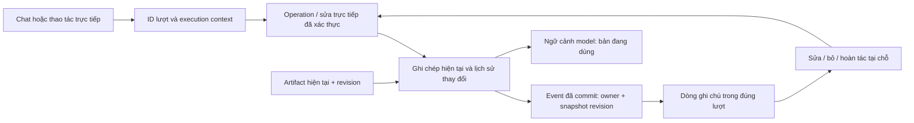

# RAT: ghi chép thuộc từng lượt hội thoại

Ngày lập kế hoạch: 2026-10-12, Asia/Saigon.
Trạng thái hiện tại: bản xem UI giai đoạn 1, iteration 3, chờ người dùng duyệt.
Người dùng chọn tinh chỉnh UI trước; giai đoạn 2 (ID lượt, lịch sử phiên bản
và bỏ/hoàn tác trong core) chưa bắt đầu. Xem
[báo cáo iteration 3](/Users/thundercock2/Documents/Github/multi-step-structured-reasoning/audit/rat_turn_notes_stage1_iteration3_20261012/report.md)
và ảnh Qt trong cùng thư mục. Bản xem dùng dữ liệu mẫu, chưa nối vào phiên RAT
thật. Các phần bên dưới giữ thiết kế và phạm vi của kế hoạch gốc.

## Quyết định sản phẩm

Người dùng đã xác nhận:

- Ghi chú xuất hiện trong lượt chat nơi nó được ghi hoặc thay đổi.
- Khi thay đổi ở lượt sau, lượt cũ giữ bản cũ, có nhãn đã được thay thế và
  dẫn tới bản mới. Không đổi lời ghi cũ thành lời mới một cách âm thầm.
- Chuột lớn đứng bên trái, chuyển động vui vừa; chạm Chuột emote và mở ghi
  chép. Những lựa chọn này tiếp tục áp dụng.
- Hỏi người dùng ở từng giai đoạn thiết kế trước khi triển khai phần đó.

Mục tiêu: người dùng đọc kết quả, thấy điều Chuột đã ghi trong chính lượt đó,
sửa ngay tại dòng ghi chú và tiếp tục trò chuyện. Một phiên vẫn có ngữ cảnh
dùng tiếp; vị trí hiển thị theo lượt không làm ghi chép mất tác dụng ở lượt sau.

## Vấn đề trong source hiện tại

`rat/ui/omnibar.py` đặt `NotebookPane` giữa composer và nội dung chat.
`rat/ui/work_context.py` dùng vùng cuộn riêng cao tối đa 190px, thêm ô nhập
ghi chú và các điều khiển riêng. Ghi chép đứng ngoài các reply handle.

`WorkNote` chỉ có ID, text, source, quote, confirmed và revision. Các hàm
record/user_edit/record_input sửa bản hiện tại tại chỗ; remove xóa khỏi dict.
Chưa có lượt sở hữu, nguồn lời nói theo lượt hoặc lịch sử revision. Refresh
snapshot không thể tái tạo chính xác thời điểm tạo/sửa hoặc lượt đã thay thế.

`ChatStreamWidget._turn_id` là số nhóm widget cục bộ. `ConversationHistory`
giữ cặp text với cửa sổ ngữ cảnh giới hạn; không có ID ổn định. Callback chỉ
có generation và handle. Thao tác trực tiếp cập nhật reply gần nhất, nên việc
gắn note vào một handle bằng vị trí widget có thể gắn sai lượt.

Vì vậy, triển khai cần liên kết dữ liệu với lượt và giữ các thay đổi đã nhận,
rồi dùng dữ liệu đó để dựng ghi chép bên trong hội thoại.

## Hình thức giao diện đề xuất để duyệt ở giai đoạn bản xem

Một lượt gồm câu người dùng, phản hồi/kết quả, các dòng ghi chép của lượt đó
và phần “Cách Chuột làm” có thể mở. Ghi chép là các dòng nhẹ cùng nền và vùng
cuộn với chat. Thứ tự mặc định: phản hồi/kết quả chính → ghi chép → trace.

```text
Bạn: Mình có 20 phút, chỉ ôn TCP.
Chuột: … kết quả hoặc phản hồi …
  Ghi lại: Có 20 phút · Chỉ ôn TCP                 Sửa · ⋯

Bạn: Đổi thành 30 phút nhé.
Chuột: … phản hồi …
  Đã đổi: 20 → 30 phút                           Sửa · ⋯

Ở lượt đầu:
  Ghi lại: Có 20 phút
  Đã được thay thế ở lượt sau → Xem bản 30 phút
```

Đây là wireframe, không phải câu trả lời model đã đo được. Dòng “ghi lại” chỉ
được dựng từ thay đổi đã lưu thành công. Trong lúc worker chạy, dòng đó có
thể xuất hiện trước câu trả lời cuối; lỗi ở bước sau vẫn giữ ghi chép đã nhận.

Chi tiết nguồn/xác nhận mở tại dòng ghi chú. Editor xuất hiện tại chỗ, có Áp
dụng/Hủy; Enter xuống dòng, Tab đi tới điều khiển, Escape hủy editor đang sửa,
⌘L đổi kích thước và giữ bản nháp/focus. Control phải dùng được bằng bàn phím,
không chỉ xuất hiện khi hover. Bản xem cần chốt mật độ 1–2 dòng đầu và cách
mở thêm nếu một lượt có nhiều ghi chú.

Chạm Chuột vẫn emote, rồi mở/highlight ghi chú đang dùng gần nhất trong chat.
Nếu nó ở lượt cũ, mở lượt đó ngay trong cùng viewport. Khi chưa có ghi chép,
hiện lời nhắc ngắn tại chat hiện tại và giữ ô nhập sẵn sàng. Hành vi điều hướng
này là đề xuất cần duyệt trong bản xem; không dựng lại một notebook tổng.

## Dữ liệu và đường thực hiện



Phần lưu và validation là Python thuần, độc lập Qt và personal-file indexing.
Giữ dữ liệu trong bộ nhớ của phiên; chưa thêm database memory hoặc dịch vụ mới.

Các record cần có:

| Record | Nội dung và ý nghĩa |
| --- | --- |
| `TurnRef` | conversation_id, turn_id, kind=chat/interaction. ID cấp một lần bởi app, dùng chung ở history, worker, reply và direct action. |
| `NoteWriteContext` | TurnRef, execution_id khi có worker, generation. App cung cấp; model không được tự chọn lượt sở hữu. |
| `NoteVersion` | note_id, revision, text/value snapshot, trạng thái xác nhận, source_ref và quote. Snapshot không đổi sau commit. |
| `NoteEvent` | event_id, sequence, kind=create/update/confirm/remove/restore, owner_turn_id, before/after revision, snapshot, context. |
| Ghi chép hiện tại | Ánh xạ note_id → revision đang dùng hoặc tombstone; phục vụ lượt tiếp theo. |
| `SourceRef` | Nguồn là lời người dùng, thao tác sửa, hoặc artifact input. Giữ quote_source_turn_id; với artifact có ID/revision/field. |

Lượt ghi note và lượt chứa lời được trích có thể khác nhau. Ví dụ ở lượt 3
Chuột ghi một điều người dùng nói ở lượt 1: note nằm ở lượt 3, nguồn dẫn về
lượt 1. Không suy lượt sở hữu từ câu chữ, nhãn note hoặc widget gần nhất.

Chat tạo TurnRef trước khi gọi worker. Sửa/bỏ bằng control tạo một interaction
có ID thật; hiển thị thành dòng hoạt động ngắn trong chat, không gửi prompt
hoặc bịa câu trả lời của model. Thao tác trên ghi chú/lá số cũ giữ reference
đến đối tượng gốc. Editor ở vị trí được chạm; thay đổi đã lưu xuất hiện theo
thứ tự thực hiện, và bản gốc có link tới lần thay đổi đó. Khi người dùng đang
đọc lượt cũ, việc commit không tự kéo họ xuống cuối.

Nguồn quote phải được xác thực với message user có ID thật. Nếu cùng quote
có ở nhiều lượt và không xác định được nguồn, trả lỗi/làm rõ reference thay
vì tự chọn lượt theo câu chữ. Quote ngắn hợp lệ như “30 phút” hoặc “TCP” cần
được hỗ trợ khi source đã xác thực; bỏ yêu cầu tối thiểu 8 ký tự hiện tại,
giữ điều kiện không rỗng, trích đúng và giới hạn độ dài. UI thể hiện rõ phần
diễn giải của model là đề xuất nếu khác quote.

Các API dự kiến, cần chốt contract trước khi sửa call sites:

- `record(..., context, source_ref)` / `record_input(...)` xác thực rồi commit
  bản hiện tại và event cùng một lần giữ lock.
- `user_edit(note_id, expected_revision, text, context)` và `remove/restore`
  dùng revision đang quan sát; sai revision trả lỗi và giữ draft.
- `events_since(cursor, conversation_id)` trả thay đổi theo sequence, không
  suy event bằng diff toàn bộ snapshot.
- `model_context()` trả phiên bản hiện tại và nguồn; ghi chú đã bỏ không còn
  trong tập active. Historical revisions dành cho lịch sử/tra cứu có chủ đích.
- `ChatStream.apply_note_events(...)` và `reveal_note(...)` dùng ID để cập nhật
  đúng lượt, deduplicate callback và điều hướng trong cùng bề mặt.

NoteEvent đi qua AgentStep/AgentResponse và đường direct action như dữ liệu
có cấu trúc. Backend không emit Qt signal. Response cuối có cursor/events để
bù callback bị trễ; presenter áp dụng mỗi event_id đúng một lần. Event không
thuộc conversation/generation đang mở bị bỏ qua.

## Quy tắc sửa, bỏ và nguồn

1. Bản cũ giữ snapshot cũ. Nhãn “đã được thay thế” được tính từ revision
   hiện tại, link trỏ tới event thay đổi thực. Không clone widget editor qua
   nhiều lượt hoặc đổi toàn bộ lịch sử thành bản mới nhất.
2. Bấm Sửa trên bản cũ mở bản đang dùng và ghi rõ phiên bản đang sửa. Nếu có
   cập nhật trong lúc người dùng gõ, giữ draft và báo xung đột revision;
   không ghi đè hoặc merge câu chữ bằng rule.
3. “Bỏ khỏi ghi chép” tạo tombstone và cho Hoàn tác. Hoàn tác tăng revision,
   có event riêng và kiểm tra không có thay đổi mới hơn. Lượt chat gốc giữ
   nguyên; thao tác này loại note khỏi ngữ cảnh active, không xóa lời đã nói.
4. Model paraphrase vẫn là đề xuất chờ xác nhận. Plan, thought hoặc câu trả
   lời nói “đã ghi” không tạo NoteEvent. Quote cần nguồn lời người dùng thật.
5. Ghi chép tham chiếu đầu vào artifact dùng artifact làm nguồn chuẩn. Sửa
   mở action editor đã đăng ký với ID/revision hiện tại; dispatcher chấp nhận
   rồi mới cập nhật phần ghi chép. Trường không có binding chỉnh sửa hợp lệ
   dẫn tới nguồn/điều khiển gốc. Không parse nhãn như “Giờ sinh” để chọn tool.
   Handler phải cung cấp các input/value thực sự đã nhận và chuẩn hóa, hoặc
   reference tới các giá trị đó. `needs_input` chưa xác nhận mọi field người
   dùng vừa nhập hợp lệ; presenter không tự nâng raw form values thành note
   active chỉ dựa vào status này.
6. Ví dụ đổi giờ sinh: action thất bại thì note và dữ liệu đang dùng giữ nguyên;
   action thành công thì note tham chiếu giá trị/revision mới. Nếu đồng bộ
   note bị lỗi sau artifact commit, hiện trạng thái cần đồng bộ và loại bản
   note cũ khỏi active context cho đến khi refresh từ nguồn. Không tuyên bố
   hai store atomic khi contract hiện tại chưa cung cấp bảo đảm đó.
7. Khi worker đang chạy, giữ cách chặn Apply/Bỏ của phiên hiện tại; cho xem
   và soạn draft. Không áp bản sửa vào một prompt đã được gửi. Chỉ mở lại
   thao tác sau khi lượt kết thúc/dừng; không âm thầm queue hoặc gọi lại model.

## Compact/full, Chuột và trace

Một renderer note và một editor cho mỗi vị trí event. Chuyển kích thước chỉ
reflow; giữ event/revision, draft, selection, focus và vị trí đọc.

Compact hiện tại chỉ hiện nhóm widget mới nhất. Cần thêm reveal cho lượt cũ
được tham chiếu: mở chính nhóm cũ đó trong cùng vùng chat, có đường quay về
lượt đang làm, không bắt bật full. Không tạo bản sao của note ở một panel mới.
Đây là disclosure cục bộ; composer và công việc đang chạy vẫn là một.

Note mới không lặp lại toàn bộ note cũ ở mỗi trả lời. Source reference đến
note cũ mở đúng revision/lượt. Metadata “được đưa vào context model” phải
phân biệt với claim model thực sự dùng note để suy luận.

Note cho biết điều được ghi/được sửa; trace cho biết quá trình và kết quả thao
tác. Cùng một event chỉ có một dòng nội dung note trong chat. Trace có thể
tham chiếu event đó thay vì in lại toàn bộ. Giữ public execution summary,
không đưa private thought/raw completion vào UI. Chuột phản ứng sau commit
thật; việc highlight/edit không thay đổi vị trí nhân vật đã được chọn.

## Kế hoạch triển khai theo giai đoạn

| Giai đoạn | Công việc cụ thể | Sản phẩm để duyệt / điều kiện sang bước sau |
| --- | --- | --- |
| 1. Bản xem UX | Dựng fixture Qt có note dưới từng reply: tạo, đề xuất, sửa ở lượt sau, sửa trực tiếp, bản cũ/link, lỗi, compact/full. Chưa nối live model. | Người dùng chốt mật độ, thứ tự, editor, cách chạm Chuột và mở lượt cũ trên bản xem tương tác. Fixture phải ghi rõ là minh họa. |
| 2. Hợp đồng dữ liệu | Thêm TurnRef, context, lịch sử version/event, active projection, tombstone/undo; giữ validation nguồn và generation. | Kiểm tra backend đảm bảo owner/source đúng, lịch sử không đổi, context mới đúng, stale writes bị chặn. Không phụ thuộc Qt. |
| 3. Nối một luồng thực | Truyền ID/context qua worker/runtime/direct action; renderer theo event; nguồn artifact rõ ràng; bỏ NotebookPane và wiring ngoài chat khi luồng mới hoàn chỉnh. | Ghi/sửa/bỏ/undo diễn ra trong đúng lượt bằng operation thực; không để hai nơi quản lý note song song. Trình bày cho người dùng duyệt thao tác. |
| 4. Kiểm tra và bàn giao | Chạy regression phù hợp, thử native, rồi development smoke model thật trên dữ liệu fixture riêng; lưu raw calls và kiểm tra thao tác thật. | Công khai những ca pass/fail và giới hạn model; hỏi phản hồi trước thay đổi thiết kế tiếp. Chỉ kết luận software/UX đúng với evidence đã có. |

Mapping file dự kiến:

- `rat/ui/chat_session.py`: ID/reference ổn định cho lượt; tách lịch sử UI
  khỏi cửa sổ text giới hạn gửi model.
- `rat/engine/work_notes.py`: versions/events, active projection, provenance,
  revision và undo. Có thể tách record/session types nếu giúp giảm coupling.
- `rat/engine/assistant_runtime.py`, `rat/ui/assistant_worker.py`: context/event
  transport; model context theo snapshot của lượt đang chạy.
- `rat/ui/chat_stream.py`, `rat/ui/work_context.py`: inline note/event renderer,
  editor, link/reveal lượt cũ, giữ reading position và bỏ scroll vùng riêng.
- `rat/ui/omnibar.py`: tạo/route TurnRef, direct actions, reset/stop, bỏ wiring
  NotebookPane và tính chiều cao của pane.
- `rat/ui/live_companion.py`: thay hành động mở pane bằng reveal trong chat;
  giữ vị trí/chuyển động đã chọn.
- Registry/view metadata nếu cần: field/source binding cho input note, dùng
  schema/action đã đăng ký; không thêm branch theo từng chức năng.
- Tests và docs: cập nhật contract/UX đã thay, giữ các kiểm tra cũ có giá trị.

Không cần migration database vì note hiện chỉ theo phiên. Khi nạp bản mới,
nếu app có dữ liệu/bản nháp thật cần giữ, chốt cách giữ với người dùng trước
restart. Note cũ chưa có origin không được tự gán nguồn/lượt bằng suy đoán.

## Các ca bắt buộc trước bàn giao

| Ca | Điều phải quan sát được |
| --- | --- |
| Hai lượt cùng text | ID khác nhau; note không nhảy nhầm lượt vì khớp câu chữ. |
| Ghi 20, lượt sau sửa 30 | Lượt cũ vẫn 20, nhãn/link tới 30; active context là 30. |
| Note dựa trên lời ở lượt trước | Owner là lượt commit; quote source trỏ đúng lượt chứa lời nói. |
| Hỏi tiếp nhưng không ghi mới | Không thêm note/event lặp; context vẫn giữ bản đang dùng. |
| Quote ngắn hoặc lặp ở nhiều lượt | Quote ngắn có nguồn hợp lệ được nhận; nguồn mơ hồ không bị gán vào một lượt đoán. |
| Bỏ và Hoàn tác | Active context đổi đúng; lịch sử nguyên vẹn; stale undo bị từ chối. |
| Draft đang mở, note đổi từ nơi khác | Draft/caret không mất; Apply không overwrite revision mới. |
| Direct input hợp lệ / sai | Event gắn đúng interaction; dữ liệu sai không trở thành ghi chú đã nhận. |
| Sửa note có source artifact | Dùng action/revision thật; note và nguồn không có hai giá trị active trái nhau. |
| Stop / reset / callback trễ | Event cũ không vào lượt mới; thay đổi đã nhận trước Stop vẫn có thể xem. |
| Callback step và response lặp | Event chỉ xuất hiện một lần, giữ đúng thứ tự commit. |
| Compact/full/⌘L khi sửa hoặc chạy | Cùng note/editor, focus/selection/draft; không gọi lại model/operation. |
| Mở note ở lượt cũ bằng Chuột/link | Giữ composer, hiện đúng note trong viewport, không ép full. |
| Nhiều note, câu dài, màn hình hẹp | Cuộn trong chat, không che kết quả, không vùng cuộn note riêng. |
| Model chỉ nói “đã ghi” | Không có note đã lưu nếu không có commit; failure giữ evidence thực. |

Tests hiện có là nền tảng regression, không phải phép đo AI. Chỉ chạy các
tests cần thiết cho thay đổi; test note/history/worker và UI liên quan trước,
sau đó regression đầy đủ khi đã nối luồng. Không viết test chỉ so nhãn/vị trí
trùng với code; kiểm tra provenance, state và thao tác người dùng thực.

## Tradeoff và phạm vi

History rõ ràng cần thêm record/event và link theo lượt; đổi lại người dùng
biết bản nào được dùng ở từng thời điểm. Giữ cả historical view và active
context tăng trách nhiệm đồng bộ, nên mọi write phải qua cùng service/context.
Thêm interaction ID cho thao tác trực tiếp giúp giữ thứ tự thật; presentation
là dòng hoạt động nhỏ để box không thành chuỗi form/card.

Chi phí lịch sử trong bộ nhớ tăng theo các thay đổi của phiên; không gửi toàn
journal cho model. Giữ hạn mức active hiện có trong phiên đầu. Khi cần history
dài/persistence, xem lại pagination, retention và migration nguồn thay vì tự
cắt mất origin note đang dùng.

Thay UI này chưa giải quyết việc model 1.5B bỏ operation hoặc timeout của
lượt thử 4B. Không thêm keyword fallback để tạo ghi chú thành công giả. Live
smoke tương lai phải kiểm tra thao tác thực, lưu lỗi/tokens trả được/wall time;
không coi đó là unseen benchmark hoặc full inference cost.

NCKH vẫn là ưu tiên dự án. Không đổi pipeline `experiments.research_study`,
threshold/controller, train/calibration/test hoặc trạng thái Stage 0 trong
kế hoạch này. Vị trí Chuột, phong cách đã chọn và nghiên cứu ngoài scope note
được giữ; các thay đổi thiết kế tiếp cần trình người dùng ở từng giai đoạn.
