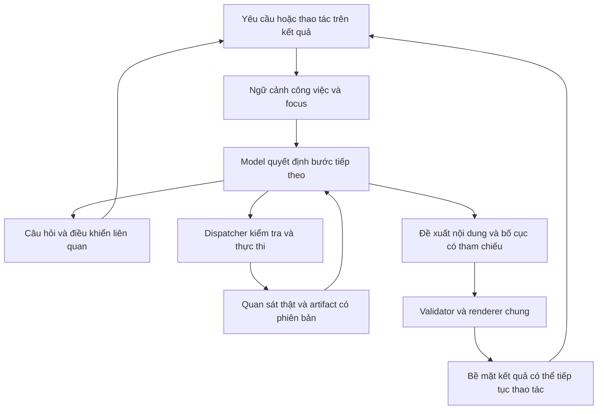

# ADR-002: RAT quyết định cách làm việc theo yêu cầu hiện tại

**Status:** Backlog theo yêu cầu người dùng ngày 2026-10-12. Đây là thiết kế
đề xuất, chưa phải hành vi đã triển khai hoặc năng lực model đã đo. Ưu tiên
thiết kế RAT hiện tại là bố cục UI và cách chuyển trạng thái; xem
[backlog](rat_backlog.md) và [brief UI](rat_ui_fluidity.md).
**Date:** 2026-10-12
**Deciders:** Người dùng phụ trách sản phẩm RAT.
**Related:** [ADR-001](adr-001-rat-interaction-kernel.md).

## Context

Người dùng thử bản interaction kernel rồi nhận xét: nó vẫn là tool wrapper,
chỉ gọn hơn. Yêu cầu hiện tại là suy nghĩ lại cách tiếp cận và thiết kế.

ADR-001 tạo nền tảng thực thi hữu ích: artifact có phiên bản, dispatcher chung,
kiểm tra action và renderer tách khỏi dữ liệu. Tuy nhiên, mô hình sản phẩm đang
chạy vẫn bám theo capability: chọn chức năng, cung cấp các trường, nhận một thẻ
chuẩn cho loại kết quả đó. Kiến trúc module tốt hơn chưa tạo ra trải nghiệm mà
người dùng mong muốn. Các kiểm tra phần mềm trong bản review trước chỉ xác nhận
luồng này chạy đúng; không xác nhận thiết kế phù hợp với ý định sản phẩm.

### Nhận xét thiết kế từ app thật và code

Quan sát cửa sổ RAT đang chạy trên máy, không chỉ preview fixture. Form đang
trống; review không nhập hay lưu thông tin sinh của người dùng.

| Vấn đề | Mức ảnh hưởng | Hệ quả và hướng sửa |
| --- | --- | --- |
| Thanh Trò chuyện / Tệp tin / Lịch học / CLB / Lá số vẫn chi phối bề mặt. | Cao | Người dùng phải nghĩ theo danh mục chức năng. Điểm vào chính cần là yêu cầu tự nhiên và kết quả đang làm việc. |
| Form nằm trong nhiều lớp thẻ và chiếm gần hết cửa sổ. | Cao | Cảm giác điền màn hình chức năng vẫn nguyên vẹn. Đưa một câu hỏi thích hợp vào hội thoại; chỉ hiện điều khiển phục vụ câu hỏi đó. |
| Lời dẫn “Cần thêm thông tin” diễn đạt trạng thái của phần mềm. | Vừa | Thiếu quan hệ với mục đích cụ thể. Hỏi trực tiếp dữ liệu cần để giúp người dùng tiếp tục. |
| `view_input_request` biến `missing_fields` thành `input_form`. | Cao | Schema của tool quyết định trải nghiệm nhập. Tách yêu cầu dữ liệu của backend khỏi quyết định hỏi/hiển thị của trợ lý. |
| `AssistantRuntime.run` trả về ngay khi tool báo `needs_input`. | Cao | Không có bước quyết định cách làm rõ, giảm phạm vi, hoặc tận dụng dữ kiện đã có. Đưa thiếu dữ kiện trở lại vòng quyết định của model. |
| `StandardViewProvider` chọn factory của operation; natal, lịch và tệp có bố cục cố định. | Cao | Ý định “so sánh”, “giải thích một phần” hay “xếp việc” chưa quyết định cách trình bày. Model cần có quyền ghép một kết quả phục vụ mục đích đó. |
| `ViewSpec` gắn với một artifact/revision. | Cao | Khó biểu diễn một kết quả phối hợp nhiều nguồn, như lịch ôn kèm tài liệu hoặc hai phiên bản lá số. Thêm bề mặt tham chiếu nhiều kết quả và các phép biến đổi đã kiểm tra. |
| Footer trong cửa sổ lá số vẫn có thông tin tìm tệp/chuyển mục. | Vừa | Trạng thái không liên quan tạo cảm giác các app con ghép chung. Bề mặt chính chỉ hiện trạng thái của yêu cầu hiện tại. |

Màu giấy/ink, typography và dữ liệu lá số có thể giữ. Thứ tự chú ý hiện tại
đặt danh mục và form trước kết quả; thay cấu trúc tương tác có tác dụng lớn hơn
việc chỉnh thêm màu, border hay animation. Đây không phải audit WCAG đầy đủ;
chưa đo contrast và chưa kiểm tra luồng mới bằng bàn phím/screen reader.

## Decision proposed

RAT nhận một yêu cầu, dùng ngữ cảnh có nguồn, quyết định cách tiếp tục, rồi
trình bày một kết quả phù hợp với yêu cầu đó. **Đơn vị tương tác là công việc
đang diễn ra; quyết định của model bao gồm cả hội thoại và cách trình bày.**

Backend cung cấp khả năng đọc, tính và thao tác đáng tin cậy. Mỗi backend
không sở hữu một hành trình người dùng hoặc màn hình mặc định bắt buộc.
Model dùng các khả năng đó để giải quyết và phối hợp những yêu cầu chưa được
viết thành chức năng riêng. Thêm tên lớp hoặc registry không đủ để đạt điều này.

### 1. Mô hình trạng thái dùng được cho quyết định thực tế

Giữ execution state và artifact store hiện có. Bổ sung trạng thái công việc
được runtime quản lý, với các dữ kiện có cấu trúc:

- Mục đích, ràng buộc và phạm vi hiện tại do người dùng nêu.
- Dữ kiện đã cung cấp: giá trị, người/đối tượng mà nó thuộc về, nguồn và trạng
  thái xác nhận. “Tôi sinh…” và “bạn tôi sinh…” tạo tham chiếu khác nhau.
- Kết quả đang được chú ý: ID/revision, phần đang chọn trên hình/tài liệu,
  những kết quả được ghim và quan hệ nguồn/so sánh của chúng.
- Những yêu cầu dữ liệu hoặc quyền thực thi còn thiếu, gắn với thao tác đích.
- Dự định đang chờ và hiệu ứng thực sự đã chạy. Một câu model viết “xong”
  không thay thế execution event.

Model đề xuất cập nhật có cấu trúc; runtime kiểm tra và ghi trạng thái. Task
memory dạng mô tả hiện tại có thể hỗ trợ model, nhưng không là nguồn xác nhận
duy nhất cho tham chiếu, dữ kiện hay hiệu ứng thực thi. Dữ liệu người dùng
cung cấp trong công việc được dùng tiếp ở công việc đó; ghi vào hồ sơ dùng lâu
dài cần một hành động lưu rõ ràng. Chưa xây dự án memory/database mới ở lát cắt đầu.

### 2. Thiếu dữ kiện là một quan sát để trợ lý quyết định cách tiếp tục

Backend vẫn trả yêu cầu dữ liệu có kiểu và constraint. Thông báo đó là dữ liệu
cho vòng model. Nó không tự động trở thành một form bao trùm tất cả trường.

Model có thể hỏi một câu, gom những thông tin dễ trả lời cùng nhau, dùng dữ kiện
đã có, đề xuất một kết quả giảm phạm vi khi backend hỗ trợ, hoặc trả lời câu hỏi
mới của người dùng trước. Câu hỏi phải gắn với một nhu cầu thật; model không
được tự thêm trường bắt buộc hoặc đoán dữ kiện để đủ schema.

Ví dụ khi chưa có dữ liệu sinh: “Bạn sinh ngày nào, khoảng mấy giờ và ở đâu?
Gõ chung một câu cũng được.” Người dùng có thể trả lời tự do, dùng picker
ngày/giờ nếu thích, hoặc nói không biết giờ. Nếu đã có ngày và nơi, chỉ hỏi giờ.
Không hỏi lần lượt từng trường nếu một câu là đủ; số lượt ít hơn không tự
đồng nghĩa với dễ dùng hơn, cần đánh giá thực tế.

Trả lời mới đi qua cùng model và trạng thái công việc: đó có thể là dữ liệu
bổ sung, một sửa đổi, câu hỏi phụ, đổi mục tiêu hoặc hủy. Chỉ resume operation
khi tham chiếu và các giá trị đã hợp lệ. Một click chọn ứng viên rõ ràng hoặc
nhập chính xác giá trị vẫn có thể dispatch trực tiếp để giảm độ trễ.

### 3. Model quyết định phần kết quả hữu ích và cách ghép nó

Thay hợp đồng “artifact loại X dùng view X” bằng một đề xuất trình bày gắn với
**công việc và tập artifact/revision**. Tên minh họa là `PresentationPlan`;
chưa thêm module này vào code.

Nội dung đề xuất gồm:

- Mục đích của kết quả hiển thị: trả lời, xem, chỉnh, so sánh hoặc làm rõ.
- Những tham chiếu dữ liệu/thành phần kết quả cần dùng.
- Bố cục từ một catalog nhỏ: văn bản, danh sách, bảng, timeline, vector và
  nhóm so sánh; điều khiển lựa chọn/chỉnh có liên hệ rõ với dữ liệu đang nhìn.
- Một patch cho bề mặt hiện tại hoặc kết quả riêng nếu đó là công việc mới.
- Lời giải thích/diễn giải, tách khỏi số liệu của công cụ và kèm nguồn thích hợp.

Các trường số, đường dẫn, tọa độ, hàng bảng và đối tượng action bind tới dữ
liệu thật. Model không chép lại một bảng số để tự tạo phiên bản đẹp hơn.
Thao tác sort/filter/compare/join có contract và kết quả kiểm tra riêng.
Biểu diễn không được làm phép so sánh mơ hồ giữa hai thang đo khác nhau.
Nội dung diễn giải do model tạo cần được đánh giá riêng; validator cấu trúc
không xác nhận được ý nghĩa của nó.

Một dữ liệu lá số có thể xuất hiện dưới dạng vòng lá số, bảng hai giờ sinh,
hoặc một phần góc chiếu đang được hỏi. Cùng dữ liệu lịch có thể hiện thành
ba ca học hoặc một kế hoạch ôn với tệp thật đính kèm. Việc ghép này phải do
model quyết định trên dữ liệu thực, không thêm factory riêng cho từng ví dụ.

Provider chuẩn hiện tại giữ vai trò xem dữ liệu khi cần hoặc phục hồi có nhãn
rõ nếu đề xuất trình bày lỗi. Chế độ phục hồi không được ghi là model đã hoàn
thành yêu cầu. Không sinh Python/Qt hoặc thực thi mã tùy ý trong lát cắt này.

### 4. Thiết kế bề mặt

Mặc định có một ô yêu cầu và một vùng kết quả đang chú ý. Không gian tăng theo
nội dung cần nhìn; chi tiết mở tại đúng điểm người dùng quan tâm. Kích thước
do renderer, nhu cầu đọc và lựa chọn phóng lớn quyết định, không do model đưa
pixel tùy ý. Chat history có thể mở; kết quả đang sửa không bị chôn trong feed.

- Không đặt tab chức năng trên đường chính. Settings, lịch sử và entry point
  nâng cao nằm trong menu phụ; dịch vụ và CLI hiện có vẫn dùng được.
- Không lồng thẻ “Chuột · Kết quả” → “Cần thêm thông tin” → form. Một câu hỏi
  ngắn nằm cùng bề mặt với ô trả lời và điều khiển liên quan.
- Kết quả chính xuất hiện trước lời giải thích dài. Với lá số, vòng lá số là
  nội dung; ngày/giờ/nơi là metadata chỉnh được trên nó.
- Action hiện theo thao tác đang có ý nghĩa: chọn một điểm để hỏi nó; chỉnh
  giờ ở nhãn giờ; xuất trong menu kết quả. Không luôn dựng toàn bộ danh sách
  nút mà capability công bố.
- “Đổi thành 9:30” cập nhật bề mặt đang chú ý và có hoàn tác/lịch sử phiên bản.
  “So sánh với 10:00” tạo nhánh so sánh, không ghi đè lá số gốc.
- Có thể ghim nhiều kết quả, chuyển focus hoặc mở lịch sử. Khi tham chiếu
  mơ hồ, trợ lý hỏi rõ đối tượng; một canvas không đồng nghĩa chỉ có một task.
- Giao diện bàn phím và nội dung đọc được không phụ thuộc vào hover. Chi tiết
  được chọn và bản tóm tắt dữ liệu cần có tên truy cập được.

### Luồng kiến trúc đề xuất

Nhánh hỏi, thực thi và trình bày là các lựa chọn thích hợp theo tình huống;
không phải một chuỗi bắt buộc phải gọi nhiều model cho mỗi lượt. Hướng đầu tiên
là sử dụng vòng model hiện có và một output contract cho quyết định trình bày.
Đo overhead trước khi thêm một model/agent chuyên làm UI.

## Kịch bản thiết kế, chưa phải bản chạy được

Các câu dưới đây là ví dụ tương tác, không phải canned response sẽ nhét vào
runtime. Các giá trị trong ví dụ là dữ liệu giả để mô tả luồng.

| Người dùng | Hành vi cần đạt |
| --- | --- |
| “Xem bản đồ sao giúp tôi.” | Kiểm tra dữ kiện đúng đối tượng trong công việc. Hỏi dữ liệu còn thiếu bằng một câu thích hợp, có input tiện dụng tùy chọn. |
| “15/6/2000, tầm 9:30 sáng ở Sài Gòn.” | Trích xuất và kiểm tra các giá trị; giải quyết địa điểm/giờ khi cần. Vẽ từ kết quả tính thật, giữ mức độ bất định “tầm” của giờ. |
| “Không biết giờ sinh.” | Dùng mode backend hỗ trợ cho giờ chưa rõ; ghi rõ mốc tạm và phần không xác định. Không vẽ nhà/cung mọc như đã biết. |
| “Chỉ giải thích góc này thôi.” | Dùng điểm/góc đang chọn và dữ liệu tính; tập trung phần đó, giữ khả năng quay lại toàn lá số. |
| “Nếu sinh 10 giờ thì khác gì?” | Tạo phép tính thứ hai với đúng ràng buộc, so sánh dữ liệu thật và trình bày thay đổi có ý nghĩa; giữ bản gốc. |
| “Mai học gì, tìm giúp slide để ôn lúc trống.” | Phối hợp lịch, khoảng trống và tài liệu thật thành một kết quả dễ dùng; không mở ba app hoặc thêm chức năng preparation-plan cố định. |
| “Cái thứ hai; chỉ lấy những gì tôi chưa đọc.” | Giải quyết tham chiếu và kiểm tra thông tin đọc có nguồn. Nếu chưa biết đã đọc gì thì hỏi hoặc nói giới hạn, không tự coi tìm được là đã đọc. |
| Đang chờ giờ sinh, người dùng hỏi “Sài Gòn dùng múi giờ nào?” | Trả lời bằng nguồn phù hợp trong ngữ cảnh đó; giữ yêu cầu sinh đang chờ, không coi câu hỏi là giá trị giờ. |

## Options considered

| Phương án | Độ phức tạp | Chi phí và độ ổn định | Khả năng đáp ứng phản hồi |
| --- | --- | --- | --- |
| Tiếp tục tinh chỉnh kích thước và factory của từng capability | Thấp ban đầu | Ít thay đổi inference; hành vi dễ dự đoán | Giữ mô hình form/thẻ mà người dùng vừa phản đối. |
| Model điều khiển hội thoại, phối hợp kết quả và ghép trình bày khai báo | Vừa/cao | Có rủi ro lỗi quyết định và overhead cần đo; thực thi vẫn kiểm tra được | Chuyển quyền quyết định trải nghiệm sang yêu cầu và ngữ cảnh. **Đề xuất.** |
| Model viết và chạy cả giao diện/logic tùy ý | Cao | Thêm môi trường thực thi, kiểm tra hiệu ứng, chi phí và lỗi khó kiểm soát | Linh hoạt hơn, nhưng chưa có bằng chứng cần thiết để đạt lát cắt hiện tại. Future work. |

## Trade-offs and consequences

Ranh giới giữa phần học được và phần lập trình cần nói rõ. Backend chuyên môn,
catalog UI, schema và kiểm tra vẫn là phần mềm được viết. Phần cần model quyết
định là hiểu yêu cầu, giải quyết tham chiếu, hỏi, chọn/phối hợp thao tác và ghép
phần kết quả hữu ích. Sự khác biệt phải thể hiện ở yêu cầu mới và hành vi thực tế,
không ở tên “agent” hay số lớp abstraction.

UI do model ghép cũng có thể vẫn kém hữu ích. Nếu model không làm được các
quyết định này, thêm prompt và widget không chứng minh đã giải quyết vấn đề.
Không thay default model hoặc tăng budget trước khi có development evidence.
Khả năng và độ trễ của model hiện tại cho contract mới vẫn chưa được kiểm tra.

Giữ dispatcher, artifact revisions, calculation services và resource renderers.
Thay quyền điều phối input và presentation. Hợp đồng `ViewSpec` một artifact
cần mở rộng có kiểm soát cho task surface/multiple references; không sửa nó
bằng cách giấu nhiều kết quả vào một payload không có provenance.

“Năng lực mới” ở bước này là cách phối hợp và biến đổi các khả năng thực có
để đáp ứng yêu cầu chưa có màn hình/workflow riêng. Một nguồn dữ liệu hoặc
thuật toán chuyên môn hoàn toàn mới vẫn cần được cung cấp và kiểm tra. Đường
xa hơn là model đề xuất recipe/transform từ phép toán đã giới hạn, rồi mới
đánh giá code/component trong môi trường tách biệt. Chưa triển khai đường đó.

### Tham chiếu kỹ thuật

[Anthropic, Building effective agents](https://www.anthropic.com/engineering/building-effective-agents)
phân biệt điều phối theo đường viết trước và quá trình do model quyết định.
Áp dụng vào RAT ở đây là một đề xuất thiết kế: model cần điều khiển cả việc
làm rõ và trình bày, thay vì chỉ chọn tool.

[A2UI, What is A2UI?](https://a2ui.org/introduction/what-is-a2ui/)
mô tả cách agent gửi cấu trúc UI khai báo để client dựng bằng thành phần của
mình; [Data Flow](https://a2ui.org/concepts/data-flow/) mô tả cập nhật dữ liệu
và phản hồi hành động. Đây là tham chiếu cho contract trình bày và cập nhật,
không phải bằng chứng RAT đã có năng lực đó. Chưa chọn SDK/protocol hoặc thêm
dependency. Cơ chế kiểu này không tự tạo năng lực suy luận/phối hợp cho model.

## Implementation slice and acceptance

Chưa code thêm chức năng hoặc đổi app đang chạy trong lượt thiết kế này.
Không triển khai cả redesign cùng lúc. Lát cắt đề xuất dùng backend lá số đã
có để kiểm tra thay đổi thực chất:

1. [ ] Đưa trạng thái thiếu dữ liệu vào cùng vòng quyết định; xử lý lời đáp,
   sửa dữ kiện và câu hỏi phụ bằng model thật, giữ tham chiếu/nguồn rõ.
2. [ ] Thêm proposal trình bày đa tham chiếu và patch bề mặt kết quả; validator
   kiểm tra dữ liệu/action/biến đổi, renderer dùng lại tài nguyên đã có.
3. [ ] Thực hiện “xem → hỏi về phần đang chọn → đổi giờ → so sánh” trên một
   bề mặt, không thêm handler/view factory dành riêng cho từng câu ví dụ.
4. [ ] Áp dụng cùng contract cho lịch + tài liệu. Cần xác nhận khả năng ghép
   vượt một domain trước khi gọi đây là nền tảng mở rộng năng lực.
5. [ ] Kiểm tra trực tiếp với người dùng về số liệu cần nhập lại, thao tác
   thừa, focus, khả năng sửa bằng lời nói và cảm giác liền mạch.

Software regressions cần xác nhận tham chiếu, số liệu, phiên bản, pending
input, cancel/reset, bàn phím và lỗi provider. Test scripted không chứng minh
model quyết định đúng. Development model checks riêng cần giữ raw request,
tool trace, presentation proposal, validation/recovery và review kết quả.

So bản hiện tại với điều phối hội thoại mới và với ghép UI mới để phân biệt
tác dụng của hai thay đổi. Giữ backend/dữ liệu/model/budget phù hợp giữa các
so sánh và ghi overhead, tổng token các call, thời gian online thực. Dùng yêu
cầu biến thể chưa dùng để tinh chỉnh, đặc biệt đổi mục tiêu giữa chừng và ghép
nhiều domain. Chưa đặt ngưỡng quality/latency không có cơ sở. Độ đúng kết quả,
số câu hỏi thừa, lặp lại dữ kiện, sửa đúng đối tượng và khả năng dùng là các
tiêu chí phải review; mức độ đẹp là một đánh giá riêng.

Đây là nghiên cứu phát triển ứng dụng RAT. Không thay research protocol,
threshold fitting, Stage 0, train/calibration/test hay claims NCKH. Chưa có
benchmark/model training nào được thực hiện cho đề xuất này.
