# Gói tham chiếu UI RAT cho Gemini — 2026-10-29

Mục tiêu: concept UI cho **RAT đầy đủ**, có sáng/tối cùng bố cục. Đây là gói
tham chiếu từ ảnh có sẵn; không chụp mới, không chạy app/test, không gửi dữ liệu
lên Gemini trong lượt chuẩn bị này.

## Cách gửi

Giải nén, mở `PROMPT_GEMINI.txt`, copy toàn bộ prompt vào Gemini và đính kèm
PNG trực tiếp. Không cần gửi cả ZIP vào Gemini.

**Lượt đầu, 8 ảnh:** D01, D02, D03, A01, A02, A05, C01, C02.
Prompt yêu cầu Gemini tạo trước một cặp sáng/tối cho cùng trạng thái tìm file.
Sau khi chọn hướng, gửi thêm A03/A04/A06/A07 cho ứng dụng, trả lời và revision;
gửi B01/B02/B03 khi làm Look. D04 chỉ giải thích nhận diện Lite.

## Phân loại ảnh

- A: screenshot UI RAT lịch sử; có nội dung demo/fixture, không chứng minh model chạy thật hay UI hiện tại đã được chấp nhận.
- B: screenshot Look/Lite lịch sử, chỉ là tham chiếu bổ sung, không thay phạm vi full RAT. Một số hành vi pose đã thay đổi trong source sau đó.
- C: mockup HTML lịch sử với nội dung tổng hợp; không phải screenshot native app.
- D: nhân vật gốc, sheet pose và icon; không phải screenshot app.

`manifest.json` ghi nguồn, vai trò và hash từng ảnh. Các file được sao chép
nguyên bản, không chỉnh sửa. Không suy ra acceptance hay chức năng đã triển khai
từ gói này. Mini/Lite đang tạm gác; việc chuẩn bị concept không khởi động lại phát triển.

## Xem ảnh

### A01-idle.png

Historical UI screenshot; demo/fixture content, not current live acceptance

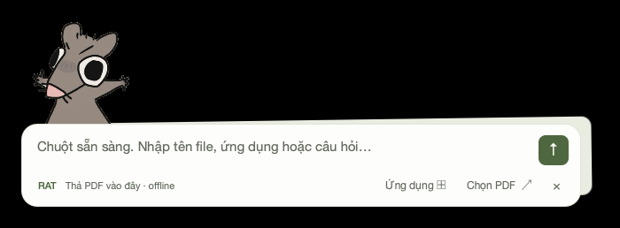

### A02-files.png

Historical UI screenshot; demo/fixture content

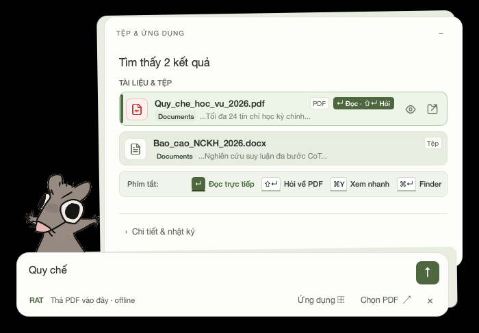

### A03-apps.png

Historical UI screenshot; demo/fixture content

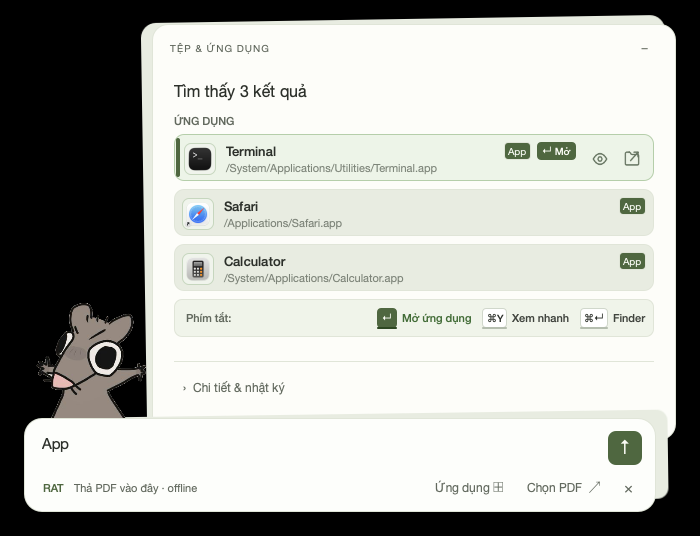

### A04-answer.png

Historical UI screenshot explicitly labeled fixture, not model evaluation

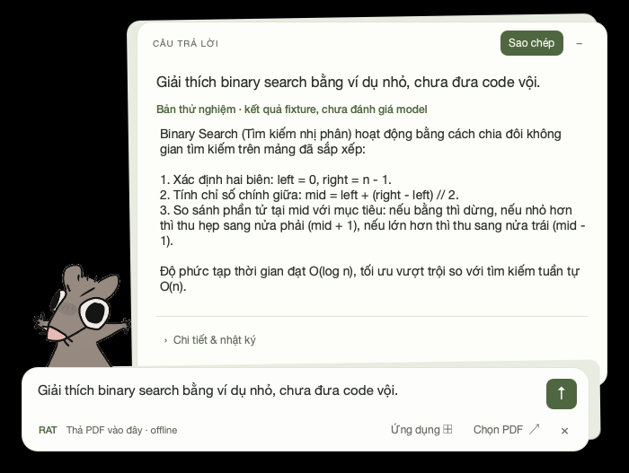

### A05-document.png

Historical UI screenshot; document content is reference only, not PDF acceptance evidence

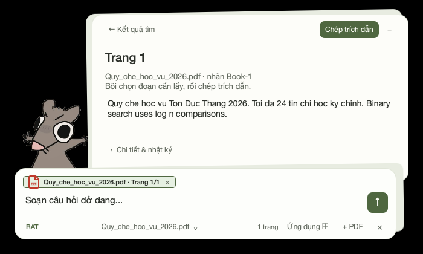

### A06-revision.png

Historical UI screenshot explicitly labeled fixture

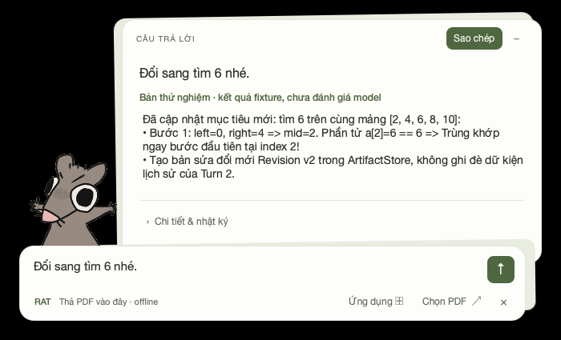

### A07-history.png

Historical UI screenshot; demo/fixture content

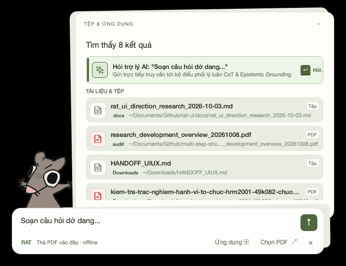

### B01-look-idle.png

Historical Look/Lite capture; not latest continuity-build acceptance

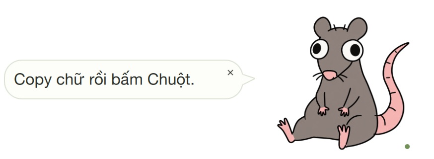

### B02-short-result.png

Historical short-result capture; floating-head behavior is not a new requirement

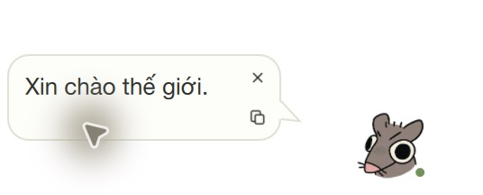

### B03-error.png

Historical recoverable-error capture

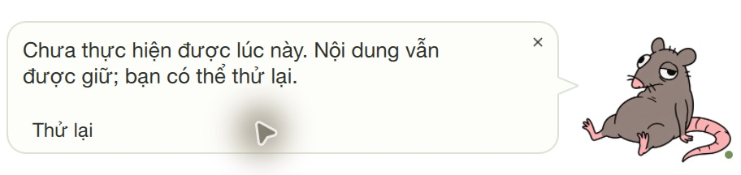

### C01-workbench-light.png

Historical approved HTML composition; synthetic content, not native app

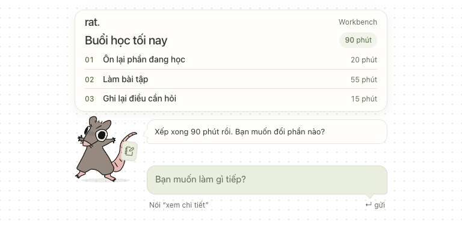

### C02-workbench-dark.png

Historical illustrative HTML mockup; synthetic content

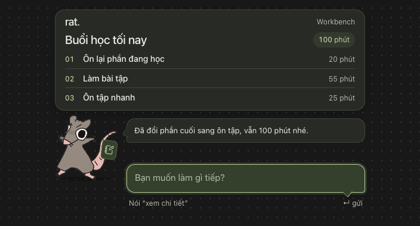

### D01-rat-original.png

Strict original character reference

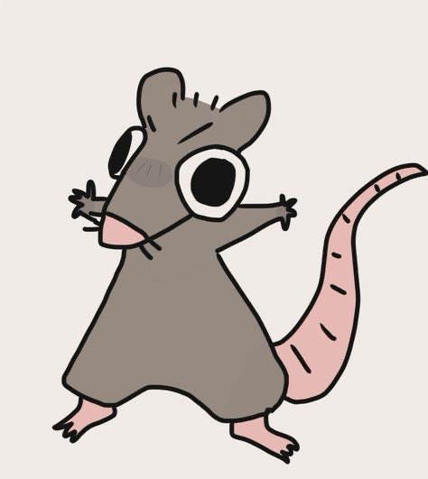

### D02-pose-sheet.png

Generated pose reference; not animation frames or approved state mapping

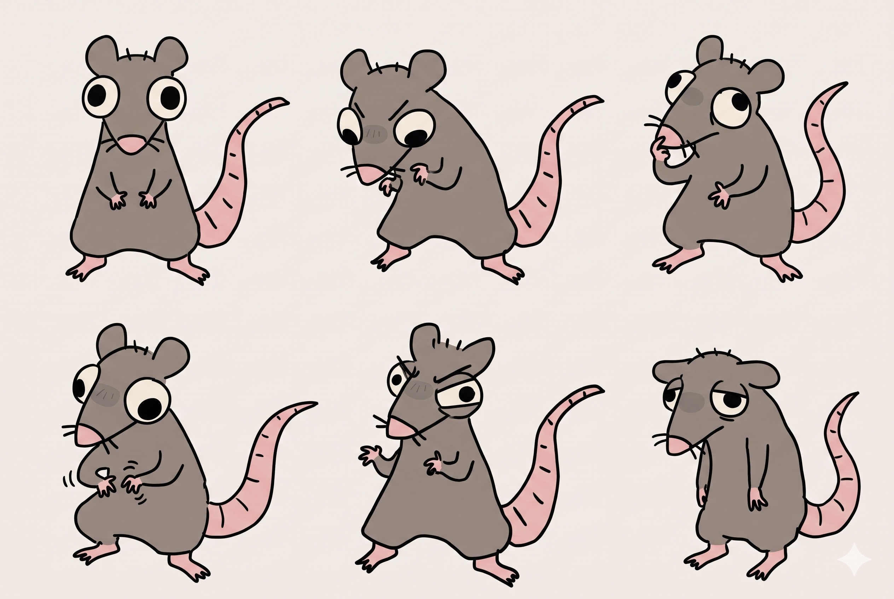

### D03-full-icon.png

Prepared full RAT icon adaptation

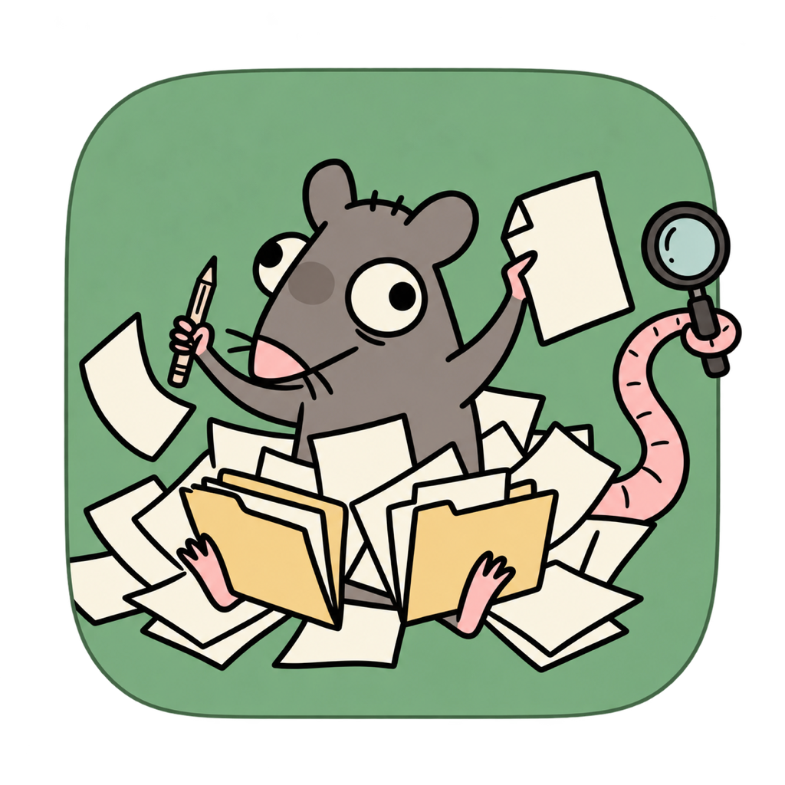

### D04-lite-icon.png

Prepared RAT Lite icon adaptation; edition branding only

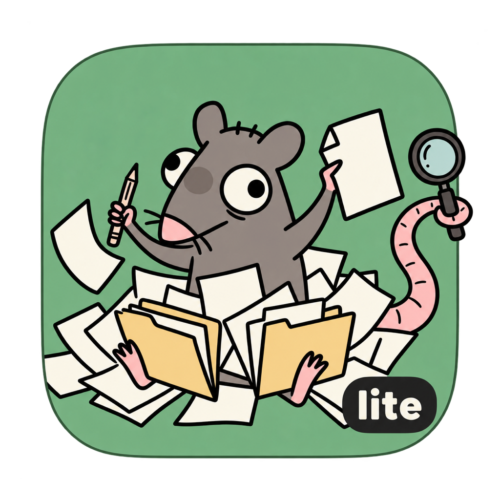

