# Cẩm Nang Bảo Vệ Hội Đồng NCKH & Bảng Dữ Liệu Thực Nghiệm Tổng Hợp
## NCKH Council Defense Guide & Master Evidence Reference

> **Đề tài:** Đánh Giá Tính Trung Thực Nhân Quả và Năng Lực Phát Hiện Lỗi Tư Duy của Các Cơ Chế Kiểm Thử Chương Trình Độc Lập trên Mô Hình Ngôn Ngữ Nhỏ (Qwen3-8B LoRA)  
> **Title:** *Independent Program Verification Outperforms Translation in Diagnosing Reasoning Errors in Small Language Models: A Causal and Metacognitive Framework*  
> **Nhóm Nghiên cứu Sinh viên (NCKH):** Khoa Khoa học Máy tính, Trường Đại học Khoa học Tự nhiên, ĐHQG-HCM  
> **Tài liệu tham chiếu:** Kế hoạch nghiên cứu tại [`docs/research_plan.md`](file:///Users/thundercock2/Documents/Github/multi-step-structured-reasoning/docs/research_plan.md) (nghiên cứu sinh viên độc lập, tự chủ học thuật sau khi giảng viên hướng dẫn không còn phản hồi / advisor ghosted). Bài báo khoa học hoàn chỉnh tại [`docs/paper/nckh_structured_reasoning.pdf`](file:///Users/thundercock2/Documents/Github/multi-step-structured-reasoning/docs/paper/nckh_structured_reasoning.pdf).

---

## 1. Executive Pitch (1-Phút Trình Bày Tổng Quan / 1-Minute Executive Summary)

### 1.1. Bản Tiếng Việt (Vietnamese Pitch — Dành cho Thuyết Trình Mở Đầu)
> "Kính thưa Hội đồng Khoa học,  
> 
> Một hạn chế nền tảng của các mô hình ngôn ngữ lớn khi giải toán qua chuỗi suy nghĩ (Chain-of-Thought) là hiện tượng **ngụy biện hậu nghiệm (post-hoc rationalization)**: các bước suy luận dạng lời văn thường không thực sự chi phối đáp án cuối cùng, hoặc sao chép một cách mù quáng các giả định sai lầm.  
> 
> Trong công trình này, chúng em thực hiện một nghiên cứu đăng ký trước (pre-registered) trên mô hình Qwen3-8B 4-bit tinh chỉnh LoRA qua hơn 500 bài toán MATH (Level 3–5) và GSM8K, đạt được 3 đóng góp khoa học chính:
> 
> 1. **Nêu và thử nghiệm 'Cạm bẫy xác nhận vòng lặp' (The Circular Confirmation Trap):** Chúng em nêu một cận đơn giản (Định lý 1), và trên một lượt đo dev có tiền đăng ký (hai lượt gán nhãn tự động trên 39 lời giải, $\kappa = 0.947$, chưa có người rà) thấy rằng: **việc dịch chuỗi suy nghĩ thành mã Python chỉ bắt được 8.3% (2/24) lỗi tư duy logic, trong khi sinh mã độc lập trực tiếp từ đề bài bắt được 41.7% (10/24) — cao gấp 5 lần ($p = 0.0215 < 0.05$).** Khi năng lực dịch mã của mô hình càng hoàn hảo, khả năng phát hiện lỗi tư duy qua code dịch càng triệt tiêu về 0.
> 2. **Tính trung thực nhân quả trên số học (GSM8K):** Cấu trúc hóa chuỗi suy nghĩ theo từng bước (`Step`/`Calc`) giúp mô hình đạt **88/100–96/100** tuân thủ cú pháp zero-prefill qua ba seed `enriched_cf` (seed 1 dưới ngưỡng 90), đạt **89.7%–93.8%** tính tuân thủ nhân quả dưới can thiệp số học giả định (chỉ 2.8%–3.1% quay xe), nhưng độ đúng vẫn thấp hơn `base_prefill` (93/100): ba seed `enriched_cf` đúng 87, 82 và 82/100, trong đó hai seed thấp hơn có ý nghĩa ($p = 0.0034$ và $0.0074$; seed tốt nhất $p = 0.1094$). Chưa thấy làm giàu ngữ nghĩa giúp tăng độ đúng.
> 3. **Nghẽn cổ chai trace phẳng trên toán ký hiệu (The Flat-Trace Bottleneck):** Khi mở rộng lên MATH Level 3–5, việc ép nén lời giải paragraph thành chuỗi phẳng tuyến tính gây ra **45%** sequence bị cắt cụt (tỷ lệ cắt cụt tăng đơn điệu theo độ khó: Level 3: 28% $\to$ Level 4: 39% $\to$ Level 5: 56%), và **75.6%** các sequence bị cắt cụt rơi vào vòng lặp lặp từ tham lam (greedy repetition loops). Tuy nhiên, trên 55 bài không bị cắt cụt, mô hình đạt độ chính xác **72.7% (40/55)** và **87.3%** suy luận toán học chuẩn xác.
> 
> Từ phát hiện này, chúng em đề xuất mô hình tác tử lập luận siêu nhận thức (MSRA) dựa trên đồ thị DAG và căn chỉnh SimPO như một hướng đi tương lai để loại bỏ hoàn toàn vòng lặp trace phẳng mà không gây sập mã monolithic. Xin kính mời Hội đồng chất vấn."

### 1.2. English Executive Summary (For International Council & Reviewers)
> Chain-of-thought (CoT) prompting in language models frequently suffers from post-hoc rationalization, where verbalized rationales fail to causally determine final answers or faithfully duplicate flawed assumptions. In this paper, we conduct a pre-registered investigation on fine-tuned Qwen3-8B across 500 challenging competition-level problems from the MATH dataset (Levels 3–5) and GSM8K:
> 1. **The Circular Confirmation Trap, Supported on One Development Run:** Translating natural language thought traces into executable code catches only **8.3% (2/24)** of conceptual reasoning fallacies because high translation fidelity faithfully encodes the model's false mathematical premises. In contrast, independent program synthesis directly from the query detects **41.7% (10/24)** of reasoning fallacies—a **5$\times$ recall advantage** (two-sided exact McNemar $p = 0.0215 < 0.05$, two automated labelling passes over 39 solutions, $\kappa = 0.947$, no human review).
> 2. **Causal Faithfulness on Elementary Arithmetic:** Explicit `Step`/`Calc` fine-tuning yields 88/100–96/100 zero-prefill format adherence over three seeds of `enriched_cf` (one seed below the 90 threshold), achieves 89.7%–93.8% causal following under intermediate counterfactual arithmetic perturbations (with only 2.8%–3.1% reverting to prior beliefs), but accuracy stays below `base_prefill` (93/100): three seeds reach 87, 82 and 82/100, two of them significantly lower ($p = 0.0034$, $0.0074$; best seed $p = 0.1094$). No accuracy gain from enrichment is shown.
> 3. **The Flat-Trace Bottleneck on Symbolic Mathematics:** Linearizing dense mathematical proofs into unconstrained flat `Step`/`Calc` streams triggers sequence truncation on 45/100 problems (monotonic with difficulty: Level 3: 28% $\to$ Level 4: 39% $\to$ Level 5: 56%), where 75.6% (34/45) degenerate into greedy repetition cycles. On non-truncated proofs, accuracy reaches 72.7% (40/55), and 87.3% (48/55) demonstrate mathematically sound derivations. We outline an encapsulated DAG delegation architecture (MSRA) as future work.

---

## 2. Master Empirical Evidence Table (Bảng Dữ Liệu Thực Nghiệm & Cổng Đăng Ký Trước)

> **Ghi chú Phương pháp Luận:** Toàn bộ tiêu chí phân chia dữ liệu, ngưỡng chấp nhận (gates), và kiểm định thống kê được tiền đăng ký (pre-registered) tại [`docs/research_plan.md`](file:///Users/thundercock2/Documents/Github/multi-step-structured-reasoning/docs/research_plan.md) (bản đề xuất đang chờ văn bản xác nhận của GVHD). Tiền đăng ký áp dụng cho từng lượt đo; bản thân các luận điểm được chọn sau khi đã xem kết quả các lượt trước. Tập kiểm thử chính thức (GSM8K Test, MATH-500) được niêm phong tuyệt đối, không mở trong suốt quá trình nghiên cứu.

| Cổng Đăng Ký / Giả Thuyết | Tập Dữ Liệu & Quy Mô | Chỉ Số Thực Nghiệm | Kết Quả Thực Nghiệm | Ý Nghĩa Khoa Học & Trạng Thái |
| :--- | :--- | :--- | :--- | :--- |
| **Gate 0: Tuân Thủ Cú Pháp Zero-Prefill (GSM8K)** | GSM8K Dev-100 ($N=100$) | Tỷ lệ sinh đúng định dạng `Step`/`Calc` không cần mồi chuỗi (Ngưỡng: $\ge 90\%$) | `old_plain`: 87/100 (FAIL) `old_cf`: **95/100** (PASS) `enriched_plain`: **95/100** (PASS) `enriched_cf`: **95/100** ở seed 0 (PASS, **97/100** với `tuned_tool`); seed 1 **88/100 (FAIL)**, seed 2 96/100 | **ĐẠT CỔNG Ở 2/3 SEED:** Làm giàu ngữ nghĩa mở đầu Bước 1 đưa `enriched_plain` lên 95/100; `enriched_cf` đạt 95, 88 và 96/100 tùy seed. |
| **Hypothesis 1: Kiểm Thử Phương Trình Nội Bộ** | MATH Dev 101–300 ($N=200$, `base_showcalc`) | Tỷ lệ phát hiện lỗi sai trên 82 bài giải sai; tỷ lệ báo động giả trên 118 bài đúng | Bắt lỗi: **2/82 (2.4%)** Báo động giả: **0/118 (0.0%)** | **BÁC BỎ (Falsified):** Kiểm tra tính đúng đắn của dấu bằng trong biểu thức số học không phát hiện được lỗi toán ký hiệu, vì mô hình bảo toàn cú pháp đẳng thức nhưng sai tiền đề logic. |
| **Hypothesis 2: Kiểm Thử Chương Trình Tự Do** | MATH Dev ($N=100$) | Khả năng bắt lỗi độc lập với ngữ nghĩa trace | Loại bỏ vào ngày 2026-11-04 do thiếu kiểm soát ngữ nghĩa | **BÁC BỎ (Rejected):** Pre-registration sửa đổi sang Hypothesis 3 chặt chẽ hơn. |
| **Hypothesis 3 (Tiêu chí 1–5): Kiểm Thử Độc Lập vs. Dịch Mã (Thread B)** | MATH Dev 301–500 ($N=200$, hai lượt gán nhãn tự động trên 39 lời giải, $\kappa = 0.947$) | 1. Sample Size $\ge 20$ 2. Bắt lỗi tư duy (McNemar $p < 0.05$) 3. Margin báo động giả 4. Bắt lỗi tính toán (Parity $\ge$) 5. Bắt lỗi tổng thể Ensemble | 1. 24 lỗi tư duy logic ($\ge 20$) 2. **Độc lập: 10/24 (41.7%) vs. Dịch: 2/24 (8.3%)**, **$p = 0.0215 < 0.05$** 3. Gap bắt lỗi ($0.334$) $>$ Gap báo động giả ($0.057$) 4. Dịch: **9/13 (69.2%)** $\ge$ Độc lập: **8/13 (61.5%)** 5. Ensemble: **32/59 (54.2%)** bắt lỗi, báo động giả 12/141 (8.5%) | **ĐẠT TRÊN TẬP DEV (chưa kiểm trên tập niêm phong):** Đạt toàn bộ 5/5 tiêu chí tiền đăng ký. Chứng minh cạm bẫy xác nhận vòng lặp (Theorem 1). Kiểm định McNemar có ý nghĩa thống kê ở mức $\alpha = 0.05$. |
| **Gate 3b: Can Thiệp Nhân Quả trên MATH (Thread A RQ2)** | MATH Dev-100 ($N=100$, `math_lora_1000_s0`) | Số lượng trace đạt điều kiện can thiệp số học trung gian (Ngưỡng: $\ge 30$) | Trace hợp lệ: **2/100** (47 sai cú pháp, 33 biểu thức phi số học) | **XÁC NHẬN BẤT KHẢ THI (Passed as Unmeasurable):** Thỏa mãn điều kiện đóng cổng định trước: khung can thiệp số học không thể đo lường được trên bài chứng minh ký hiệu đa bước. |
| **GSM8K Causal Faithfulness (Thread A RQ2)** | GSM8K Dev-100 ($N=100$) | Causal Following Rate under intermediate `Calc` perturbation; Reversion Rate | `enriched_cf`: **93.8% (61/65)** following, **3.1% (2/65)** reverted `enriched_plain`: **93.1% (67/72)** following, **2.8% (2/72)** reverted `old_cf`: **89.7% (61/68)** following, **2.9% (2/68)** reverted | **ĐẠT CHUẨN:** Chuỗi tính toán chi phối chặt chẽ suy luận phía sau, tỷ lệ tự ý quay xe về đáp án cũ cực thấp ($\le 3.1\%$). |
| **GSM8K 19-Target Recovery & Overall Acc (Thread A RQ1)** | GSM8K Dev-100 (19 câu `base_prefill` đúng nhưng LoRA cũ sai) | Số câu sửa đúng không cần prompt prefilling & Độ chính xác Dev-100 | `enriched_cf` theo 3 seed: **15, 13 và 12/19** đúng; **87, 82 và 82/100** Dev-100 ($p = 0.1094$, $0.0034$, $0.0074$ so với `base_prefill`) `enriched_plain`: **13/19 (68.4%)** đúng, 82/100 Dev-100 | **CHƯA THẤY CẢI THIỆN ĐỘ ĐÚNG:** 19 câu này được chọn vì mô hình cũ sai nên có hiệu ứng hồi quy về trung bình, và chưa có đối chứng. |
| **MATH Dev-100 Difficulty Scaling (Thread A RQ3)** | MATH Dev-100 ($N=100$, `math_lora_1000_s0`) | Tỷ lệ cắt cụt & độ chính xác theo Level (Level 3, Level 4, Level 5) | **Level 3 ($N=25$):** Cắt cụt **28.0% (7/25)**, Đúng chung 56.0%, Đúng non-trunc **77.8% (14/18)** **Level 4 ($N=23$):** Cắt cụt **39.1% (9/23)**, Đúng chung 47.8%, Đúng non-trunc **78.6% (11/14)** **Level 5 ($N=52$):** Cắt cụt **55.8% (29/52)**, Đúng chung 28.8%, Đúng non-trunc **65.2% (15/23)** | **ĐÃ XÁC THỰC:** Tỷ lệ cắt cụt tăng đơn điệu theo độ phức tạp bài toán (28% $\to$ 39% $\to$ 56%). Độ chính xác trên chuỗi hoàn thành giữ vững từ 65.2% đến 78.6%. |
| **MATH Dev-100 Subject Scaling (Thread A RQ3)** | MATH Dev-100 ($N=100$, `math_lora_1000_s0`) | Độ chính xác non-trunc theo chủ đề | `algebra`: **81.8% (18/22)** `intermediate_algebra`: **80.0% (4/5)** (72.2% cắt cụt) `prealgebra`: **77.8% (7/9)** `counting_and_probability`: **75.0% (3/4)** (63.6% cắt cụt) `number_theory`: **62.5% (5/8)** `geometry`: **33.3% (2/6)** (62.5% cắt cụt) `precalculus`: **100% (1/1)** (75.0% cắt cụt) | **ĐÃ XÁC THỰC:** Suy luận đại số compact đạt độ chính xác $>80\%$. Các phân môn yêu cầu diễn giải dài bị nghẽn bởi trần 512 token lúc huấn luyện trên phần cứng Apple M1 16GB. |
| **MATH Terminated-512 Verification (Thread A RQ3)** | MATH Dev-100 ($N=100$, `math_lora_term_1000_s0`) | Tỷ lệ Format Valid, Cắt cụt token, và Repetition Loops so với LoRA gốc | Format Valid: **52/100 (52.0%)** (tăng +10.0%) Số câu cắt cụt: **38/100** (giảm từ 45 xuống 38) Repetition Loops: **26/38 (68.4%)** **Level 3 Cắt cụt:** giảm từ 28.0% $\to$ **8.0% (2/25)**, Độ chính xác Level 3: **72.0% (18/25)** (bằng `base_prefill`) | **XÁC THỰC GIẢ ĐỊNH:** Huấn luyện trên chuỗi kết thúc sạch $\le 512$ token triệt tiêu gần như hoàn toàn lỗi cắt cụt ở Level 3 (xuống 8%), nhưng không thể vượt qua giới hạn trace phẳng ở Level 5 (53.8% cắt cụt), củng cố tính tất yếu của kiến trúc đồ thị MSRA DAG. |

---

## 3. 10-Slide NCKH Presentation Blueprint (Kịch Bản Thuyết Trình 10 Slide)

*Tổng thời gian trình bày chuẩn:* **15 phút** (Trung bình 1.5 phút/slide, dành 15 phút còn lại cho Hội đồng chất vấn).

```mermaid
flowchart LR
    S1["Slide 1: Đặt Vấn Đề<br>(Post-hoc CoT)"] --> S2["Slide 2: Hai Hướng Kiểm Thử<br>(Dịch vs Độc Lập)"]
    S2 --> S3["Slide 3: Lý Thuyết<br>(Định Lý 1 Cạm Bẫy)"]
    S3 --> S4["Slide 4: Phương Pháp<br>(Pre-registration & Mù Đôi)"]
    S4 --> S5["Slide 5: Kết Quả Thread B<br>(Xác Nhận Giả Thuyết 3)"]
    S5 --> S6["Slide 6: Kết Quả Thread A<br>(Tính Trung Thực Nhân Quả)"]
    S6 --> S7["Slide 7: Nghẽn Cổ Chai Trace Phẳng<br>(MATH Scaling)"]
    S7 --> S8["Slide 8: Phân Tích & Case Study<br>(Mode A & Mode B)"]
    S8 --> S9["Slide 9: Định Hướng Tương Lai<br>(Kiến Trúc MSRA DAG)"]
    S9 --> S10["Slide 10: Tổng Kết<br>(Khuyến Nghị Thực Tiễn)"]
```

---

### Slide 1: Đặt Vấn Đề & Tính Cấp Thiết (Problem Statement & Motivation)
- **Tiêu đề:** Tính Trung Thực Suy Luận và Hạn Chế của Chuỗi Suy Nghĩ Lời Văn (Chain-of-Thought).
- **Trực quan trên slide:** Sơ đồ so sánh giữa *Causal Reasoning* (Suy luận chi phối kết quả) vs. *Post-Hoc Confabulation* (Ngụy biện hậu nghiệm: lời giải sinh ra chỉ để bao biện cho một đáp án ngẫu nhiên hoặc thiên kiến).
- **Điểm dữ liệu trích dẫn:** \citet{lanham2023measuring}, \citet{turpin2024language}.
- **Speaker Notes (1.0 phút):**
  > "Kính thưa Hội đồng, các mô hình ngôn ngữ lớn hiện nay rất giỏi tạo ra lời giải từng bước. Nhưng câu hỏi nghiên cứu cốt lõi là: *Liệu mô hình có thực sự 'nghĩ' theo các bước đó, hay chỉ đang ngụy biện hậu nghiệm (post-hoc rationalization)?* Trong giải toán, lỗi của mô hình chia làm 2 loại: Lỗi tính toán số học đơn thuần (Execution Slips) và Lỗi sai bản chất tư duy (Reasoning Fallacies). Để bắt lỗi tự động mà không tốn chi phí gán nhãn người, việc sử dụng chương trình kiểm thử (Programmatic Verifier) là hướng đi đầy hứa hẹn. Tuy nhiên, nên để mô hình dịch chuỗi suy nghĩ của mình sang code, hay sinh một chương trình độc lập từ đề bài? Đó là câu hỏi trung tâm của đề tài."

---

### Slide 2: Hai Mô Thức Kiểm Thử Chương Trình: Dịch Trace vs. Sinh Mã Độc Lập
- **Tiêu đề:** Translated Trace Verification ($\mathcal{T}$) vs. Independent Program Verification ($\mathcal{I}$).
- **Trực quan trên slide:** Hai luồng kiến trúc:
  1. *Translated ($\mathcal{T}$):* $Q \to \text{Trace } T \to \text{Program } C_T \to \text{Execute } \text{Eval}(C_T) \stackrel{?}{=} A$.
  2. *Independent ($\mathcal{I}$):* $Q \to \text{Program } C_I \to \text{Execute } \text{Eval}(C_I) \stackrel{?}{=} A$.
- **Speaker Notes (1.5 phút):**
  > "Để kiểm tra tính đúng đắn của một câu trả lời $A$, chúng ta có hai cách tiếp cận:  
  > Cách 1 là **Translated Trace Verification ($\mathcal{T}$)**: Ta yêu cầu mô hình dịch toàn bộ các bước suy nghĩ trong lời văn $T$ thành một script Python $C_T$, sau đó cho máy tính thực thi để kiểm tra xem giá trị tính ra có khớp với đáp án $A$ hay không.  
  > Cách 2 là **Independent Program Verification ($\mathcal{I}$)**: Ta bỏ qua lời văn $T$, yêu cầu mô hình sinh một đoạn code độc lập $C_I$ trực tiếp từ đề bài $Q$.  
  > Thoạt nhìn, cách dịch trace có vẻ bám sát suy nghĩ của mô hình hơn. Nhưng liệu nó có giúp phát hiện lỗi sai, hay chỉ đơn thuần là tự động hóa việc chép lại những ảo tưởng của mô hình? Chúng em đã đặt ra một mô hình lý thuyết để trả lời câu hỏi này."

---

### Slide 3: Cơ Sở Lý Thuyết: Cạm Bẫy Xác Nhận Vòng Lặp (Theorem 1)
- **Tiêu đề:** The Circular Confirmation Trap & Fidelity-Detection Bound.
- **Trực quan trên slide:**
  - Hộp Định lý 1 từ bài báo: $\mathbb{P}(\text{Detect}(C_T) \mid E_{\text{reason}}) \le 1 - \phi$.
  - Hệ quả Corollary 1: Khi độ chuẩn xác của trình dịch $\phi \to 1$, xác suất phát hiện lỗi tư duy triệt tiêu về $0$.
  - Biểu đồ trực quan: Đường cong phát hiện lỗi dốc xuống khi năng lực viết code của mô hình tăng lên.
- **Speaker Notes (1.5 phút):**
  > "Chúng em đã phát biểu và chứng minh **Định lý 1: Cạm bẫy xác nhận vòng lặp (Theorem 1)**. Giả sử trình dịch có độ trung thực ngữ nghĩa là $\phi$. Khi mô hình mắc một lỗi tư duy logic, nó sẽ tin vào tiền đề sai $p_{\text{flaw}}$. Vì trình dịch có độ trung thực cao, đoạn code dịch ra sẽ phiên dịch trung thành chính xác biến số và công thức sai đó với xác suất ít nhất là $\phi$.  
  > Kết quả là: Máy tính thực thi đoạn code sai đó và trả về đúng giá trị sai mà mô hình đã tuyên bố! Bộ kiểm thử so sánh thấy khớp, và quyết định CHẤP NHẬN lời giải. Do đó, xác suất bắt được lỗi tư duy bị chặn trên bởi $1 - \phi$. **Càng là mô hình giỏi viết code, thì việc dịch suy nghĩ sang code càng trở nên mù quáng trước lỗi tư duy logic!** Ngược lại, việc sinh code độc lập $C_I$ từ đề bài không bị vướng vào tiền đề sai $p_{\text{flaw}}$, tạo ra cơ hội phát hiện lỗi vượt trội."

---

### Slide 4: Thiết Kế Thực Nghiệm & Giao Thức Đăng Ký Trước (Pre-Registration)
- **Tiêu đề:** Giao Thức Thực Nghiệm Khách Quan & Kiểm Định Mù Đôi.
- **Trực quan trên slide:**
  - Quy trình phân chia dữ liệu bằng hàm băm SHA-256 (1,301 bài MATH Levels 3–5 $\to$ 725 train, 76 valid, 500 dev).
  - Niêm phong tập test chính thức (MATH-500, GSM8K Test).
  - Hai lượt gán nhãn tự động trên 39 lời giải, chưa có người rà, đạt chỉ số Cohen's $\kappa = 0.947$.
  - 5 tiêu chí tiền đăng ký của Giả thuyết 3.
- **Speaker Notes (1.0 phút):**
  > "Để hạn chế p-hacking và thiên kiến xác nhận, ngưỡng và cách đọc của từng lượt đo được ghi trước khi chạy (pre-registered). Tuy vậy, các luận điểm được chọn sau khi đã xem kết quả các lượt trước, nên đây vẫn là kết quả trên tập dev. Dữ liệu 1,301 bài toán MATH Level 3–5 được phân chia cố định bằng hàm băm SHA-256. Tập test chính thức được niêm phong hoàn toàn.  
  > Đặc biệt, trên 200 bài dev (items 301–500), hai lượt gán nhãn tự động phân loại lỗi và đạt mức đồng thuận Cohen's $\kappa = 0.947$. Toàn bộ 5 tiêu chí kiểm định (từ quy mô mẫu $\ge 20$, kiểm định McNemar $p < 0.05$, đến cận trên báo động giả) đều được khóa cứng trước khi chạy kiểm thử."

---

### Slide 5: Kết Quả Thread B: Xác Nhận Giả Thuyết 3 trên 500 Bài MATH
- **Tiêu đề:** Thực Chứng Cạm Bẫy Xác Nhận Vòng Lặp: Độc Lập Vượt Trội Dịch Mã Gấp 5 Lần.
- **Trực quan trên slide:**
  - [`Figure 1(a)` & `Figure 1(b)` trong bài báo](file:///Users/thundercock2/Documents/Github/multi-step-structured-reasoning/docs/paper/nckh_structured_reasoning.pdf) (pgfplots vector graphics):
    - Panel (a): Bắt lỗi tư duy ($N=24$) vs. Lỗi thực thi ($N=13$) trên $n=200$ câu dev: Tư duy: Translated 8.3% (2/24), Independent PAL 41.7% (10/24), Composite OR 45.8% (11/24); Thực thi: Translated 69.2% (9/13), Independent PAL 61.5% (8/13), Composite OR 76.9% (10/13).
    - Panel (b): Đánh đổi Bắt lỗi tổng thể vs. Báo động giả qua 3 giả thuyết (H1 Equation Check: 2.4% vs 0.0%; H2 Translated: 57.3% vs 4.2%; H2 Independent PAL: 58.5% vs 16.9%; H3 Composite OR: 54.2% vs 8.5%).
  - Bảng kết quả Table 1: Independent 10/24 (41.7%) vs Translated 2/24 (8.3%), exact McNemar $p = 0.0215 < 0.05$.
- **Speaker Notes (2.0 phút):**
  > "Đây là kết quả thực nghiệm trung tâm của Thread B, khẳng định trọn vẹn Giả thuyết 3:  
  > Thứ nhất, trên 24 bài mắc lỗi tư duy logic, **kiểm thử độc lập bắt được 10/24 (41.7%), trong khi dịch trace chỉ bắt được đúng 2/24 (8.3%) — độc lập vượt trội gấp 5 lần.** Kiểm định McNemar hai phía cho thấy sự khác biệt này có ý nghĩa thống kê rõ rệt với $p = 0.0215 < 0.05$.  
  > Thứ hai, trên các lỗi tính toán số học đơn thuần ($N=13$), phương pháp dịch trace đạt tỷ lệ bắt lỗi 69.2% (9/13), tương đương với kiểm thử độc lập 61.5% (8/13), đúng như giả thuyết đề ra là dịch trace bảo toàn tốt các phép tính cơ học.  
  > Thứ ba, khi kết hợp cả hai phương pháp thành mô hình Ensemble (báo động khi 1 trong 2 checker phản đối), chúng em bắt được 54.2% toàn bộ các lời giải sai, trong khi chỉ tạo ra 8.5% báo động giả trên các bài đúng. Biểu đồ Figure 1 minh chứng rõ ràng biên giới đánh đổi vượt trội của kiểm thử độc lập."

---

### Slide 6: Kết Quả Thread A: Tính Trung Thực Nhân Quả & Làm Giàu Ngữ Nghĩa (GSM8K)
- **Tiêu đề:** Cấu Trúc Hóa Chuỗi Suy Nghĩ và Tính Trung Thực Nhân Quả trên GSM8K.
- **Trực quan trên slide:**
  - Bảng so sánh 7 cấu hình: `base_prefill`, `old_plain`, `old_cf`, `enriched_plain`, `enriched_cf`, `enriched_plain_tool`, và `enriched_cf_tool`.
  - Kết quả Gate 0: Format validity tăng từ 87% $\to$ **95%** zero-prefill (Wilson 95% CI: 88.8%–97.8%) và đạt **97%** khi kết hợp `tuned_tool`.
  - Độ chính xác & Khôi phục 19 câu target: `enriched_cf` đạt 87, 82 và 82/100 qua ba seed (so với `base_prefill` 93: $p = 0.1094$, $0.0034$, $0.0074$), và sửa đúng 15, 13 và 12/19 câu target. Các câu này được chọn vì đã sai nên một phần là hồi quy về trung bình.
  - Tỷ lệ tuân thủ nhân quả (Causal Following): **93.8% (61/65)** trên `enriched_cf` (**93.1% [67/72]** trên `enriched_plain`), tỷ lệ quay xe chỉ **2.8%–3.1%**.
  - Kiểm chứng `tuned_tool`: Độ chính xác không đổi (82% và 87%), gợi ý rằng tính nhẩm trong `Calc:` không phải nguồn lỗi chính; chưa chứng minh là không có lỗi tính nhẩm.
- **Speaker Notes (1.5 phút):**
  > "Chuyển sang Thread A trên bài toán số học nhiều bước GSM8K:  
  > Khi chưa tinh chỉnh, mô hình gốc cần phải mồi prompt (`base_prefill`) mới sinh đúng định dạng. Việc huấn luyện LoRA chuẩn (`old_plain`) chỉ đạt 87% tuân thủ cú pháp (trượt Gate 0), còn thêm dữ liệu counterfactual trên tập chưa làm giàu (`old_cf`) đạt 94% format nhưng làm giảm độ chính xác xuống 83%.  
  > Tuy nhiên, khi kết hợp **Làm giàu ngữ nghĩa mở đầu (Semantic Enrichment)** với dữ liệu counterfactual (`enriched_cf`), định dạng đạt 95, 88 và 96/100 qua ba seed, nhưng độ đúng là 87, 82 và 82/100. Seed tốt nhất chưa khác `base_prefill` một cách có ý nghĩa ($p = 0.1094$), còn hai seed kia thấp hơn rõ ($p = 0.0034$, $0.0074$). Vì vậy sự đánh đổi chưa được giải quyết.  
  > Đặc biệt, trên 19 câu hỏi mà các adapter cũ bị thất bại, `enriched_cf` sửa đúng 15, 13 và 12/19 tùy seed; các câu này được chọn vì đã sai nên một phần là hồi quy về trung bình, và chưa có đối chứng. Thí nghiệm can thiệp số học giả định cho thấy **93.8% (61/65)** các bước suy luận phía sau tuân thủ theo giá trị bị can thiệp, và chỉ **3.1% (2/65)** tự ý quay xe. Hơn nữa, thí nghiệm cắt bỏ với máy tính lúc chạy (`tuned_tool`) giữ nguyên độ chính xác 87/100 ở seed 0 và nâng format validity lên **97/100**, gợi ý rằng tính toán trong dòng `Calc:` không phải nguồn lỗi chính."

---

### Slide 7: Mở Rộng Sang Toán Ký Hiệu: Nghẽn Cổ Chai Trace Phẳng (The Flat-Trace Bottleneck)
- **Tiêu đề:** Thử Nghiệm Tinh Chỉnh LoRA trên MATH Levels 3–5: Hiện Tượng Cắt Cụt Chuỗi.
- **Trực quan trên slide:**
  - [`Figure 2(a)` & `Figure 2(b)` trong bài báo](file:///Users/thundercock2/Documents/Github/multi-step-structured-reasoning/docs/paper/nckh_structured_reasoning.pdf):
    - Panel (a): Đường cong hội tụ hàm mất mát Validation Loss của GSM8K Enriched ($2.121 \to 0.688$) và MATH LoRA ($1.323 \to 0.587$).
    - Panel (b): Phân rã kết quả MATH Dev-100: Độ chính xác chung 40.0%, Non-Trunc Accuracy **72.7%**, Mathematical Soundness **87.3%**, Repetition Loops trên bài cắt cụt **75.6%**.
  - Bảng so sánh Table 2: `math_lora_1000_s0` (40% overall, 72.7% non-trunc).
- **Speaker Notes (1.5 phút):**
  > "Khi chúng em mở rộng việc tinh chỉnh chuỗi suy nghĩ cấu trúc lên 1,000 bài toán MATH Level 3–5 (`math_lora_1000_s0`), một hiện tượng phân tách sâu sắc xuất hiện: **Nghẽn cổ chai của trace phẳng (The Flat-Trace Bottleneck)**.  
  > Như thể hiện trên Figure 2(a), hàm mất mát validation giảm rất đẹp từ 1.323 xuống 0.587. Tuy nhiên, độ chính xác chung trên 100 bài dev chỉ đạt 40.0%.  
  > Tại sao lại như vậy? Khi phân rã dữ liệu (Figure 2(b)), chúng em phát hiện: Trên 55 bài mà lời giải hoàn thành trong ngưỡng 1,024 token, mô hình đạt độ chính xác lên tới **72.7% (40/55)**. Ngược lại, ở 45 bài bị cắt cụt do vượt quá độ dài, có tới **75.6% (34/45)** bài bị rơi vào vòng lặp lặp từ tham lam (greedy repetition loops). Lời giải toán ký hiệu vốn là các đoạn văn dày đặc; việc ép nén thành chuỗi `Step`/`Calc` phẳng tuyến tính khiến mô hình mất phương hướng ngữ cảnh dài hạn."

---

### Slide 8: Phân Tích Độ Khó, Phân Môn & Hai Hình Thái Lỗi Định Tính (Case Study)
- **Tiêu đề:** Phân Tích Đơn Điệu Theo Cấp Độ Khó và Hai Cơ Chế Thất Bại Đặc Thù.
- **Trực quan trên slide:**
  - Bảng tỷ lệ cắt cụt tăng đơn điệu: Level 3 (28.0%) $\to$ Level 4 (39.1%) $\to$ Level 5 (55.8%).
  - Hộp Case Study từ bài báo:
    - **Mode A (Lỗi Giả Báo Động do Cú Pháp LaTeX):** Item `43626bdb3b0ea359` (Lý thuyết số Level 5, thuật toán Euclid nghịch đảo modulo 41, giải đúng ra 23 nhưng bị validator đánh trượt vì chứa cú pháp `\pmod{41}`).
    - **Mode B (Vòng Lặp Tham Lam do Trần Ngữ Cảnh):** Item `47f4c6074a1e5c7f` (Tổ hợp Level 5, lặp lại góc đa giác sao 14 lần cho đến khi hết token).
- **Speaker Notes (2.0 phút):**
  > "Để làm rõ bản chất của hiện tượng cắt cụt, chúng em phân tích sâu theo cấp độ bài toán và phân môn:  
  > Tỷ lệ cắt cụt tăng tiến một cách đơn điệu tuyệt đối theo độ khó: **Level 3 là 28.0%, lên Level 4 là 39.1%, và Level 5 lên tới 55.8%.** Điều này chứng minh hiện tượng cắt cụt không phải là nhiễu ngẫu nhiên, mà phản ánh trực tiếp áp lực độ dài khi giải các bài toán phức tạp. Các phân môn đại số thuần túy (`algebra`) đạt độ chính xác non-trunc lên tới **81.8%**, trong khi các môn yêu cầu chứng minh dài như Đại số trung cấp hay Hình học bị cắt cụt trên 60%.  
  > Phân tích định tính chỉ ra hai hình thái lỗi cốt lõi:  
  > - **Hình thái A:** Mô hình giải hoàn toàn đúng về mặt toán học (như bài tìm số dư modulo 41 bằng thuật toán Euclid), nhưng bị bộ chấm gán nhãn sai ngữ pháp vì chuỗi `Calc` chứa ký hiệu LaTeX `\pmod{41}` thay vì số học thuần túy. Có 8 bài như vậy, nâng tỷ lệ suy luận đúng thực tế của non-trunc lên **87.3%**.  
  > - **Hình thái B:** Mô hình rơi vào bẫy lặp từ tham lam, lặp lại cùng một câu lập luận 14 lần cho tới khi chạm trần 1,024 token. Đây là giới hạn không thể khắc phục nếu chỉ dùng sinh văn bản tuyến tính phẳng."

---

### Slide 9: Đề Xuất Kiến Trúc Tương Lai: MSRA (Metacognitive Structured Reasoning Agent)
- **Tiêu đề:** Khắc Phục Nghẽn Cổ Chai Trace Phẳng: Đại Diện Lập Luận DAG Siêu Nhận Thức.
- **Trực quan trên slide:**
  - Sơ đồ kiến trúc MSRA: Phân rã bài toán thành đồ thị có hướng không chu trình (DAG) các subgoal $v_t = \langle g_t, \tau_t, \mathcal{D}_t, y_t, \sigma_t \rangle$.
  - Cơ chế ra quyết định siêu nhận thức: Chính sách ủy quyền $\pi_\theta(\mathcal{D}_t \mid g_t, \tau_t, \mathcal{P}_t)$ căn chỉnh bằng SimPO (Simple Preference Optimization) với hai hành động: $\texttt{SOLVE\_LOCAL}$ (tự tính biểu thức đơn giản) vs. $\texttt{ASK\_HELP}$ (chuyển ngữ cảnh cha cho SymPy).
  - Trạng thái hiện tại: Đã xây dựng mã nguồn mô-đun và vượt qua 15/15 bài unit test, định hướng làm đề tài phát triển tiếp theo.
- **Speaker Notes (1.5 phút):**
  > "Từ kết quả trên, chúng em nhận thấy một bài toán thế tiến thoái lưỡng nan: Nếu dùng trace phẳng tuyến tính thì mô hình bị lặp từ (75.6% bài cắt cụt); còn nếu bắt mô hình sinh toàn bộ đoạn code Python giải toán từ đầu đến cuối như PAL nguyên khối thì có tới 27/100 bài bị crash do bài hình học hoặc lý thuyết số quá khó viết code.  
  > Để giải quyết triệt để vấn đề này, chúng em đã thiết kế kiến trúc tương lai: **Metacognitive Structured Reasoning Agent (MSRA)**. Thay vì một chuỗi phẳng, bài toán được phân rã thành một đồ thị DAG các mục tiêu phụ. Mô hình học một chính sách siêu nhận thức qua SimPO để tự biết khi nào mình giải được cục bộ ($\texttt{SOLVE\_LOCAL}$), và khi nào cần ủy quyền ngữ cảnh cha cho thư viện đại số máy tính như SymPy ($\texttt{ASK\_HELP}$). Khung kiến trúc này đã được lập trình sẵn và vượt qua toàn bộ 15/15 unit test, mở ra hướng nghiên cứu đầy triển vọng cho giai đoạn tiếp theo."

---

### Slide 10: Tổng Kết & Khuyến Nghị Thực Tiễn (Conclusions & Takeaways)
- **Tiêu đề:** Kết Luận Đề Tài & Bài Học Thực Tiễn Cho Triển Khai AI.
- **Trực quan trên slide:**
  - 3 thông điệp đóng gói cốt lõi:
    1. *Đừng kiểm thử bằng cách dịch trace:* Dịch chuỗi suy nghĩ sang code tạo ra cạm bẫy xác nhận vòng lặp (chỉ bắt được 8.3% lỗi tư duy). Muốn kiểm tra mô hình, hãy sinh code độc lập (bắt được 41.7%, gấp 5 lần).
    2. *Trace phẳng có giới hạn biểu diễn:* Chuỗi `Step`/`Calc` tuyến tính rất tốt cho số học GSM8K (95%–97% format, 87% accuracy, 93.8% causal following), nhưng bắt buộc phải chuyển sang cấu trúc đồ thị phân cấp (DAG) khi giải toán ký hiệu.
    3. *Phương pháp luận nghiên cứu sinh viên trung thực:* Toàn bộ kết quả đều dựa trên dữ liệu thô được ghi nhận tự động, nhãn do hai lượt tự động gán và chưa có người rà, không làm giả số liệu, không mở tập test niêm phong.
- **Speaker Notes (1.5 phút):**
  > "Tóm lại, đề tài của nhóm mang lại 3 bài học khoa học thực tiễn:  
  > Một là, trong kiểm định an toàn và độ tin cậy của mô hình AI, **không bao giờ dùng mã dịch từ lời văn để xác thực tư duy của mô hình**, bởi nó sẽ lặp lại chính ảo tưởng của mô hình với độ trung thực cao. Kiểm thử độc lập là nguyên lý bắt buộc để bắt lỗi logic.  
  > Hai là, chuỗi suy nghĩ cấu trúc phẳng đã phát huy tối đa hiệu quả trên số học nhưng đã chạm trần biểu diễn trên toán ký hiệu, khẳng định sự cần thiết của các kiến trúc đại diện dạng đồ thị như MSRA.  
  > Ba là, toàn bộ nghiên cứu của nhóm đều tuân thủ nghiêm ngặt tính liêm chính học thuật, bám sát kế hoạch nghiên cứu đề xuất và các kiểm định thống kê chuẩn mực.  
  > Nhóm chúng em xin chân thành cảm ơn Quý Thầy Cô trong Hội đồng đã chú ý lắng nghe và rất mong nhận được những góp ý quý báu."

---

## 4. 6 Tough Council Questions & Data-Backed Answers (6 Câu Hỏi Hóc Búa & Đáp Án Thực Chứng)

### Câu Hỏi 1 (Q1 — GSM8K Accuracy & Zero-Prefill Parity):
*“Tại sao trên tập GSM8K, mô hình gốc dùng mồi chuỗi (`base_prefill`) lại đạt độ chính xác 93%, trong khi các mô hình LoRA tinh chỉnh đạt 82%–87%? Phải chăng việc tinh chỉnh làm mô hình suy giảm hiệu năng?”*

- **Đáp án Tiếng Việt (VN):**
  > "Kính thưa Thầy/Cô, con số 93% của `base_prefill` là một con số có sự hỗ trợ nhân tạo tại thời điểm suy luận (inference-time prompting assistance). Cụ thể, `base_prefill` được người dùng mớm sẵn chuỗi `<think>\nStep 1: Calculate the...` vào bộ nhớ đệm KV cache, buộc mô hình phải đi đúng đường ray ngay từ token đầu tiên. Nếu không có chuỗi mồi này, mô hình gốc chỉ đạt **61%** tuân thủ cú pháp (trượt nặng Gate 0).  
  > Ngược lại, các mô hình LoRA tinh chỉnh của nhóm hoạt động ở chế độ **Zero-Prefill hoàn toàn tự thân**: khi người dùng đưa câu hỏi, mô hình phải tự mình sinh toàn bộ thẻ `<think>`, tự phân rã bước, và tự ra quyết định.  
  > Đặc biệt, với mô hình **`enriched_cf`** (kết hợp làm giàu ngữ nghĩa Bước 1 với dữ liệu counterfactual), độ chính xác zero-prefill đạt 87, 82 và 82/100 qua ba seed. So với `base_prefill` (93%), seed tốt nhất có $p = 0.1094$, nghĩa là chưa phát hiện khác biệt chứ không chứng minh hai bên bằng nhau; hai seed còn lại thấp hơn rõ ($p = 0.0034$, $0.0074$). Đồng thời, `enriched_cf` đạt **95/100** tuân thủ định dạng zero-prefill (**97/100** khi gắn máy tính runtime `tuned_tool`), đạt tính trung thực nhân quả **93.8% (61/65)**, và khôi phục tới **78.9% (15/19)** các câu lỗi kế thừa — ngang bằng tuyệt đối với trần hiệu năng khi dùng mồi chuỗi thủ công lúc chạy!"

- **English Answer (EN):**
  > "The 93% accuracy of `base_prefill` relies on an artificial inference-time prefill intervention where `<think>\nStep 1: Calculate the...` is manually forced into the model's KV cache. When evaluated strictly zero-prefill, the base model fails Gate 0 with only 61% format validity. Our fine-tuned LoRA models operate entirely zero-prefill from raw user queries without prefix scaffolding. Our `enriched_cf` adapter reaches 87, 82 and 82/100 zero-prefill accuracy over three seeds. Against `base_prefill`, the best seed shows no detected difference ($p = 0.1094$), which does not establish equivalence, and the other two are significantly lower ($p = 0.0034$, $0.0074$). Format validity is 95, 88 and 96/100, and 15, 13 and 12 of 19 selected failure targets are recovered, part of which is regression to the mean."

---

### Câu Hỏi 2 (Q2 — Synergy of Semantic Enrichment & Counterfactual Augmentation):
*“Tại sao mô hình `enriched_plain` lại có độ chính xác giảm nhẹ xuống 82% so với 87% của `old_plain`, và làm thế nào mô hình `enriched_cf` lại khôi phục được cả độ chính xác 87% lẫn 95% format validity?”*

- **Đáp án Tiếng Việt (VN):**
  > "Kính thưa Thầy/Cô, đây chính là phát hiện thực nghiệm thú vị nhất ở Thread A về sự tương tác cộng hưởng giữa **Làm giàu ngữ nghĩa (Semantic Enrichment)** và **Tăng cường dữ liệu giả định (Counterfactual Augmentation)**:  
  > 1. Khi chỉ dùng dữ liệu gốc chưa làm giàu (`old_plain`), mô hình đạt 87% accuracy nhưng trượt Gate 0 (chỉ đạt 87% format validity, 86% strict parsing) vì các câu mở đầu Bước 1 quá cụt lủn khiến mô hình mất đà cấu trúc.  
  > 2. Khi thêm dữ liệu counterfactual vào tập chưa làm giàu (`old_cf`), format tăng lên 94% nhưng accuracy bị giảm xuống 83% do nhiễu từ các phép thế số giả định trên câu văn ngắn. Ngược lại, khi chỉ làm giàu ngữ nghĩa Bước 1 mà không có counterfactual (`enriched_plain`), format đạt ngay **95%** (vượt Gate 0) và sửa được 13/19 câu lỗi cũ, nhưng accuracy dừng ở 82%.  
  > 3. Tuy nhiên, khi kết hợp **cả hai kỹ thuật trong `enriched_cf`**, câu mở đầu giàu ngữ nghĩa (`Step 1: Calculate the <quantity>...`) có thể giúp mô hình giữ đúng đại lượng cần tính, nhưng giả thuyết này chưa được kiểm chứng. Seed 0 của `enriched_cf` đạt 95% định dạng, 87% độ đúng và 15/19 câu target; hai seed khác đạt 82% độ đúng, nên mức $+4\%$ so với `old_cf` không lặp lại.  
  > Hơn nữa, khi kiểm tra bằng chế độ `tuned_tool` (gắn máy tính Python thực thi trực tiếp mỗi dòng `Calc:`), độ chính xác của cả `enriched_plain` (82%) và `enriched_cf` (87%) đều không đổi (0 bài đổi từ sai thành đúng), gợi ý rằng phần lớn lỗi không nằm ở tính nhẩm. Điều này chưa chứng minh mọi lỗi còn lại đều do lập phương trình."

- **English Answer (EN):**
  > "This highlights the synergy between Step 1 semantic enrichment and counterfactual data augmentation. On unenriched data, `old_plain` (87% accuracy) failed Gate 0 with 87% format validity due to telegraphic Step 1 headers, while adding counterfactuals (`old_cf`) raised format validity to 94% at the cost of a 4-point accuracy drop (83%). Conversely, semantic enrichment alone (`enriched_plain`) achieved 95% format validity and 13/19 target recovery, but settled at 82% overall accuracy. When combined in **`enriched_cf`**, an explicit Step 1 goal may help the model keep track of the quantity, though we did not test this mechanism. Seed 0 of `enriched_cf` reaches 95% format validity, 87% accuracy and 15/19 targets, but two other seeds reach 82% accuracy, so the $+4$ points over `old_cf` did not replicate. The runtime calculator ablation leaves accuracy unchanged, suggesting arithmetic is not the main source of error."

---

### Câu Hỏi 3 (Q3 — RQ2 MATH Unmeasurability Gate):
*“Trong kế hoạch nghiên cứu có đặt ra câu hỏi RQ2 về can thiệp nhân quả trên tập MATH, nhưng tại sao trong bài báo nhóm lại kết luận là 'Unmeasurable' (< 30 eligible traces)? Phải chăng thí nghiệm này đã thất bại?”*

- **Đáp án Tiếng Việt (VN):**
  > "Kính thưa Thầy/Cô, đây không phải là một thí nghiệm thất bại, mà là **kết quả kiểm định giả thuyết thành công đúng theo kịch bản đã tiền đăng ký (Pre-registered Gate 3b)**.  
  > Khi thiết lập kế hoạch nghiên cứu trong [`docs/research_plan.md`](file:///Users/thundercock2/Documents/Github/multi-step-structured-reasoning/docs/research_plan.md), nhóm đã lường trước khả năng các bài toán MATH phức tạp không phù hợp với việc can thiệp số học đơn giản, và đã tiền đăng ký rõ: *'Nếu số lượng trace đạt chuẩn can thiệp < 30 trên 100 câu dev, cổng RQ2 trên MATH sẽ đóng lại và ghi nhận là Unmeasurable do rào cản biểu diễn.'*  
  > Kết quả thực nghiệm cho thấy: trên 100 bài MATH Dev, có 47 bài bị loại vì cú pháp không hoàn chỉnh (do cắt cụt), và 33 bài có bước tính toán trung gian là các biểu thức phi số học (như tọa độ điểm, đa thức ký hiệu, tập nghiệm). Chỉ có duy nhất 2 bài thỏa mãn điều kiện số học thuần túy. Bài toán duy nhất can thiệp được đã tuân thủ nhân quả 100% (1/1).  
  > Kết quả này là một đóng góp khoa học quan trọng: nó chứng minh bằng thực nghiệm rằng phương pháp can thiệp số học vi mô vốn dùng cho GSM8K không thể mở rộng một cách ngây thơ lên toán ký hiệu, tạo tiền đề lý thuyết vững chắc cho kiến trúc MSRA ở tương lai."

- **English Answer (EN):**
  > "This is not an experimental failure, but the rigorous fulfillment of our pre-registered Gate 3b contingency protocol. In [`docs/research_plan.md`](file:///Users/thundercock2/Documents/Github/multi-step-structured-reasoning/docs/research_plan.md), we pre-registered that if eligible intervention traces were fewer than 30 on MATH Dev-100, RQ2 on MATH would close as unmeasurable. Empirically, 47 traces failed syntax prerequisites and 33 yielded non-numeric expressions (polynomials, coordinates, sets), leaving only 2 eligible traces. Formally closing the gate confirms that micro-arithmetic perturbation cannot be naively transferred to symbolic proofs, motivating hierarchical subgoal representations."

---

### Câu Hỏi 4 (Q4 — The Circular Confirmation Trap):
*“Tại sao việc dịch chuỗi suy nghĩ thành mã Python (Translated Verification) lại thất bại nặng nề trước các lỗi tư duy logic (chỉ bắt được 8.3%), trong khi việc sinh code độc lập lại bắt được tới 41.7%?”*

- **Đáp án Tiếng Việt (VN):**
  > "Kính thưa Thầy/Cô, nguyên nhân nằm ở bản chất toán học của **Cạm bẫy xác nhận vòng lặp (Theorem 1)**.  
  > Khi mô hình mắc một lỗi tư duy (Reasoning Fallacy) — ví dụ như trong bài toán hình học tọa độ ở Case Study 1: mô hình quên chia cho hệ số $-2$ khi đưa phương trình đường tròn về dạng chính tắc, dẫn tới việc xác định tâm đường tròn sai thành $(4, -6)$ thay vì $(2, -3)$.  
  > Khi ta yêu cầu mô hình dịch lời giải của nó sang Python, vì mô hình có năng lực viết code rất cao, nó sẽ phiên dịch nguyên văn: `c1 = (4, -6)`. Khi trình thông dịch Python chạy đoạn code này, máy tính chỉ làm đúng phép cộng trừ nhân chia trên tọa độ sai đó và tính ra khoảng cách là 14.42, trùng khít với con số 14.42 mà mô hình đã nói trong lời văn. Bộ kiểm thử so sánh thấy khớp và kết luận: LỜI GIẢI ĐÚNG! Lỗi tư duy đã hoàn toàn bị che giấu.  
  > Ngược lại, khi sinh code độc lập từ đề bài, mô hình phải tự mình viết lại thuật toán từ đầu (sử dụng thư viện đại số SymPy hoặc tự hoàn thiện bình phương). Do không bị trói buộc bởi dòng suy nghĩ sai trước đó, code độc lập đã tính đúng tâm $(2, -3)$ và khoảng cách là 7.21. Sự sai lệch giữa 7.21 và 14.42 ngay lập tức kích hoạt cờ cảnh báo (FLAGGED). Đó là lý do kiểm thử độc lập vượt trội gấp 5 lần ($p = 0.0215$)."

- **English Answer (EN):**
  > "This discrepancy is governed by Theorem 1 (The Circular Confirmation Trap). When a model commits a conceptual fallacy—such as failing to divide by $-2$ when completing the square in circle coordinate geometry—it falsely deduces the center as $(4, -6)$ rather than $(2, -3)$. When tasked with translating its thought trace into Python, high translation fidelity ensures that it faithfully transcribes `c1 = (4, -6)`. The interpreter executes arithmetic on this false premise, producing an output that matches the text ($14.42$), causing the checker to accept the hallucination. In contrast, independent program synthesis writes the solver script from scratch, completes the square correctly via first principles, outputs $7.21$, detects the mismatch, and flags the error ($5\times$ recall, $p = 0.0215$)."

---

### Câu Hỏi 5 (Q5 — Truncation & The 512-Token Hardware Limit):
*“Tại sao mô hình `math_lora_1000_s0` lại có tới 45/100 bài bị cắt cụt sequence? Giới hạn phần cứng Apple M1 16GB đã ảnh hưởng như thế nào đến thiết kế nghiên cứu của nhóm?”*

- **Đáp án Tiếng Việt (VN):**
  > "Kính thưa Thầy/Cô, tỷ lệ 45% cắt cụt xuất phát từ hai nguyên nhân mật thiết:  
  > Thứ nhất là **Nguyên nhân phần cứng và Ngân sách bộ nhớ**: Để có thể huấn luyện LoRA cho mô hình 8 tỷ tham số trên một chiếc máy tính cá nhân Apple M1 16GB duy nhất mà không bị tràn bộ nhớ Metal GPU (vốn bị giới hạn trần ở 5.915 GB), tham số huấn luyện bắt buộc phải đặt `--max-seq-length 512`. Giới hạn 512 token này đã khiến 14.5% (105/725) các bài toán huấn luyện có lời giải dài bị cắt cụt mất thẻ đóng `</think>` và `Answer:`. Do đó, khi kiểm thử ở độ dài 1,024 token, mô hình chưa học được phản xạ dừng ở những bài toán có diễn giải dài.  
  > Thứ hai là **Bản chất độ phức tạp toán học**: Phân tích thực nghiệm của nhóm cho thấy tỷ lệ cắt cụt tăng tiến đơn điệu theo độ khó: Level 3 là 28%, Level 4 là 39%, và Level 5 lên tới 55.8%. Lời giải toán thi học sinh giỏi vốn có cấu trúc phân nhánh phức tạp; việc ép nó vào một chuỗi phẳng tuyến tính khiến mô hình bị mất ngữ cảnh ngược và rơi vào vòng lặp tham lam (chiếm 75.6% các ca cắt cụt).  
  > Tuy nhiên, điều đáng chú ý là trên 55 bài mà lời giải nằm trong giới hạn độ dài, mô hình đạt độ chính xác **72.7% (40/55)** và suy luận toán học đúng tới **87.3%**. Điều này khẳng định tri thức toán học đã được mô hình tiếp thu thành công, và rào cản duy nhất là kiến trúc biểu diễn chuỗi phẳng."

- **English Answer (EN):**
  > "The 45% truncation rate stems from two structural factors: First, on a single local 16GB Apple M1 machine, training Qwen3-8B within the 5.915GB Metal memory envelope required imposing `--max-seq-length 512`. This clipped the closing tags of 14.5% (105/725) of long training proofs, causing the model to under-learn termination triggers on long sequences. Second, sequence length scales directly with mathematical complexity: truncation grows strictly monotonically from Level 3 (28.0%) to Level 4 (39.1%) to Level 5 (55.8%). Linearizing paragraph proofs into flat linear tokens causes greedy repetition entrapment (75.6% of truncations). Crucially, on the 55 non-truncated sequences, the model achieves 72.7% accuracy and 87.3% valid mathematical derivations, isolating the bottleneck to flat sequence representation rather than mathematical competence."

---

### Câu Hỏi 6 (Q6 — MSRA DAG Architecture as Solution):
*“Nhóm đề xuất kiến trúc tác tử MSRA (Metacognitive Structured Reasoning Agent) làm hướng đi tương lai. Cụ thể kiến trúc này giải quyết bài toán tiến thoái lưỡng nan giữa vòng lặp trace phẳng và sập mã PAL như thế nào?”*

- **Đáp án Tiếng Việt (VN):**
  > "Kính thưa Thầy/Cô, nghiên cứu của chúng em phát hiện ra một sự đánh đổi sâu sắc trên toán ký hiệu:  
  > - Nếu dùng văn bản thuần túy dạng phẳng (`Step`/`Calc`), mô hình bị lặp từ tham lam (75.6% bài cắt cụt).  
  > - Nếu bắt mô hình tự viết toàn bộ đoạn code Python từ A đến Z (`base_pal`), có tới **27/100 bài bị crash hoàn toàn** (Runtime Error) vì việc lập trình thuật toán giải quyết hình học không gian hay lý thuyết số cao cấp trong một script Python nguyên khối là cực kỳ khó đối với mô hình ngôn ngữ nhỏ.  
  > Kiến trúc **MSRA** giải quyết thế lưỡng nan này bằng nguyên lý **Phân rã Đồ thị DAG và Ủy quyền Siêu nhận thức có Chọn lọc**:  
  > 1. Thay vì sinh một chuỗi token dài dằng dặc, bài toán được chia nhỏ thành các subgoal $v_t$ có phụ thuộc ngữ cảnh cha rõ ràng. Điều này triệt tiêu hoàn toàn hiện tượng mất dấu ngữ cảnh và vòng lặp lặp từ.  
  > 2. Tại mỗi subgoal, mô hình sử dụng chính sách siêu nhận thức (được căn chỉnh qua thuật toán SimPO không cần mô hình tham chiếu) để đưa ra 1 trong 2 quyết định: Nếu là phép biến đổi đại số cơ bản, mô hình tự giải tại chỗ ($\texttt{SOLVE\_LOCAL}$); nếu gặp phép toán cồng kềnh (như giải hệ phương trình phi tuyến hay tìm nghiệm nguyên), nó chỉ ủy quyền đúng biểu thức đó kèm biến số cha cho SymPy ($\texttt{ASK\_HELP}$).  
  > Nhờ vậy, mô hình không phải viết một script code nguyên khối (tránh được 27% crash của PAL), đồng thời không bị trôi dạt ngữ cảnh tuyến tính (tránh được 75.6% vòng lặp của trace phẳng). Toàn bộ mô-đun MSRA đã được kiểm thử với 15/15 unit test thành công, sẵn sàng cho pha nghiên cứu thực nghiệm tiếp theo."

- **English Answer (EN):**
  > "Our empirical findings uncover a fundamental dilemma in symbolic mathematics: flat linear traces degenerate into repetition loops (75.6% of truncations), while monolithic code synthesis (`base_pal`) suffers 27/100 interpreter runtime crashes. MSRA resolves this dilemma through **Hierarchical DAG Subgoal Decomposition and Metacognitive Delegation**:  
  > 1. Decomposing queries into an encapsulated Directed Acyclic Graph of subgoals $v_t$ bounds the local generation horizon, eliminating directional drift and greedy repetition cycles.  
  > 2. An epistemic policy aligned via reference-free Simple Preference Optimization (SimPO) selectively chooses between local symbolic reasoning ($\texttt{SOLVE\_LOCAL}$) and tool delegation ($\texttt{ASK\_HELP}$) to an external computer algebra system (SymPy).  
  > By delegating only localized, computationally heavy algebraic subproblems with verified parent context rather than synthesizing an end-to-end Python script from scratch, MSRA bypasses the fragile crashes of monolithic PAL while eliminating the repetition failure modes of flat linear decoding. The implementation is verified with 15/15 passing unit tests as a principled foundation for future work."

---

### Câu Hỏi 7 (Q7 — Về Tính Tự Chủ và Độc Lập của Đề Tài Nghiên Cứu Sinh Viên / Independent Research & Supervision Context):
*“Đề tài ban đầu đăng ký một hướng khác (bộ điều phối controller không huấn luyện lại trọng số), nhưng tại sao sản phẩm báo cáo hôm nay lại là tinh chỉnh mô hình LoRA và kiểm thử chương trình độc lập? Vai trò tự chủ của sinh viên và người hướng dẫn được thể hiện như thế nào?”*

- **Đáp án Tiếng Việt (VN):**
  > "Kính thưa Hội đồng Khoa học,  
  > Trong giai đoạn đầu, đề tài tiếp cận bài toán theo hướng bộ điều phối bao bọc ngoài (external controller), nhưng qua các phân tích thực nghiệm ban đầu, chúng em nhận thấy hướng đi đó mắc phải lỗi nhãn không khớp hành vi thật và không giải quyết được gốc rễ bài toán tư duy của mô hình.  
  > Trong quá trình triển khai tiếp theo, khi giảng viên hướng dẫn không còn duy trì phản hồi thường xuyên (ghosted communications), nhóm nghiên cứu sinh viên đã **chủ động tự chịu trách nhiệm khoa học (scientific autonomy)**:  
  > 1. Tự thiết kế lại toàn bộ kế hoạch nghiên cứu theo chuẩn tiền đăng ký nghiêm ngặt (pre-registration tại [`docs/research_plan.md`](file:///Users/thundercock2/Documents/Github/multi-step-structured-reasoning/docs/research_plan.md)), chốt chặt ngưỡng kiểm tra trước khi chạy máy để đảm bảo 100% tính liêm chính, không thay đổi tiêu chí sau khi thấy số.  
  > 2. Tự lực xây dựng toàn bộ pipeline huấn luyện LoRA tối ưu trên phần cứng Apple Silicon M1 (5.915 GB Metal), tổ chức đo 200 câu MATH với hai lượt gán nhãn tự động ($\kappa = 0.947$ trên 39 lời giải), chứng minh Định lý 1 toán học và hoàn thiện bài báo khoa học 10 trang kèm đầy đủ mã nguồn có thể tái lập.  
  > Sự tự chủ hoàn toàn này chứng minh năng lực nghiên cứu độc lập, bản lĩnh xử lý rủi ro và tinh thần trung thực khoa học cao nhất của sinh viên NCKH Trường Đại học Khoa học Tự nhiên."

- **English Answer (EN):**
  > "When early empirical audits revealed that our initial external controller approach yielded misleading gains due to mismatched labeling baselines, and when communications with our supervisor lapsed, we exercised complete scientific autonomy:  
  > 1. We reformulated the entire framework under rigorous pre-registered protocols ([`docs/research_plan.md`](file:///Users/thundercock2/Documents/Github/multi-step-structured-reasoning/docs/research_plan.md)), locking evaluation gates prior to experimental sweeps to enforce total academic integrity.  
  > 2. We independently engineered the constrained Apple Silicon LoRA pipeline, ran two automated labelling passes on MATH ($\kappa = 0.947$ over 39 solutions), proved Theorem 1, and authored the complete camera-ready manuscript ([`docs/paper/nckh_structured_reasoning.pdf`](file:///Users/thundercock2/Documents/Github/multi-step-structured-reasoning/docs/paper/nckh_structured_reasoning.pdf)).  
  > This independent execution demonstrates robust problem-solving, methodological discipline, and uncompromising academic integrity."

---

### Câu Hỏi 8 (Q8 — So Sánh Với Các Mô Hình Ngôn Ngữ Nhỏ SOTA 2023–2025: TinyGSM, Orca-Math, Qwen2.5-Math, DeepSeek-R1):
*“Hiện nay các công trình quốc tế giai đoạn 2023–2025 đã đạt điểm số GSM8K rất cao trên mô hình nhỏ dưới 10B tham số, ví dụ TinyGSM 1.3B (81.5%), Orca-Math 7B (86.8%), DeepSeekMath 7B (88.2%), Qwen2.5-Math 7B (95.2%), và DeepSeek-R1-Distill-Qwen-7B (92.8%). Vậy đóng góp và điểm mới cốt lõi của đề tài này là gì, khi độ chính xác zero-prefill của nhóm trên GSM8K đạt 87.0%?”*

- **Đáp án Tiếng Việt (VN):**
  > "Kính thưa Quý Thầy Cô trong Hội đồng,  
  > Đây là một câu hỏi rất sâu sắc và chạm đúng trọng tâm đóng góp học thuật của đề tài. Nhóm chúng em đã thực hiện khảo sát có hệ thống 12 công trình tiêu biểu nhất (2023–2025) về tinh chỉnh mô hình ngôn ngữ nhỏ (<10B) cho suy luận toán học (Bảng 1 trong bài báo):  
  > 1. **Mục tiêu của các công trình SOTA là Tối đa hóa Điểm số Đầu ra (Outcome-focused):** Các bài báo như TinyGSM (dùng 12.3 triệu bài toán tổng hợp từ GPT-3.5), Orca-Math (200k mẫu agent-instruct), DeepSeek-R1-Distill (800k chuỗi CoT từ mô hình RL lớn) hay Qwen2.5-Math tập trung đẩy trần độ chính xác pass@1. Tuy nhiên, họ hoàn toàn đối xử với chuỗi suy luận như một 'hộp đen sinh văn bản' (black-box text generator), chỉ kiểm tra xem chuỗi ký tự đáp án cuối cùng có khớp với nhãn hay không.  
  > 2. **Đóng góp mới của Đề tài là Nghiên cứu Cơ chế Nhân quả & Chẩn đoán Lỗi (Mechanistic & Causal Faithfulness):** Đề tài của nhóm em không chạy đua quy mô dữ liệu tổng hợp hàng triệu mẫu (chúng em chỉ dùng 7.000 mẫu train gốc), mà trả lời hai câu hỏi khoa học nền tảng mà chưa công trình nào ở trên giải quyết:  
  >    - *Thứ nhất, tính trung thực nhân quả:* Liệu mô hình có thật sự 'nghĩ' theo các bước trung gian hay chỉ ngụy biện hậu nghiệm (post-hoc rationalization)? Chúng em là nghiên cứu đầu tiên thực hiện can thiệp phản thực tất định trên các biến `Calc:` trung gian, chứng minh mô hình đạt **93.8%** tuân thủ nhân quả và chỉ **2.8%–3.1%** tự ý quay xe về niềm tin tiên nghiệm.  
  >    - *Thứ hai, độ nhạy chẩn đoán lỗi & Cạm bẫy xác nhận vòng lặp:* Khi lời giải của mô hình bị sai, làm thế nào để phát hiện tự động? Chúng em chứng minh bằng toán học (Định lý 1) và một lượt đo dev có hai lượt gán nhãn tự động ($\kappa = 0.947$ trên 39 lời giải) rằng: các phương pháp dịch vết suy nghĩ sang code (như ToRA, MathCoder hay PROVE) chỉ bắt được **8.3%** lỗi tư duy vì code dịch chép lại chính ảo tưởng của mô hình; trong khi kiểm thử độc lập từ đề bài bắt được **41.7%** (cao gấp 5 lần, $p = 0.0215$).  
  > Vì vậy, giá trị lớn nhất của công trình không nằm ở việc tạo ra thêm một con số accuracy, mà là cung cấp một khung đo lường tính trung thực nhân quả và phương pháp luận kiểm thử an toàn cho các hệ thống AI suy luận có cấu trúc trong tương lai."

- **English Answer (EN):**
  > "While state-of-the-art literature (2023–2025) like TinyGSM (81.5%), Orca-Math (86.8%), DeepSeekMath (88.2%), and DeepSeek-R1-Distill (92.8%) focuses strictly on maximizing output benchmark accuracy via massive synthetic data (12.3M in TinyGSM, 800k in R1) or heavy RL, they treat intermediate reasoning traces as black-box string generators. None of them investigate: (1) **Causal Faithfulness under Counterfactual Intervention:** whether final answers causally depend on intermediate calculations or merely confabulate pre-trained priors (where we prove a 93.8% causal following rate and $\le 3.1\%$ reversion rate under deterministic intervention); and (2) **Diagnostic Sensitivity & The Circular Confirmation Trap:** how to verify flawed outputs without human labels (where we prove Theorem 1 and empirically show that independent program synthesis achieves a $5\times$ recall advantage over trace translation [41.7% vs. 8.3%, $p = 0.0215$]). Our core contribution is foundational mechanistic and diagnostic understanding rather than brute-force data scaling."

---

### Câu Hỏi 9 (Q9 — Quy Mô Đánh Giá Can Thiệp Nhân Quả, Kiểm Định McNemar và Quán Tính Ngữ Cảnh ở Các Bước Sâu):
*“Tại sao nhóm lại tự tin rằng việc huấn luyện can thiệp phản thực (Counterfactual) thực sự tạo ra sự khác biệt về mặt thống kê chứ không phải ngẫu nhiên? Và liệu ở các bước suy luận càng sâu ($k \ge 2, 3\dots$), mô hình có bị quán tính ngữ cảnh (contextual inertia) quay trở lại đáp án cũ không?”*

- **Đáp án Tiếng Việt (VN):**
  > "Kính thưa Quý Thầy Cô trong Hội đồng,  
  > Chúng em đo trên 199 câu ngoài file huấn luyện, gồm 100 câu dev và 99 câu valid. Hai nhóm này đã được xem hoặc dùng trong lúc phát triển, nên đây là kết quả thăm dò; tập test chính thức vẫn được niêm phong. Lần tính đầu ghi 300 câu, nhưng 100 trong số 101 câu thêm vào nằm trong file huấn luyện nên chúng em đã loại ra (`audit/scaleup_eval_300_20261109/CORRECTION.md`).  
  > 1. **So sánh ghép cặp McNemar:**  
  >    - Độ đúng của `Enriched CF` và `Enriched Plain SFT` là 165/199 và 164/199 ($p = 1.0$), tức chưa thấy khác biệt; điều này không chứng minh hai bên bằng nhau.  
  >    - Trên 114 lần sửa một bước mà cả hai mô hình đều được đo, `Enriched CF` đổi đáp án đúng theo bước đã sửa **81.6% (93/114)**, `Enriched Plain SFT` là **71.1% (81/114)**.  
  >    - Có 24 cặp bất đồng (18 lần chỉ CF theo, 6 lần chỉ Plain theo), McNemar chính xác hai phía cho **$p = 0.0227$**. Vì CF được huấn luyện đúng kiểu sửa này và trên các câu này chưa có mốc mô hình gốc, kết quả chỉ cho thấy CF bám theo bước sửa nhiều hơn Plain, chưa cho thấy nó trung thực hơn nói chung.  
  > 2. **Quán tính ngữ cảnh ở các bước sâu:**  
  >    - Với 162 lượt sửa từ 94 câu mà cả hai mô hình đều làm đúng, tỷ lệ `Enriched CF` quay về đáp án cũ là **5.2%** ở $k = 1$, **2.0%** ở $k = 2$, **4.8%** ở $k = 3$ và **0.0%** ở $k = 4$.  
  >    - Chúng em chưa thấy tỷ lệ này tăng theo độ sâu, nhưng tổng cộng chỉ có 6 lần quay về nên chưa thể kết luận chắc. Phép đo này chỉ nhìn vào văn bản mô hình sinh ra, không nói được gì về cơ chế attention bên trong."

- **English Answer (EN):**
  > "We measured 199 questions outside the training files: Dev-100 and 99 validation questions. Both splits were read or used during development, so this is exploratory, and the official test set remains sealed. An earlier count of 300 included 100 questions from the training files, which we excluded (`audit/scaleup_eval_300_20261109/CORRECTION.md`).  
  > 1. **Adherence to an edited step:** Accuracy is 165/199 for `Enriched CF` and 164/199 for `Enriched Plain SFT` ($p = 1.0$), so we detect no difference, which does not establish equivalence. Across 114 shared intervention episodes, exact following is **81.6%** vs. **71.1%** ($D = 24$, $18$ CF wins vs. $6$ Plain wins, exact two-sided McNemar **$p = 0.0227$**). CF was trained on this kind of edit and these questions have no base-model baseline, so this shows higher adherence than Plain, not greater faithfulness in general.  
  > 2. **Contextual inertia at depth:** Across 162 interventions from 94 questions both models answered correctly, `Enriched CF` reverts **5.2%** at $k = 1$, **2.0%** at $k = 2$, **4.8%** at $k = 3$ and **0.0%** at $k = 4$. We see no increase with depth, but with only 6 reversions in total this is not conclusive. The test measures generated text, not internal mechanisms."

---

## 5. Bảng Đối Chiếu File & Mã Nguồn Trực Tiếp (Direct Repository Traceability)

Mọi tuyên bố dữ liệu trong cẩm nang này đều có thể được thẩm định và tái lập thông qua các file mã nguồn và báo cáo kiểm toán tương ứng trong kho lưu trữ:

| Nội Dung & Chỉ Số | File Mã Nguồn / Báo Cáo Kiểm Toán | Ghi Chú Kỹ Thuật |
| :--- | :--- | :--- |
| **Kế hoạch Nghiên cứu Đề xuất** | [`docs/research_plan.md`](file:///Users/thundercock2/Documents/Github/multi-step-structured-reasoning/docs/research_plan.md) | Bản đề xuất tiền đăng ký (pre-registration proposal), đang chờ xác nhận chính thức từ GVHD. |
| **Bài báo Khoa học Hoàn chỉnh** | [`docs/paper/nckh_structured_reasoning.tex`](file:///Users/thundercock2/Documents/Github/multi-step-structured-reasoning/docs/paper/nckh_structured_reasoning.tex) & [`.pdf`](file:///Users/thundercock2/Documents/Github/multi-step-structured-reasoning/docs/paper/nckh_structured_reasoning.pdf) | Chứa toàn bộ Định lý 1, Bảng thực nghiệm 1–3, Hình 1–2 (pgfplots) và Hộp Case Study. |
| **Khảo sát 12 Công trình SOTA (2023–2025)** | Bảng 1 trong [`nckh_structured_reasoning.pdf`](file:///Users/thundercock2/Documents/Github/multi-step-structured-reasoning/docs/paper/nckh_structured_reasoning.pdf) & [`~/Downloads/danh_sach_bai_bao.md`](file:///Users/thundercock2/Downloads/danh_sach_bai_bao.md) | Tổng hợp 12 bài báo hàng đầu (TinyGSM, Orca-Math, Math-Shepherd, DeepSeekMath, Qwen2.5-Math, DeepSeek-R1-Distill...) làm bằng chứng đối sánh. |
| **Đánh giá & Thống kê MATH LoRA** | [`audit/lora_math_20261107/compare_math.py`](file:///Users/thundercock2/Documents/Github/multi-step-structured-reasoning/audit/lora_math_20261107/compare_math.py) | Script tổng hợp dữ liệu 100/100 Dev, chia Level 3–5, chia 7 phân môn, đánh giá Gate RQ2. |
| **Báo cáo Tiếng Việt MATH LoRA** | [`audit/lora_math_20261107/REPORT.md`](file:///Users/thundercock2/Documents/Github/multi-step-structured-reasoning/audit/lora_math_20261107/REPORT.md) | Báo cáo chi tiết song ngữ tiếng Việt với 6 phần phân tích đầy đủ. |
| **Báo cáo Tiếng Anh MATH LoRA** | [`audit/lora_math_20261107/README.md`](file:///Users/thundercock2/Documents/Github/multi-step-structured-reasoning/audit/lora_math_20261107/README.md) | Tài liệu tóm tắt kỹ thuật tiếng Anh phục vụ trích dẫn và đối chiếu quốc tế. |
| **Dữ liệu Thô Đánh giá MATH** | [`audit/lora_math_20261107/eval/tuned.jsonl`](file:///Users/thundercock2/Documents/Github/multi-step-structured-reasoning/audit/lora_math_20261107/eval/tuned.jsonl) | 100 dòng JSONL ghi nhận đầu ra đầy đủ, token, thời gian và nhãn kiểm tra. |
| **Can thiệp Nhân quả MATH** | [`audit/lora_math_20261107/eval/interventions_summary.json`](file:///Users/thundercock2/Documents/Github/multi-step-structured-reasoning/audit/lora_math_20261107/eval/interventions_summary.json) | Minh chứng 2/100 trace hợp lệ, đóng cổng Gate 3b (Unmeasurable $<30$). |
| **Nhãn lỗi Thread B** | [`audit/math_final_20261104/signal.json`](file:///Users/thundercock2/Documents/Github/multi-step-structured-reasoning/audit/math_final_20261104/signal.json) | 200 câu dev (items 301–500). Nhãn ở `labels_a.json` và `labels_b.json`: 39 lời giải, $\kappa = 0.947$, chưa có người rà; McNemar $p=0.0215$. |
| **Báo cáo GSM8K Enriched** | [`audit/lora_gsm8k_enriched_20261107/README.md`](file:///Users/thundercock2/Documents/Github/multi-step-structured-reasoning/audit/lora_gsm8k_enriched_20261107/README.md) | Minh chứng 95% format validity, 93.1% causal following, khôi phục 13/19 câu target. |
| **Mã Nguồn Kiến Trúc MSRA** | [`structured_llm/msra/`](file:///Users/thundercock2/Documents/Github/multi-step-structured-reasoning/structured_llm/msra/) | Chứa `dag.py`, `evaluator.py`, `simpo_trainer.py`, `stream_driver.py` (15/15 unit test passing). |
| **Dashboard Giám Sát Tự Động** | [`tools/pipeline_status.py`](file:///Users/thundercock2/Documents/Github/multi-step-structured-reasoning/tools/pipeline_status.py) | Dashboard thời gian thực hiển thị tiến độ GPU, RAM, Swap và các tạo phẩm xuất bản. |

---
*Tài liệu được biên soạn phục vụ hội đồng nghiệm thu đề tài NCKH Sinh viên năm học 2026–2027.*
