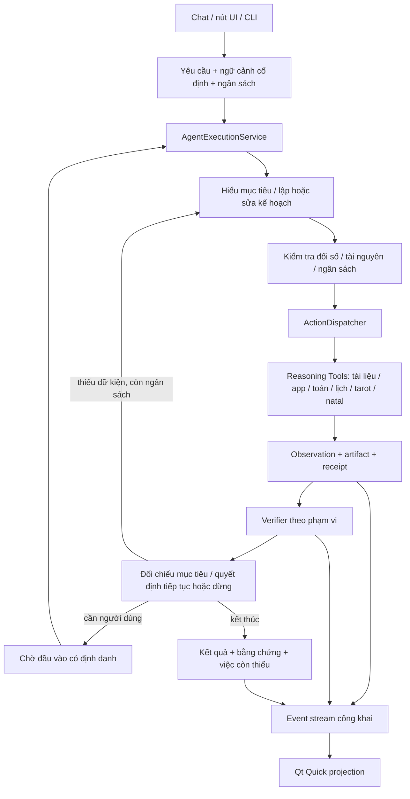

# RAT — một hệ điều phối reasoning agentic cho mọi khả năng

Ngày: 2026-10-25, Asia/Ho_Chi_Minh.
Trạng thái: Đợt 0 ĐÃ XONG; Đợt 1 và Đợt 3 MỘT PHẦN; Đợt 2 và Đợt 4 CHƯA ĐẠT; Đợt 5 CHƯA THÔNG QUA (chỉ có smoke chẩn đoán lỗi).
Xem [bằng chứng Đợt 0](../audit/rat_agentic_phase0_20261025/README.md),
[báo cáo kỹ thuật trung thực Đợt 1–4](../audit/rat_agentic_consolidation_20261025/README.md), và
[biên bản chẩn đoán thất bại Đợt 5](../audit/rat_agentic_live_acceptance_20261025/README.md).

Quy tắc: **“TẤT CẢ CHỨC NĂNG ĐỀU ĐI THEO REASONING AGENTIC.”**
Tài liệu này cụ thể hóa quy tắc trong `AGENTS.md` và `project_scope.md`.
Không thay research scope, Stage 0, dataset, prompt nghiên cứu hoặc policy đã freeze.
Không tuyên bố accuracy, chi phí, latency hoặc tối ưu stopping đã được chứng minh.

## 1. Quyết định kiến trúc

Một `AgentExecutionService` headless (`rat/engine/execution_service.py`) tiếp nhận mọi yêu cầu nghiệp vụ của RAT.
Service quản lý phiên thực thi và mở rộng `AssistantRuntime.run`; không xây thêm một vòng Agent cạnh tranh.
Chat, CLI và thao tác trực tiếp trong Qt Quick chỉ là các adapter đầu vào.
Capability cung cấp công cụ chính xác; UI dựng hình từ event/artifact đã quan sát.

Không cần gọi model để kéo cửa sổ, đổi theme, focus, cuộn, thu gọn hoặc mở một
panel đã có. Các thao tác trình bày này không thực thi nghiệp vụ. Đọc/tính/tìm/
chỉnh dữ liệu/lưu artifact/mở file hay app đều phải có execution và dispatcher.
Việc copy kết quả đã hiển thị giữ clipboard adapter; nếu cần đọc lại hoặc tạo
trích dẫn mới thì phần đó là operation có nguồn, không IO ẩn trong renderer.

## 2. Đối chiếu nền tảng đang có

| Thành phần | Đang có | Thay đổi cần làm |
| --- | --- | --- |
| `rat/engine/execution.py` | ExecutionRequest, context snapshot/hash, định danh | Mở rộng thành envelope thống nhất; lane là adapter nội bộ, không quyết định nghiệp vụ từ UI |
| `rat/engine/assistant_runtime.py` | Vòng model/tool, task state, controller, verification, reconciliation | Dùng làm vòng điều phối chung; bỏ các bypass theo domain |
| `rat/kernel/registry.py`, `dispatcher.py` | Schema, operation, artifact, events, cancellation | Bắt buộc mọi domain IO/effect đi qua; bổ sung ràng buộc đầu vào và observation |
| `rat/engine/verification.py` | PASS/FAIL/UNKNOWN, checker execution và answer | Giữ phạm vi check; bổ sung coverage, tránh suy PASS toàn bộ từ một check nhỏ |
| `rat/engine/completion.py` | TurnContract, ExecutionJournal, receipts, reconciliation | Là căn cứ hoàn tất; model không tự chứng nhận effect |
| `rat/engine/controller.py` | Predictor stopping thử nghiệm | Giữ opt-in có provenance; bản chưa fit không được quảng cáo là optimal stopping |
| `rat/ui/reasoning_worker.py` và worker factory hiện có | Off-thread execution và callback | Bọc service chung, không tự đọc/chọn đường giải domain |
| `QuickPDFController` | Composer, Finder, PDF, Reading và state projection | Chuyển thành adapter request/event; bỏ domain handler trực tiếp |

Các nhận xét trên là kết quả đọc source; không phải live acceptance.
Đặc biệt, tool Reading đã đăng ký không chứng minh có vòng model suy luận.

## 3. Hợp đồng yêu cầu

Mở rộng `ExecutionRequest` hiện có, không tạo envelope thứ hai lâu dài.
Schema đề xuất `rat.agent_request/v1`:

| Trường | Ý nghĩa / kiểm tra |
| --- | --- |
| `conversation_id`, `turn_id`, `execution_id`, `generation` | Bind mọi event, callback, artifact và cancellation |
| `origin` | `chat`, `ui_action`, `cli`; dùng audit, không thay quyền hay verifier |
| `goal` | Yêu cầu nguyên bản; không ghi đè bằng prompt từ màn hình hiện tại |
| `requested_action` | Operation và đối số người dùng chỉ định rõ, nếu có; không tự suy quyền cho action khác |
| `context_snapshot` | History, task state, selected resources, artifact ID/revision, hash; sao chép tại lúc submit |
| `resource_bindings` | File do người dùng chọn hoặc tool đã tìm thấy; path/hash/revision/page/range nếu có |
| `expected_outcomes` | Kết quả bắt buộc từ yêu cầu/action; model có thể đề xuất thêm nhưng không tự xóa điều người dùng yêu cầu |
| `budget` | Deadline, model calls, tool calls, prompt/completion token caps, số lần repair |
| `continuation` | Request ID và artifact revision chính xác khi trả lời câu hỏi bổ sung |
| `idempotency_key` | Chống double click / retry gây effect hai lần; phân biệt với một yêu cầu mới có chủ ý |

Giữ query sạch cho UI, model input riêng và có version. File/artifact quá hạn
phải báo stale; không âm thầm lấy phiên bản mới rồi dùng receipt cũ.
Đối số tool phải được registry kiểm tra; binding tài nguyên và ngân sách do
runtime kiểm tra trước dispatch, không để model hoặc QML tự xác nhận.

`requested_action` là ràng buộc thực thi do người dùng đưa, không phải đáp án
của planner. Một thao tác chính xác như mở app đã chọn có thể chỉ cần kế hoạch
một bước và kiểm tra receipt. Tác vụ diễn giải/tổng hợp phải có model nhận mục
tiêu và observation thật; không dùng template văn bản thay cho suy luận.

## 4. Vòng điều phối và điều kiện dừng

Các trạng thái đề xuất:

`accepted → planning → dispatching → observing → checking → deciding`

Từ `deciding`: `planning`, `waiting_input`, `completed`, `partial`, `unresolved`.
Từ mọi bước chưa terminal: có thể `cancelling → cancelled` hoặc `failed`.

1. Pin context, outcomes và budget; reject stale/không hợp lệ trước IO.
2. Planner nhận mục tiêu, tool schemas, observations và việc chưa đạt. Kế hoạch
   là structured data với dependency, không là raw chain-of-thought để đưa lên UI.
3. Validate quyết định và budget trước từng model/tool call; mọi call retry cũng tính phí.
4. Dispatcher thực thi tool; journal ghi kết quả thật, kể cả lỗi và effect đã xảy ra.
5. Verifier chạy tự động theo operation/claim; model không chọn bỏ checker bắt buộc.
6. Model nhận observation và check report để sửa kế hoạch, hỏi thêm, soạn draft
   hoặc đề nghị dừng. Runtime đối chiếu outcomes và quyết định terminal cuối cùng.
7. Final draft bị ràng buộc vào evidence/revision đã dùng. Sửa nội dung sau khi
   check làm check đó hết hiệu lực; phải kiểm lại hoặc đánh dấu chưa kiểm.

Hard stops: cancel, deadline, hết budget, resource stale hoặc protocol error.
Hết budget với việc chưa đạt trả `partial`/`unresolved`, không gắn `completed`.
FAIL quan trọng chưa sửa được không thành PASS nhờ model nói “đã đối chiếu”.
UNKNOWN có thể trả lời kèm giới hạn nếu outcome cho phép; nếu yêu cầu bắt buộc
xác minh thì giữ chưa hoàn tất. Tránh lặp tool cùng args và cùng revision khi
không có dữ kiện mới; ghi nguyên nhân không tiến triển rồi dừng/hỏi thêm.

Các cap là cấu hình có version, chưa chọn số tối ưu trong thiết kế này. Timeout
không giết worker đang dùng tài nguyên rồi khai báo sạch. App chặn Quit trước
`aboutToQuit`, hủy execution, giữ worker ownership và chỉ thoát khi đã drain;
nếu chậm thì hiện trạng thái đang dừng và cho người dùng quyết định bước sau.

### Adapter phương pháp CoT / structured reasoning

`MetaReasonerEngine` và `OnlineReasoningController` tiếp tục là implementation
chiến lược/policy hiện có, được runtime chung gọi qua adapter có execution ID,
input snapshot, cancellation và ledger cha. Chúng không là một sản phẩm khác
và UI không tự chọn lane để thoát khỏi Agent. Adapter trả candidate answer và
trace metadata; candidate vẫn qua checks và reconciliation của execution cha.
Mọi model request bên trong SC/TOT/REACT/PAL tính vào cùng ngân sách; cấm vòng
Agent gọi lại chính nó đệ quy hoặc tạo budget mới để vượt cap.

Phải ghi riêng model/version, prompt profile, strategy path, verifier, stopping,
normalization và policy provenance khi nối adapter. Policy chưa được duyệt
không tự bật, không fit lại từ hội thoại cá nhân. Chiến lược chưa hỗ trợ context/
tool contract của tác vụ thì báo unsupported, không giả định parity với harness.
Token generated và full inference cost là hai scope riêng; online timing không
thay bằng replay timing. Harness headless và thiết kế thí nghiệm giữ nguyên.

## 5. Tách thực thi, kiểm chứng và hoàn tất

Không gộp các trục sau vào một badge xanh:

| Trục | Ví dụ trạng thái | Bằng chứng |
| --- | --- | --- |
| Operation | success / error / cancelled | Dispatcher result + receipt |
| Check | PASS / FAIL / UNKNOWN | Checker ID/version, scope, evidence IDs/hash, nội dung đã kiểm |
| Coverage | complete / partial / unsupported | Danh sách claim được/không được checker hỗ trợ |
| Completion | completed / partial / unresolved / waiting_input | Turn reconciliation theo outcomes |
| Model | called / unavailable / failed | Model ID, request outcome, token/timing thực |

Mở file thành công chỉ nghĩa OS chấp nhận lệnh, không chứng minh người dùng đã
đọc. Đọc excerpt thành công không chứng minh answer đúng. Quote khớp chứng minh
đoạn trích tồn tại, không chứng minh mọi suy diễn từ nó. Không biết số trang thì
để trống; không mặc định trang 1. Checker lỗi trả UNKNOWN với lý do.

Không có model: công cụ xác định có thể hoàn thành action người dùng chỉ rõ
trong cùng execution; tác vụ cần diễn giải trả `model_unavailable`, giữ dữ kiện
và cho retry. Không thay bằng canned answer và đánh dấu suy luận thành công.

## 6. Thiết kế lại từng khả năng

| Khả năng | Luồng qua Agent chung | Phần xác định / checker |
| --- | --- | --- |
| Tìm file/app | Hiểu mục tiêu và filter → search tool → đọc candidates → chọn/giải thích hoặc hỏi rõ → mở đúng ID khi được yêu cầu | Lexical, fuzzy và catalog là thuật toán bên trong search tool; kiểm tồn tại, filters, binding, receipt |
| Hỏi tài liệu/PDF | Tìm đoạn theo câu hỏi → đọc vùng có locator → đánh giá đủ chưa → mở rộng đúng vùng nếu cần → soạn answer có nguồn → check | Extractor PDF/OCR chung; hash, quote/page locator, arithmetic; unsupported semantic entailment vẫn UNKNOWN |
| Tính toán | Trích biểu thức/đơn vị → hỏi rõ khi thiếu → calculate tool → check kết quả và cách đưa vào answer | AST/Fraction và verifier hiện có; không nhẩm bằng model thay calculator |
| Lịch | Xác nhận dữ liệu/ràng buộc → get_schedule/availability → tính xung đột → đề xuất → kiểm ràng buộc | Giữ domain timetable; không mở rộng Spider hoặc dựng UI giả như đã có scheduler |
| Tarot | Chuẩn hóa bài nhập → pin question, positions, reversals, jumpers, notes → model diễn giải từ observation → check đầu vào/citation/attribution → draft sửa được | Parser xác định; template cũ đã chuyển vào recovery, không dùng thay model |
| Natal | Xác nhận hồ sơ/vai trò/độ chắc giờ sinh → chart tool → model dùng placements/aspects đã tính → check các số liệu được trích | Bộ tính hiện có; không suy ra góc chiếu chỉ vì nạp được một profile |
| Sửa/lưu/xuất | Bind artifact revision → requested edit hoặc model revision → check lại phần đổi → commit revision mới qua dispatcher | Optimistic locking, provenance, giữ bản người dùng sửa, chống effect trùng |
| Tùy chọn | Mở panel là presentation; đọc/cập nhật config thành tool có schema và receipt | Chỉ thay đúng keys người dùng yêu cầu; chưa có projection thì báo chưa hỗ trợ |

Tarot/natal phải tách `input_fact`, `computed_fact`, `user_context` và
`interpretation`. Kiểm đúng lá bài/số liệu không xác nhận diễn giải là sự kiện
hoặc dự báo đúng. Không để model gán sẵn PASS cho “kiểm ranh giới”. Khi checker
chưa đủ năng lực kiểm ý nghĩa, giữ UNKNOWN và ghi phạm vi thực sự đã kiểm.

### Gợi ý khi gõ

Giữ độ phản hồi bằng request `preview` tới cùng service, chạy subplan tìm kiếm
xác định qua dispatcher, có cancellation/generation và observation tạm. Preview
không mở file, lưu nghiệp vụ hay kết luận thay Agent. Không gọi model mỗi phím.
Khi submit, Agent nhận query cuối, xét lại candidate refs/hash/filters rồi tiếp
tục vòng reasoning; preview hết hạn không được dùng làm căn cứ mà không validate.
Gọi đúng đây là bước retrieval cơ học trong hệ Agent; không tính preview đơn lẻ
là bằng chứng đã có suy luận model. Không giữ một SearchEngine nghiệp vụ riêng
trong controller sau migration.

### Ví dụ hai đường vào cùng một execution

- Chat: “Tìm quy chế, xem số tín chỉ tối thiểu mỗi kỳ, cho mình nguồn”.
  Agent search → locate → read → thiếu ngữ cảnh thì expand → draft → check;
  không đánh đồng tín chỉ mỗi kỳ với tổng tín chỉ tốt nghiệp.
- Bấm “Đọc thêm” trên nguồn: gửi goal mở rộng kèm source ID/hash/page/range;
  Agent dùng observation tương ứng, dispatch đọc vùng cạnh nó và kiểm locator.
  Không lấy 1.800 ký tự đầu file thay cho vùng xung quanh nguồn.
- Chat hoặc nút “Soạn bản luận”: cùng goal và reading artifact refs. Model
  nhận câu hỏi/vị trí thật; thay câu hỏi phải đổi input của model. Bản trả lời
  dùng facts từ tools, lưu draft mới; không làm mất bản đã sửa trước đó.

## 7. UI projection và hợp đồng quan sát

UI chỉ gửi request và nhận public event stream có `execution_id`, `generation`,
`sequence`, loại event, artifact refs và payload. Tái sử dụng `ExecutionEvent`
hiện có rồi mở rộng schema có version; không tạo nguồn trạng thái song song.
Các event planning/operation/check/final chỉ sinh khi bước đó thật sự xảy ra.
Callback sai execution/generation bị bỏ; subscriber không làm thay domain logic.

Public trace gồm việc đã thực hiện, nguồn, kết quả phép tính, lỗi/check/việc còn
thiếu và lý do dừng ngắn. Không hiển thị raw completion nội bộ/private CoT.
Không dựng sẵn chuỗi “Tìm → Đối chiếu → Nguồn” toàn done khi chưa có event.

Minor UI đề xuất cho lần triển khai đầu: dưới answer hiển thị riêng
“Đã đọc nguồn · Chưa xác minh nội dung” khi tương ứng với evidence thật.
Đây là thay đổi nhìn thấy được để nhận diện phiên bản; chưa sửa UI ở lượt thiết kế.

## 8. Lộ trình triển khai và điều kiện giao

| Đợt | Thay đổi cụ thể | Điều kiện xong | Trạng thái (2026-10-25) |
| --- | --- | --- | --- |
| 0 — sửa tính trung thực | Bỏ gán PASS trong selected QA; bỏ bước UI giả; đánh dấu synthesis template hiện tại chưa có model loop | Negative probes không nhận PASS; docs không gọi registration là Agent thật | **ĐÃ XONG** (Xem `audit/rat_agentic_phase0_20261025`) |
| 1 — execution chung | Mở rộng ExecutionRequest (`rat.agent_request/v1`), AgentExecutionService bọc runtime, resource bindings/budget/idempotency/event lifecycle và worker kết nối | Chat và ui_action đi cùng service; không domain dispatch từ QML/controller | **MỘT PHẦN** (Service và worker đã nối, controller còn bypass cục bộ) |
| 2 — lát cắt PDF | Chuyển selected QA thành tool recipe/subplan trong runtime; locator-aware expand (`expand_document_context`); answer/check/reconcile chung | Câu hỏi cần đọc thêm thực sự thêm tool; thiếu dữ kiện giữ UNKNOWN/hỏi thêm | **CHƯA ĐẠT** (Selected QA vẫn là 1-call cố định 3000 ký tự đầu; chưa đưa expand vào vòng reasoning) |
| 3 — Reading/Natal | Chuyển sang Plugin Tool Packs (`divination`, `astrology`), gọi model client trong `synthesize_reading_draft`, trả `model_unavailable` khi offline, `ReadingVerifier` | Câu hỏi/context tới model; không gán Mercury–Saturn thiếu dữ liệu; giữ bản người dùng sửa | **MỘT PHẦN** (Pack và ReadingVerifier đã có; controller còn gọi thẳng dispatcher) |
| 4 — Finder và phần còn lại | Preview subplan (offline reranker/coordinator) + committed Agent search (Tab adopt & submit); app/math/lịch/config qua cùng boundary | Inventory mọi entry point có contract, tool, checker, projection và bằng chứng | **CHƯA ĐẠT** (Finder chưa chuyển sang AgentExecutionService; chưa có tool/checker cấu hình) |
| 5 — acceptance | Hội thoại production UI/backend thật, lưu prompt/response/failure/screenshots | Kiểm từng journey thật; không dùng fixture hay ảnh prototype thay acceptance | **CHƯA THÔNG QUA** (Smoke test có lỗi giữ lại: thiếu expand, click trượt, compact ratio 39.27%) |

Không thêm domain mới trong migration. Không xóa code/recovery để đạt số LOC.
Chỉ gỡ adapter cũ khi có replacement, callers và hành vi đã kiểm; giữ lịch sử.
Không giữ hai đường nghiệp vụ “nhanh cho UI” và “agent cho chat” sau closeout.

## 9. Kiểm chứng thiết kế khi triển khai

Software checks dùng synthetic có nhãn rõ, tập trung hành vi thay vì nhãn UI:

1. Chat và button tương đương: goal/resource refs cùng nghĩa → cùng service,
   dispatcher/verifier, không cần yêu cầu model sinh câu chữ giống hệt.
2. Answer sai so với source không được PASS chỉ vì tool read thành công.
3. Retrieval thiếu → model chọn mở rộng; locator/hash được giữ; file thay đổi
   trước khi trả lời → stale, không nguồn trang giả hoặc check cũ.
4. Reading: input model chứa đúng question/positions/reversals/jumpers/notes;
   không model thì không có draft canned giả thành công; unsupported claim UNKNOWN.
5. Cancel/timeout/hết budget trong model/tool/repair: charge calls thực,
   không nhận callback trễ, không commit sau cancel; effect đã xảy ra vẫn được journal giữ.
6. Artifact edit: revision conflict được phát hiện; check theo revision cũ không
   chuyển sang draft mới; double click không xuất/mở/lưu trùng ngoài ý muốn.
7. Quit khi inference còn chạy hơn 1,5 giây: không thoát trước drain, không log
   clean khi worker còn chạy; tiếp tục hiện trạng thái chờ dừng.
8. Headless service import không khởi tạo Qt, index cá nhân, watcher hoặc tải model.

Chạy checks theo lát cắt thay đổi. Nếu thay research harness/threshold fitting,
chạy đúng bộ regression trong AGENTS; không dùng pass đó để nhận Stage 0.

Live acceptance: dùng production `PDFDesk.qml`, backend/model thật đang được
cấu hình; PDF thật có provenance URL/origin và SHA-256; lưu prompt, public response,
tool receipts/checks/failures và ảnh UI actual compact/full. Không tạo PDF fixture
hoặc inject canned assistant answers. Chạy app smoke không mở campaign research.
Không tự download model hoặc dùng campaign đang bị gate để lấp thiếu backend.
Nếu backend không sẵn, báo blocked acceptance và giữ software evidence riêng.

## 10. Bàn giao bắt buộc

Bảng kiểm kê (Inventory) các Entry Point sản xuất theo mã nguồn thực tế:

| Entry Point | Mục tiêu | Hợp đồng (Contract) | Operation / Dispatcher | Planner / Model | Observation & Receipts | Checker thực tế | Stopping & Budget | UI Projection | Bằng chứng phần mềm | Bằng chứng thực tế (Live) | Giới hạn thực tế |
| --- | --- | --- | --- | --- | --- | --- | --- | --- | --- | --- | --- |
| **Chat / Free-text** | Trả lời câu hỏi tổng quát bằng suy luận và công cụ | `ExecutionRequest` (`rat.agent_request/v1`), origin=`chat` | `AgentExecutionService.execute` -> `AssistantRuntime` | Live model (`qwen3:4b-instruct`) hoặc fallback thông báo | Output công cụ, tokens, receipts | `VerificationEngine` (answer check) | Deadline, max_steps, max_tokens | `PDFDesk.qml`: `lastAssistantAnswer`, event timeline | `test_agent_execution_service.py`, `test_execution_flow.py` | `artifacts/qtquick_only_20261025/live2/model-calls.json` | Phụ thuộc vào model local sẵn có |
| **Document Q&A** | Trả lời câu hỏi bám sát tài liệu PDF đang mở | `ExecutionRequest` với `resource_bindings` (path, sha256) | `read_document` qua `selected_document_qa` | 1-call model nhận trích đoạn 3000 ký tự đầu | Đoạn trích text, sha256 | `VerificationEngine` (trả `UNKNOWN` khi suy luận thiếu bằng chứng) | 1-call budget cứng | Answer card, citation tags, page viewer | `test_selected_pdf.py`, `test_quick_pdf.py` | `artifacts/rat_agentic_live_acceptance_20261025/` (thất bại: thiếu thông tin) | Chưa có vòng mở rộng tự động khi excerpt thiếu dữ kiện |
| **Finder & Adopt** | Tìm kiếm tài liệu, app và đưa vào bàn làm việc Agent | Gõ phím: preview. Tab: adopt file | `progressive_search`, `find_applications`, reranker | Reranker offline; adopt submit query | Candidates (`finderHits`), snippet | Kiểm tra file path tồn tại | Limit=10 hits, 300ms preview | `PDFDesk.qml`: `finderHits`, `finderAdoptAction` | `test_quick_finder_flow.py`, `test_semantic_reranker.py` | `artifacts/agentic_finder_build23_20261025/` | Chưa chạy qua AgentExecutionService |
| **Calculator** | Thực hiện phép tính số học chính xác | `ExecutionRequest` với requested_action `calculate` | Tool `calculate` trong capability `math` | AST evaluator | Kết quả số học | Đánh giá trực tiếp từ AST (chưa có verifier độc lập) | Tức thì | Answer text, verification PASS/UNKNOWN | `test_agent_execution_service.py` | Unit test | Không giải phương trình phức tạp |
| **Reading Desk** | Phân tích bài Tarot và bản đồ sao | `prepare_reading_spread`, `load_reading_profile`, `synthesize_reading_draft` | Plugin packs `divination`, `astrology` qua Dispatcher | Model client; trả `model_unavailable` khi offline | Lá bài nhập, góc chiếu Swiss Ephemeris | `ReadingVerifier` thật sự trong `verification.py` | Model single-call, timeout 45s | `ReadingDesk.qml`, thẻ bài, biểu đồ, draft editor | `test_plugin_tool_packs.py`, `test_reading_session.py` | `artifacts/reading_turn1_20261025/report.json` | Controller gọi dispatcher trực tiếp, chưa qua service |
| **Timetable** | Phân tích lịch học, tìm giờ trống | Pack `timetable` (mặc định tắt) | `TimetableCompositor` qua tool pack | Thuật toán ràng buộc | Lịch học, xung đột, giờ trống | Thuật toán kiểm tra xung đột | Deterministic solver | `view_schedule` factory | `test_timetable_compositor.py`, `test_plugin_tool_packs.py` | `artifacts/qtquick_only_20261025/live/state/club_schedules.json` | Spider adapter đã tách riêng |
| **Context Expand (Nút Đọc thêm)** | Mở rộng đoạn trích tài liệu xung quanh vị trí tìm thấy | Gọi `op.handler` trong controller (cần sửa sang dispatcher) | `expand_document_context` | Deterministic tool | Đoạn text mở rộng ngữ cảnh trước / sau | Chưa có verifier độc lập | 1 bước, tối đa 2000 ký tự | Excerpt inspector trên `PDFDesk.qml` | `test_selected_pdf.py` | Chưa có live trace | Controller đang bypass dispatcher |

Chỉ nhận “mọi chức năng theo reasoning agentic” khi inventory production không
còn bypass nghiệp vụ và các lát cắt đã có bằng chứng tương ứng. Không suy từ sơ
đồ, tên class, tool registration, số bước UI, test pass hoặc code Qt Quick.

Lượt thiết kế ban đầu chỉ khảo sát source. Cập nhật Đợt 0 ngày 2026-10-25:
đã bỏ override PASS/trang giả trong selected QA, chặn synthesis template qua
dispatcher và đổi nhãn UI chưa kiểm chứng. Chưa nối model mới hoặc service
chung; Qt import abort nên chưa xác nhận UI/live acceptance. Không có kết quả
model quality từ các thay đổi này; xem evidence Đợt 0 ở đầu tài liệu.

Cleanup sau Đợt 0: template không còn trong runtime, script Reading kiểm tra
`model_unavailable` thay cho sáu bước CoT giả, và import presentation không tự
nạp Qt. Evidence và recovery: [cleanup](../audit/rat_agentic_phase0_20261025/cleanup/README.md).

Cập nhật Đợt 1–5 ngày 2026-10-25:
Đã thiết lập khung điều phối `AgentExecutionService`, `rat.agent_request/v1`,
các plugin packs động (`divination`, `astrology`, `timetable`) và `ReadingVerifier`.
Tuy nhiên, Đợt 2 (mở rộng PDF trong runtime) và Đợt 4 (Finder qua service) chưa đạt;
nút "Đọc thêm" trong controller vẫn gọi trực tiếp `op.handler`.
Nghiệm thu Đợt 5 bị giữ lại lỗi do thiếu mở rộng ngữ cảnh khiến mô hình không trả lời
được câu hỏi về BEST-Route, cùng lỗi tọa độ chuột và ngưỡng trong suốt.
Cần hoàn thiện kỹ thuật Đợt 2 trước khi tổ chức nghiệm thu lại.
