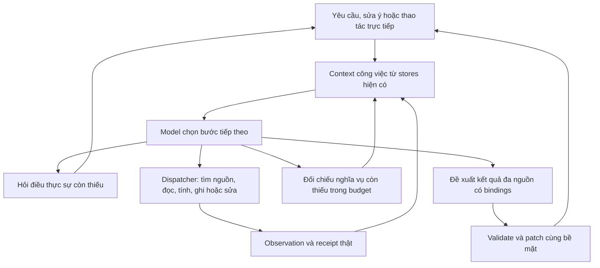

# Vì sao RAT còn rời rạc và cách xử lý

Ngày: 2026-10-14, Asia/Ho_Chi_Minh. Kết quả từ audit source hiện tại, đối chiếu
artifacts cũ và nghiên cứu nguồn chính thống. Đây là chẩn đoán và thiết kế đề
xuất; chưa thay runtime, chưa thử app đang chạy, chưa có model calls mới hoặc
đo lường trải nghiệm sau thay đổi. [Manifest audit](../audit/rat_cohesion_research_20261014/source_manifest.json)
ghi phạm vi và hashes source đã đọc.

**Kết luận chính.** RAT đã thống nhất ô nhập và có nền tảng agent thực thi dùng
chung. Tuy nhiên, phần hỏi bổ sung, tiếp tục công việc và trình bày vẫn xoay
quanh từng operation/artifact. Người dùng phải nối các kết quả thành việc mình
muốn làm. Bổ sung tìm trang, đọc trang và bảng trong lượt trước đã mở rộng khả
năng thao tác; các thay đổi đó chưa xử lý tận gốc vấn đề liền mạch.

Đề xuất chuyển đơn vị thiết kế sang **một công việc có mục tiêu, nguồn, kết quả
đang sửa và điều kiện hoàn thành xuyên nhiều lượt**. RAG/tìm kiếm là một khả
năng lấy nguồn trong công việc đó. Giữ kernel, stores, revisions và dispatcher
hiện có; tập trung nối các khoảng trống trước khi thêm chức năng khác.

**Chẩn đoán từ source.** Các tham chiếu dưới đây phản ánh source được ghi hash
trong manifest, không mô tả bản đóng gói hoặc cửa sổ người dùng đã thử.

| Điểm quan sát | Bằng chứng | Hệ quả đối với công việc |
| --- | --- | --- |
| Có agent loop, contract và đối chiếu effects thật. | `assistant_runtime.py:768`, `:841`, `:1063`; `completion.py` | Nền tảng đã có giá trị. Không cần thêm một framework/controller thứ hai để bắt đầu. |
| Actor context chưa nhận current contract/journal như một bức tranh thống nhất. | [assistant_runtime.py:608](/Users/thundercock2/Documents/Github/multi-step-structured-reasoning/rat/engine/assistant_runtime.py:608) ghép notes, task state, sources, turn refs và metadata riêng. | Runtime biết nghĩa vụ thật, nhưng model phải suy lại tiến độ từ nhiều mô tả rời nhau. |
| Compiler context đã tồn tại nhưng chưa có caller trong runtime. | [context_snapshot.py:830](/Users/thundercock2/Documents/Github/multi-step-structured-reasoning/rat/engine/context_snapshot.py:830); tìm toàn `rat/` không có import/caller ngoài module. | Một phần nền tảng đang ở B1, chưa tác động tới trải nghiệm. Đây là phạm vi B1 có chủ ý, không phải lỗi bỏ quên wiring. |
| Thiếu input kết thúc vòng quyết định hiện tại. | [assistant_runtime.py:1126](/Users/thundercock2/Documents/Github/multi-step-structured-reasoning/rat/engine/assistant_runtime.py:1126); [views.py:94](/Users/thundercock2/Documents/Github/multi-step-structured-reasoning/rat/kernel/capabilities/views.py:94) dựng form từ các trường thiếu. | `needs_input` chưa quay lại actor trong execution đó; backend schema quyết định form. Text follow-up vẫn vào model ở lượt mới, nhưng chưa nối kín cùng phần nghĩa vụ đang chờ. |
| Submit form/click chạy dispatcher rồi refresh. | [omnibar.py:3919](/Users/thundercock2/Documents/Github/multi-step-structured-reasoning/rat/ui/omnibar.py:3919), `:3926`. | Thao tác riêng thành công chưa tự tiếp tục các phần còn lại của yêu cầu ban đầu. |
| Completion reconciliation được tính ở đường trả response. | [assistant_runtime.py:978](/Users/thundercock2/Documents/Github/multi-step-structured-reasoning/rat/engine/assistant_runtime.py:978), `:1005`; [completion.py:1133](/Users/thundercock2/Documents/Github/multi-step-structured-reasoning/rat/engine/completion.py:1133). | Có thể phát hiện partial/unresolved, nhưng phần thiếu chưa thành feedback chung để actor tiếp tục trong budget còn lại. Scoped answer repair đã có; nó không bao phủ mọi nghĩa vụ công việc. |
| View vẫn gắn một artifact/revision; provider chọn factory của operation. | [view_spec.py:56](/Users/thundercock2/Documents/Github/multi-step-structured-reasoning/rat/kernel/view_spec.py:56), `:164`; [assistant_presenter.py:88](/Users/thundercock2/Documents/Github/multi-step-structured-reasoning/rat/ui/assistant_presenter.py:88). | Nhiều công cụ tạo nhiều thẻ xếp dọc. Cùng dữ liệu chưa có một kết quả chung đổi cách trình bày theo yêu cầu đọc/so sánh/lập kế hoạch. |
| Bảng nhiều nguồn là bản sao có provenance, chưa theo dõi dependency sống. | [result_tables.py:31](/Users/thundercock2/Documents/Github/multi-step-structured-reasoning/rat/kernel/capabilities/result_tables.py:31), `:52`. | Đổi nguồn về sau chưa tự đánh dấu phần diễn giải/bảng phụ thuộc là cũ. Flag historical chỉ phản ánh lúc ghép bảng. |
| Lượt đang chạy giữ bản nháp và chặn lượt mới. | [omnibar.py:3596](/Users/thundercock2/Documents/Github/multi-step-structured-reasoning/rat/ui/omnibar.py:3596). | Có thực thi tuần tự an toàn; điều chỉnh giữa lúc chạy hiện cần Stop rồi gửi tiếp. Chưa có steering đồng thời. |

Một số tài liệu có trạng thái lịch sử: ADR-003 còn nói chưa triển khai dù core
completion đã có; ADR-004 còn là thiết kế trong khi compiler B1 đã tồn tại.
Đánh giá độ hoàn thiện phải dựa vào source, wiring và packet review tương ứng.
[Phân công B1](../audit/rat_context_B_assignment_20261014/prompt_antigravity.md)
chủ ý để B2 wiring sau review. Không nối một compiler chưa qua cửa review chỉ
để nhanh có demo.

Định hướng này cũng đã có trong [ADR-002](adr-002-rat-adaptive-interaction.md).
Vì vậy, kết quả nghiên cứu lần này là xác định chỗ chưa khép kín và cách nghiệm
thu, thay vì đặt lại tên cho cùng một đề xuất kiến trúc.

**Bằng chứng chất lượng hiện có còn hạn chế.** Bộ sách mới có 165 kiểm tra
headless và 3 Qt tests qua, gồm scripted search → read → note → table. [Báo cáo](../audit/rat_book_features_20261014/REPORT.md)
ghi rõ chưa có model/native conversation acceptance hoặc rebuild package.
Các kiểm tra đó xác nhận phần mềm, không chứng minh model biết phối hợp việc.

Pilot tính toán ngày 13/10 có những lượt không lỗi runtime nhưng không hoàn
thành yêu cầu ghi kết quả đúng nguồn: [1.5B summary](../audit/rat_calculation_live_20261013_1p5/smoke_summary.json),
[4B Instruct summary](../audit/rat_calculation_live_20261013_4b_instruct/smoke_summary.json).
Đó là development evidence trên source hashes lịch sử, không là đo chất lượng
bản hiện tại hoặc so sánh model công bằng. [Phân tích latency cũ](../audit/rat_latency_context_analysis_20261013/report.md)
cũng chưa đo tốc độ sau context/compiler mới.

Kiểm tra catalog hiện tại cho thấy **16 operations mặc định**, trước khi runtime
thêm operations theo phiên; schema compact serialize dài 9.016 ký tự. Đây là
kiểm kê source, không phải số tool trong mọi request, token count, hoặc bằng
chứng tool overload gây lỗi. Chưa có căn cứ chọn tool search hoặc thêm router
làm cách sửa đầu tiên.

**Nghiên cứu bên ngoài hỗ trợ hướng nào?** Các nguồn dưới cung cấp nguyên tắc,
mẫu thiết kế hoặc phương pháp đánh giá; không xác nhận RAT đã cải thiện.

| Nguồn chính | Điều có thể rút ra | Giới hạn khi áp dụng |
| --- | --- | --- |
| [Anthropic — Building effective agents](https://www.anthropic.com/engineering/building-effective-agents) | Phân biệt đường đi cố định với model chọn bước động; bắt đầu đơn giản và tăng độ phức tạp khi có lợi ích đo được. | Bài nền tảng năm 2024, không phải benchmark cho RAT hoặc khuyến nghị SDK hiện hành. |
| [Anthropic — Context engineering](https://www.anthropic.com/engineering/effective-context-engineering-for-ai-agents) | Context, công cụ rõ ràng và trạng thái có cấu trúc bên ngoài transcript hỗ trợ công việc nhiều bước. | Không chứng minh snapshot cụ thể của RAT đúng hay model nhỏ đủ năng lực dùng nó. |
| [Anthropic — Advanced tool use](https://www.anthropic.com/engineering/advanced-tool-use) | Tải tool theo nhu cầu có thể giảm overhead ở catalog lớn, nhưng thêm bước tìm tool. | Số liệu của hệ/model khác không suy thành lợi ích trên 16 operations hiện tại. |
| [A2UI — What is A2UI?](https://a2ui.org/introduction/what-is-a2ui/) | UI khai báo dùng component catalog và binding dữ liệu, tách khỏi mã thực thi do model sinh. | Là thiết kế giao thức, không là bằng chứng UX tốt. Qt có thể dùng nguyên tắc này mà không cài SDK mới. |
| [Microsoft Research — Magentic-UI](https://www.microsoft.com/en-us/research/blog/magentic-ui-an-experimental-human-centered-web-agent/) | Minh họa việc người dùng sửa kế hoạch, dừng và tiếp tục hợp tác trong cùng công việc. | Prototype web với nghiên cứu mô phỏng; không suy ra RAT cần multi-agent hoặc hỏi duyệt mọi bước. |
| [τ-bench](https://arxiv.org/html/2406.12045v1) | Đánh giá đối thoại với API bằng mục tiêu và trạng thái cuối; xét độ ổn định qua nhiều lần chạy. | Trạng thái cuối đúng vẫn chưa đủ đánh giá toàn bộ quá trình và UX. Không dùng kết quả model năm 2024 làm xếp hạng hiện nay. |
| [LLMs Get Lost In Multi-Turn Conversation](https://arxiv.org/abs/2505.06120) | Nghiên cứu chỉ ra khó khăn khi yêu cầu được cung cấp dần qua nhiều lượt. | Không phải thí nghiệm trên RAT; chỉ hỗ trợ nhu cầu đánh giá hội thoại, không xác định nguyên nhân lỗi tại đây. |
| [Anthropic — Multi-agent research system](https://www.anthropic.com/engineering/multi-agent-research-system) | Nhánh nghiên cứu độc lập có thể hưởng lợi từ nhiều agent; chia sẻ trạng thái và chi phí là đánh đổi. | Chuỗi đọc/sửa cùng một tài liệu phụ thuộc chặt chẽ, chưa có căn cứ chia thành nhiều agent. |

**Các phương án đã cân nhắc.** Nhận định dưới là đánh giá thiết kế cho RAT.

| Phương án | Điều giúp được | Quyết định đề xuất |
| --- | --- | --- |
| Thêm chức năng và chỉnh cùng ô chat | Mở rộng thao tác, cải thiện trình bày từng kết quả. | Tạm dừng mở rộng để giải quyết các điểm nối trước. |
| Tối ưu retrieval/RAG | Tìm đúng nguồn hơn. | Duy trì; không bao phủ hỏi bổ sung, effects hoặc đổi mục tiêu. |
| Đổi sang model mạnh hơn | Có thể cải thiện hiểu ý/chọn tool. | Chỉ thử sau baseline có raw traces và ngân sách được duyệt; không đổi mặc định từ giả thuyết. |
| Viết workflow riêng cho từng ví dụ | Dễ kiểm soát hành trình đã biết. | Chỉ dùng cho quy trình nghiệp vụ cố định; tránh thêm `prepare_DSA` hoặc màn hình cho mỗi câu mẫu. |
| Một coordinator, context chung và kết quả công việc đa nguồn | Nối tiếp ý định, thao tác và phần đang sửa. | Chọn làm hướng triển khai nhỏ nhất, dùng nền tảng hiện có. |
| Nhiều agents/framework hoặc model sinh code UI tùy ý | Có thể mở rộng năng lực sau này. | Hoãn đến khi có bottleneck và bằng chứng lợi ích cụ thể. |

**Thiết kế đề xuất có bốn phần gắn nhau.** Đây chưa phải behavior đã chạy.

1. **Một bức tranh công việc chung.** Dùng canonical history, task state,
   notebook, contract, journal và artifact store hiện có để cung cấp: mục tiêu
   hiện tại; ràng buộc do user nêu; nguồn/phần đang chọn; kết quả cần tạo/sửa;
   dữ kiện thiếu; effects đã commit; nghĩa vụ chưa đạt. Tách model proposal
   khỏi user facts và observed effects. Hoàn tất cửa review B1 rồi nối cùng
   compiler vào planner/actor/repair/finish ở B2, không thêm store hoặc LLM
   summarizer cạnh tranh. Snapshot là điều kiện cung cấp thông tin, chưa tự tạo
   năng lực phối hợp.
2. **Một vòng tiếp tục công việc.** Sau tool, thiếu dữ kiện, click, form submit
   hoặc lỗi có thể phục hồi, đưa observation cùng phần còn thiếu về actor khi
   yêu cầu vẫn đang hoạt động. Actor chọn làm tiếp, hỏi ngắn, trả phần hợp lệ,
   hoặc kết thúc. Trước final, dùng chính reconciler hiện có để đưa provisional
   unmet outcomes vào quyết định nếu còn budget; không tạo một checker khác.
   Không tự chạy lại mutation đã commit; dùng receipt/revision và kiểm tra
   idempotency ở thao tác cần thiết. Không biến mọi click xem dữ liệu thành
   một model call: thao tác trực tiếp vẫn có fast path; chỉ nối inference khi
   còn công việc người dùng đã nhờ.
3. **Một kết quả đang làm có thể sửa tiếp.** Mở rộng presentation contract
   từ một artifact sang tập tham chiếu artifact/revision, các block ID ổn định
   và patch lên cùng kết quả. Catalog ban đầu chỉ cần đoạn giải thích, trích
   dẫn, danh sách, bảng và nhóm kết quả. Nguồn/số liệu/action bind vào dữ liệu
   thật; lời giải thích là model-authored và được review riêng. Observation
   trung gian nằm trong trace/chi tiết khi không cần chọn nguồn; không xóa
   history. Không thêm panel hoặc composer khác, không sinh Python/Qt tùy ý.
   Lát cắt đầu có hình thức cụ thể: một phần ôn tập gồm giải thích ngắn, hai
   đoạn trích và nguồn trang. Danh sách tìm kiếm/toàn trang được thu vào chi
   tiết sau khi đã chọn, còn các block của phần ôn tập được cập nhật tại chỗ.
4. **Nguồn đổi thì biết phần nào cần xem lại.** Dẫn xuất dependency từ typed
   source refs/revisions đã khai, đánh dấu phần phụ thuộc cũ rồi cập nhật phần
   cần thiết khi được yêu cầu. Không suy mọi dependency từ lời văn và không
   tự sửa nội dung user đã biên tập. Đổi ý qua lượt mới tạo contract mới theo
   yêu cầu mới; không cho model hạ nghĩa vụ đã freeze trong execution cũ.
   Effects và bản lịch sử vẫn giữ đúng trạng thái đã xảy ra.
   Bảng snapshot lịch sử giữ nguyên; kết quả đang làm được đánh dấu cần xem
   lại rồi refresh. Note user đã sửa chỉ nhận cảnh báo nguồn cũ, không bị
   thay chữ tự động.

Sơ đồ không quy định mỗi mũi tên là một model call. Không bắt buộc thêm planner
hoặc UI-agent riêng. Ngân sách, timeout, quyền thao tác và giới hạn backend vẫn
phải được giữ. Thiếu bằng chứng hoặc hết budget thì trả rõ phần đã làm/chưa làm.

Trước mắt giữ Stop → gửi sửa đổi theo thực thi tuần tự hiện có. Nếu bổ sung
steering khi đang chạy, cần control-event queue và một owner execution: chặn
bước tương lai của execution cũ, đưa receipts đã commit vào lượt tiếp, từ chối
late writes. Không giả hủy client đồng nghĩa backend đã dừng hoặc effects được
rollback. Đây là phần sau, không là điều kiện để bắt đầu sửa trải nghiệm.

**Ví dụ để nghiệm thu, không phải transcript thành công.**

| Người dùng | Hành vi cần đạt trên cùng công việc |
| --- | --- |
| “Tìm phần binary search trong sách DSA, giải thích ngắn và lấy hai trích dẫn.” | Tìm/chọn sách, đọc trang cần thiết rồi trả một phần ôn tập có giải thích và hai nguồn trang; yêu cầu user chọn chỉ khi thực sự mơ hồ. |
| “Dùng cuốn tiếng Việt kia.” | Giữ yêu cầu ngắn/hai trích dẫn; giải quyết nguồn đang chỉ tới, đọc lại và cập nhật phần phụ thuộc. Nếu hai sách đều phù hợp, hỏi chọn một lần. |
| “Bỏ giải thích, chỉ ghi đúng hai trích dẫn.” | Tạo nghĩa vụ mới theo sửa ý, ghi từ nguồn thực và xác nhận bằng note events; không tiếp tục sản xuất phần giải thích đã bỏ. |
| “Mai học gì, chọn tài liệu vừa đủ để ôn trước buổi đó.” | Dùng lịch tuần và nguồn đã chọn để trả một đề xuất ôn có liên kết tài liệu. Không giả biết lịch hủy hoặc đã tạo sự kiện; công cụ hiện tại không cung cấp việc ghi sự kiện mới. |
| “Ngắn hơn nữa, giữ ví dụ với mảng.” | Cập nhật phần ôn, giữ nguồn và môn/buổi đang nói tới; không bắt tìm lại mọi thứ. |
| Nhấn Stop, rồi “Chỉ giữ hai trang đã đọc; chưa ghi chú.” | Giữ kết quả đã commit, không ghi muộn hoặc tự tiếp tục ý định cũ; báo rõ nếu có effect đã commit trước Stop. |

**Thứ tự triển khai và cửa kiểm tra.** Chưa gán deadline, effort hoặc ngân sách
model chưa được ước lượng/duyệt. Không mở rộng cả redesign trong một lần.

| Bước | Phạm vi cụ thể | Điều kiện chuyển bước |
| --- | --- | --- |
| 1 | Xác nhận packet sửa B1 đã qua review; hoàn tất B2 wiring context vào các call boundary. | Canonical values, refs, scope/freeze, cancel và native tool grammar được giữ; capture raw mock requests xác nhận actor thấy obligations và progress. Không suy speed-up từ số ký tự. |
| 2 | Nối thiếu input, direct interaction và unmet obligations vào vòng tiếp tục chung. | Software checks giữ lifecycle/effects. Sau đó có pilot model thật với ngân sách được duyệt: tìm → đọc → ghi, câu hỏi phụ và đổi mục tiêu. Nếu model chưa dùng được vòng này thì sửa nguyên nhân trước bước 3. |
| 3 | Một work presentation đa nguồn trong bề mặt chat hiện có. | Cùng dữ liệu có thể đọc/so sánh/sửa mà không mở một màn hình mới hoặc tích mọi thẻ trung gian. Block/action/source refs đúng revision. |
| 4 | Refresh phần phụ thuộc khi user đổi nguồn/dữ kiện; giữ user edits và lịch sử. | Chỉ phần bị ảnh hưởng được đánh dấu/cập nhật; không âm thầm thay kết quả không liên quan. |
| 5 | Nghiệm thu model thật và người dùng trên luồng tài liệu, rồi biến thể lịch + tài liệu. | Có raw traces và review nội dung/effects/interaction. Chỉ khi đạt mới tiếp tục tăng capability. |

Với B1/B2 đang có phân công implementation/review riêng, cần nối kế hoạch này
vào cùng chuỗi bàn giao. Không mở một nhánh triển khai core song song trùng
quyền sở hữu. Kế hoạch này không tự gửi lệnh sang chat hoặc người triển khai khác.

**Cách biết đã giải quyết vấn đề.** Đánh giá theo toàn hành trình, tách ba lớp:
contract/Qt software tests; model có thực sự chọn/làm/giải thích đúng; người dùng
có tiếp tục sửa việc dễ dàng. Cần cả ba; số lượng tính năng hoặc tests qua chỉ
trả lời một phần.

- Kết quả cuối đáp ứng yêu cầu và ràng buộc; nội dung, nguồn, trang và effects
  đều đúng theo review. Completed chỉ ở phạm vi được chứng minh.
- Những câu “đoạn đó”, “cái thứ hai”, “làm tiếp” trỏ đúng đối tượng/revision;
  thông tin đã có không bị hỏi lại vô ích; hỏi rõ khi thực sự mơ hồ.
- Sửa nguồn hoặc yêu cầu chỉ ảnh hưởng phần liên quan; lưu/sửa có receipts;
  không sửa nhầm hoặc báo lưu giả. Đây là yêu cầu nghiệm thu, chưa là tỷ lệ đo.
- Qt acceptance giữ draft/caret, focus, vị trí đọc và stable block identity
  khi cập nhật phần kết quả; compact/full không thực thi lại operation.
- Theo dõi số lần user phải nhắc lại dữ kiện, hướng dẫn gọi tool, chuyển màn
  hình hoặc tự nối kết quả; ghi cả các trường hợp thất bại, không chỉ demo đẹp.
- Đo online wall time, thời gian đến kết quả hữu ích đầu tiên và mọi call
  planner/actor/repair/finish, với prompt/completion tokens. Counts thiếu giữ
  unknown; không gán zero. Replay duration không là online latency hoặc full
  inference cost.

[Bộ tình huống đề xuất](../audit/rat_cohesion_research_20261014/acceptance_proposal.json)
có 12 hành trình thiết kế đã lộ, chưa có run hoặc nhãn chất lượng đo được.
Đánh giá tổng quát về sau cần nhóm biến thể mới được review trước khi chạy.
Có thể so theo các bước A: source hiện tại; B: context mới; C: vòng tiếp tục;
D: thêm work presentation, cùng dữ liệu/model/budget và counterbalance thứ tự.
Đây là phương án evaluation để duyệt, không phải chiến dịch tự được cấp ngân sách.

Nếu các lỗi chọn tool và theo dõi yêu cầu vẫn còn sau những bước này, mới thử
đổi model hoặc tool discovery trong một so sánh có raw artifacts. Nếu chất
lượng qua nhưng latency kém, đo bottleneck trước khi thêm worker/caching/gộp
calls. Không hứa kiến trúc tự bù được giới hạn năng lực model.

**Đề xuất ưu tiên tiếp theo:** hoàn tất một công việc từ đầu đến cuối với
context chung và vòng tiếp tục thật, rồi đưa kết quả đa nguồn lên cùng bề mặt.
Giữ RAT-AI-01/02/03 như các phần của hành trình đó khi lập kế hoạch, thay vì
giao thêm các feature độc lập. Chưa thay default model, tích hợp DocAI, chạy
pipeline NCKH hoặc đổi Stage 0; đây là nghiên cứu phát triển ứng dụng RAT.
