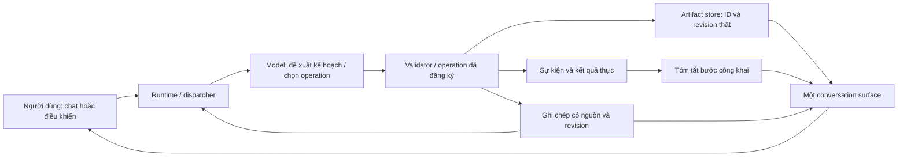

# Chuột: ngữ cảnh công việc và luồng thực hiện

2026-10-12. Triển khai app từ source; chưa build bản đóng gói. Yêu cầu đã được
người dùng xác nhận: người bạn nhận việc, ghi chép, làm rồi đưa kết quả; một
box chat với compact/full, có thể xem luồng suy luận. NCKH vẫn là ưu tiên dự án.

## Contract và đường dữ liệu

`WorkNotebook` thuộc `AssistantRuntime`, độc lập Qt, dùng RLock và generation
để chặn ghi muộn sau khi reset hội thoại. Ghi chép giới hạn 16 điều, mỗi điều
500 ký tự. Model context có phạm vi, nguồn, quote, revision và authority.
Ghi chép không tự persist. Xóa khỏi ghi chép loại khỏi active note context;
câu chat hoặc artifact cũ vẫn có thể chứa dữ liệu trước đó.

`record_work_note(text, source_quote, replace_note_id?, revision?)` xác thực
quote là đoạn người dùng đã nói, không lấy chỉ dẫn từ tài liệu làm lời người
dùng. Text đúng quote được đánh dấu trích lời; diễn giải khác vẫn là đề xuất.
Sửa có ID/revision; sai revision thất bại và giữ dữ liệu cũ. Người dùng có thể
xem, xác nhận, thêm, sửa, xóa ngay trong `NotebookPane`. Giá trị từ điều khiển
chỉ được ghi sau khi dispatcher chấp nhận. Không tự nhập annotation của plan
vào notebook: thử thật cho thấy model có thể diễn giải sai cả ràng buộc.

`select_work_results(artifact_ids)` nhận tối đa 6 ID đã tồn tại, hoặc [] để
thu kết quả đang hiển thị. Unknown ID thất bại trước mutation. Đây là chọn
tập kết quả chung cho công việc, không sinh renderer/code mới. Operation mới
thêm artifact/revision vào tập đang làm. Lượt hỏi tiếp chuyển cùng result host
sang câu trả lời mới; giữ canvas, selection và disclosure của kết quả đó.
Artifact store vẫn giữ kết quả cũ để tham chiếu; chat giữ phần lời và trace cũ.

`COMPANION_PERSONA` dùng chung cho hội thoại và actor: thân thiện, bình tĩnh,
đưa kết quả trước, không bắt buộc mỉa mai hoặc tự nói đã nhớ/làm. Nhân vật toàn
thân lớn đứng bên trái khung chat theo lựa chọn người dùng, dùng tài sản RAT
hiện có. Trạng thái gắn với worker/pending/result/error thực. Người dùng đã
chọn chuyển động vui vừa: idle thở/đung đưa, nhảy ngắn khi nhận việc, prop
ghi chép và emote khi chạm/có phản hồi. Click phản ứng vui và mở ghi chép,
không submit câu canned hoặc làm trò theo số click. Timer chỉ chạy khi hiện,
reduced motion giữ emote tĩnh. Không đổi geometry/focus của editor khi nhảy.

## Luồng suy luận công khai

`WorkTracePane` nhận `AgentStep` hoặc dispatcher event. `summarize_step` chỉ
đọc tên operation, args/result cần thiết, lỗi và artifact trạng thái; không
đọc `thought`, `raw_completion` hay `model_input`. Nó hiển thị dự định có nhãn,
nguồn đã đọc và phạm vi đọc, phép tính, kết quả lựa chọn, lỗi, thiếu đầu vào,
dừng lặp hoặc dừng do bộ điều phối. Chuỗi ngắn ở cạnh kết quả, chi tiết mở tại
chỗ trong cả compact/full. Trạng thái “đã trả lời” chỉ là model đã trả lời.

Plan khởi đầu là một lời gọi model thật với schema, `completed=[]` và status
in_progress/needs_input; model khai đã thực thi trong plan sẽ bị từ chối.
Đây là validation hợp đồng, không phải policy hiểu ý định hoặc optimal stop.
Không thay lời gọi thất bại bằng if/else intent hoặc câu trả lời thành công giả.

## Phạm vi, tradeoff và điều kiện xem lại

- Giữ typed operation/renderer để thực thi và UI an toàn, có revision; model
  chọn trình tự và kết quả. Chưa triển khai UI sinh tùy ý của ADR-002.
- Ưu tiên nguồn và sự thật của ghi chép hơn tự ghi nhiều: model phải chọn
  operation đúng. Model nhỏ có thể bỏ thao tác dù lời trả lời nói đã làm.
- Ghi chép theo phiên cho dễ xem/sửa; cần thiết kế quyền lưu, phân biệt chủ thể
  và review dữ liệu trước memory dài hạn hoặc profile.
- Tests chứng minh validator/lifecycle và thao tác Qt. Fixtures không đo AI.
  Live development smoke lưu raw calls, token counts và wall latency, không
  là nghiên cứu/benchmark hoặc full inference cost.

Xem lại khi model thật xử lý được continuation/correction/multiple sources
trên yêu cầu mới với review độc lập; khi số artifact/notes vượt phạm vi nhỏ;
hoặc khi cần memory lâu dài. Stage 0 của Qwen/Meta-Reasoner chưa thay đổi.

Implementation và artifacts: [audit companion](../audit/rat_companion_reasoning_20261012/REPORT.md).
