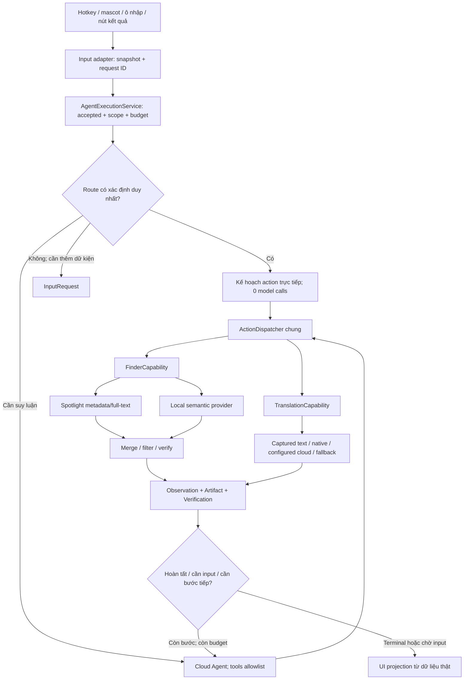
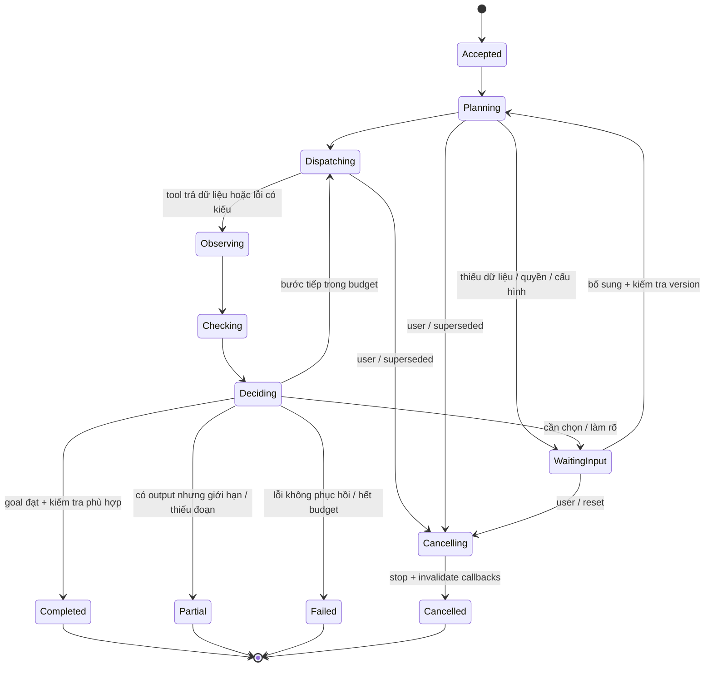

# RAT Mini — Finder + Translation, đặc tả triển khai v0.1

> **Quyết định hiện hành, 2026-10-26:** Mini là vertical slice tái sử dụng cho
> RAT chính. Dùng UI RAT cũ với một ô nhập, không chọn mode Tìm file/Dịch;
> routing và execution chung chọn tool. Bản hiện tại chỉ làm Spotlight và dịch
> snippet; vector/embedding/local LLM/Swift Translation và tối ưu tài nguyên
> được hoãn. Xem [quyết định Mini vertical slice](rat_mini_vertical_slice.md).
> Các phần thiết kế rộng hơn bên dưới là bản đề xuất ban đầu; không phải scope
> đang triển khai hoặc bằng chứng đã hoàn thành. M3 còn nút mode chưa đạt UX mới.

> **Cập nhật M5.11, 2026-10-27:** Người dùng chọn miễn phí và plug-and-play.
> Bản mặc định đóng kèm MT Anh ↔ Việt (OPUS-MT/Argos/CTranslate2), không phải
> local Agent LLM; cặp khác vẫn online. Thêm FileDialog dự phòng cho ảnh và
> tìm đồng thời scope Spotlight. Đọc [contract dịch local](contracts/local_translation.md)
> và audit theo phiên bản để phân biệt code/tool smoke/UI/recipient acceptance.

> **Cập nhật M5.4:** ⌥⇧D/chụp trực tiếp trong RAT đã được đưa vào
> [backlog](backlog/rat_mini_global_capture.md). Luồng hiện hành: macOS chụp bằng
> ⌘⇧4 → thả file ảnh vào RAT → tool OCR và dịch tự chạy. Không đăng ký global
> hotkey hay khởi động helper. Source M5.4 chưa kiểm thử.

Ngày: 2026-10-26, Asia/Ho_Chi_Minh. Trạng thái: đặc tả để review trước code.

Đầu vào đã chốt bởi người dùng: Mac M3 / 8GB unified memory; cloud Agent mặc
định (OpenAI / DeepSeek / Groq); action đơn giản không cần LLM; local Agent
tùy chọn ≤1.5B; Finder Spotlight + semantic local; embedding bundle <150MB;
dịch snippet qua clipboard/OCR, Apple hoặc cloud và fallback online;
chỉ hai capability nghiệp vụ; xây phần dùng chung cho RAT chính.

Các con số giới hạn, tên operation mới, cấu trúc module và ngưỡng acceptance
dưới đây là đề xuất kỹ thuật v0.1, chưa phải kết quả đo hoặc code đã triển khai.
Không thay đổi Stage 0, research protocol, model campaign hay tuyên bố NCKH.

## 1. Ranh giới sản phẩm và quyết định

- RAT Mini là product profile trong cùng repo/lõi RAT, không fork nghiệp vụ.
- Runtime chỉ đăng ký capability `finder` và `translation`. Infrastructure
  (task state, permissions, config, events, artifact store) là nội bộ, không
  đăng ký thêm utility/work-notes/web/timetable tools trong profile mini.
- UI: mascot + popover/ô nhập; danh sách file và thẻ dịch. Dùng cùng contracts,
  dispatcher, service và verifiers với RAT chính. Thông báo tiến trình là
  sự kiện thực thi công khai, không hiển thị private model reasoning.
- Nhánh deterministic là kế hoạch một action qua AgentExecutionService;
  không gọi LLM, không dựng câu trả lời giả. Nhánh model dùng cùng service
  và runtime loop. Ghi `route=direct|agent` và `model_calls` thật.
- Finder tìm file, không tìm/chạy app trong mini. Cho phép mở file hoặc reveal
  bằng thao tác rõ ràng của người dùng trên kết quả đã xác minh.
- Dịch snippet, không dịch dàn trang tài liệu, không tự đọc/dịch toàn bộ file.
- Cấu hình local LLM là tùy chọn nâng cao, không kèm tải model/khởi chạy server
  mặc định. ≤1.5B là điều kiện eligibility, không phải đảm bảo chạy đủ nhanh/ít RAM.
- Ưu tiên `sqlite-vec` cho spike: chạy trong SQLite, không cần vector server.
  Chroma là phương án thay thế nếu spike thất bại, không ship đồng thời hai store.
  Chưa pin version extension/model trước kiểm tra arm64, license, bundle và tải.
  Spike 2026-10-26: CPython hiện tại thiếu extension loading; dùng APSW riêng
  trong semantic provider là ứng viên đã qua storage smoke. Không thay driver
  SQLite của toàn RAT. Xem [báo cáo spike](../audit/rat_mini_spike_20261026/README.md).
- Không coi Spotlight là bao phủ toàn bộ máy hoặc miễn phí tài nguyên.
  Trả độ phủ/giới hạn; không tự sửa Spotlight Privacy hay rebuild chỉ mục hệ thống.

## 2. Tái sử dụng và các điểm bắt buộc refactor

| Mã hiện có | Giữ/tái sử dụng | Thay đổi cần làm |
| --- | --- | --- |
| `rat/kernel/contracts.py` | InputRequest, Artifact/Store, DispatchResult, ExecutionEvent | Bổ sung ánh xạ partial/cancel/error có cấu trúc, không tạo store song song |
| `registry.py`, `dispatcher.py` | Schema validation, dispatch, revision checks | Builder/profile nhẹ; allowlist thực thi và tool export |
| `engine/execution_service.py` | Entry point, direct action và runtime loop | Truyền budget thật vào từng provider/loop; không collapse needs_input/partial thành lỗi chung |
| `engine/assistant_runtime.py` | Tool feedback, observations, completion/verification | Không tự tạo timetable/db chính hoặc inject work_notes/work_context trong mini |
| `kernel/capabilities/__init__.py`, `kernel/__init__.py` | Public imports hợp lệ | Bỏ eager imports kéo domain khác vào mini, giữ tương thích RAT chính |
| `capabilities/finder.py` | Contracts, observation formatter, artifact/view patterns | Inject HybridFinder; tách app search khỏi mini; phân biệt provider lỗi và zero hits |
| `engine/finder_intent.py`, `progressive_search.py` | Intent/date/filter, snapshots, latest-query cancellation | Độc lập provider, scope/version; kiểm tra ngày theo timezone của request |
| `engine/rrf.py` | Rank fusion và gộp chunk về file | Adapter tên field, dedup theo file identity; score không phải xác suất đúng |
| `engine/verification.py` | VerificationSession, FinderVerifier | Bổ sung scope/readability/staleness; không PASS semantic relevance chỉ vì path tồn tại |
| `engine/embedder.py` | Lazy load, normalization, cache/evict pattern | Model manifest có pin/hash/license, ARM64 runtime, byte/RAM budget; không lấy model default làm quyết định |
| `document_intake/` | Vision OCR và text/PDF readers | Bounded extraction, cancel, provenance; không index/OCR nguyên máy |
| `rat/os/permissions.py`, hotkey/tray/single_instance | Native integration | Screen capture, clipboard freshness, app identity ổn định và lỗi riêng |
| `ui/mini_translate.py` | Mascot assets, interaction và backend code có thể cứu dùng | Chỉ còn projection/input adapter; dịch chuyển sang capability/shared providers |
| `tools/package_rat_translate.sh` | PyInstaller/bundle/signing scaffold | Mini dependency profile, CA/native libraries/licenses, reproducible manifest, thử máy sạch |

Lưu ý kiểm kê: AssistantRuntime hiện vẫn tạo compositor và đăng ký work-context
operations dù truyền registry. Chỉ truyền registry chứa hai capability chưa đủ.
Finder hiện dùng database metadata của RAT; Spotlight là adapter mới.
FinderVerifier hiện xác nhận schema/path existence, chưa xác nhận đúng ý định.
Transport cloud hiện có cần mở rộng headers/auth, CA, limits và usage accounting;
không giả định mọi provider OpenAI-compatible có cùng tập JSON Schema/streaming.

## 3. Kiến trúc và dataflow



### 3.1 Ingress và routing

1. Tạo `ExecutionRequest`: origin, goal/action, execution_id, generation,
   timezone, scope_version, budget và resource bindings. Capture input một lần.
2. Parser trả `direct`, `needs_input` hoặc `agent` kèm rule_id và args. Chỉ direct
   khi grammar/đầu vào xác định đủ operation; không dựa vào confidence tự khai.
3. Nút Dịch và truy vấn metadata rõ ràng → direct. Yêu cầu thiếu text → needs_input.
   Tìm kiếm mờ có thể direct tới hybrid search nếu query/filter rõ; Agent chỉ cần
   khi phải diễn giải, phân rã, nối bước hoặc hỏi làm rõ.
4. Không tự gọi cloud lúc gõ từng ký tự. Local preview debounce 200ms (đề xuất),
   còn cloud Agent chỉ chạy khi submit. Mỗi request mới hủy/supersede preview cũ.
5. Observation → verifier → decision. Kết quả direct không bắt buộc gọi LLM để
   viết lại. Trạng thái thiếu input giữ nguyên qua service và UI.
6. Nội dung file/clipboard/OCR là dữ liệu không tin cậy, không được thay đổi
   system instructions, tools allowlist, scope hoặc yêu cầu gửi thêm dữ liệu.

### 3.2 Finder tương tác

1. Chuẩn hóa query/filter; resolve scope_id nội bộ, không để model chọn tùy ý root.
   Ví dụ “tuần trước”: tuần lịch Thứ Hai–Chủ Nhật trước tuần hiện tại theo timezone
   đã snapshot; mặc định modified time và hiển thị chip để người dùng đổi created.
2. Chạy Spotlight có deadline/candidate cap, subprocess argv (không shell), NUL
   output, escaping predicate từ builder typed; không nhận raw predicate từ model.
   Scope bằng root đã duyệt rồi kiểm tra resolved path lại sau truy hồi.
3. Phát snapshot fast khi có. Semantic chạy khi query mô tả nội dung/ý nghĩa,
   khi kết quả lexical ít, hoặc người dùng yêu cầu tìm sâu; dùng query gốc và
   filters chung. Model/extension chưa sẵn sàng → lexical vẫn dùng được.
4. Semantic chỉ query đúng model/index version và roots hiện hành; lấy top chunks,
   gộp theo file; RRF trên thứ hạng, áp hard filters, dedup, ổn định thứ tự tie.
5. Kiểm tra resolved scope, file type, tồn tại, stat và readability bằng open thực
   có giới hạn (os.access chỉ là hint). Không đọc nội dung toàn file để kiểm tra.
   Symlink thoát scope bị loại; file cloud-only báo unavailable, không tự hydrate.
6. Hit bị loại được đếm theo lý do; vẫn trả các hit hợp lệ, kèm partial coverage.
   Không gán snippet nội dung nếu chỉ có name/metadata: Spotlight search content
   không cung cấp lại nguyên văn kMDItemTextContent để dùng làm evidence.
7. UI hiện hit, match reason, nguồn và coverage. Nhiều ứng viên cùng hợp lý →
   cho chọn; Agent không tuyên bố đã tìm đúng duy nhất chỉ theo top score.
8. Mở/reveal tái kiểm tra scope_version + file identity + accessibility; lỗi do
   file đổi/xóa → báo stale và cho refresh, không mở file thay thế cùng đường dẫn.

### 3.3 Index semantic nền

1. Onboarding gợi ý Documents/Desktop/Downloads, người dùng bật roots muốn dùng.
   Không tự tải model hoặc đọc/index mọi nội dung ngay lúc mở app lần đầu.
2. Bounded scan → metadata inventory → extract → chunk → embed local → transaction
   SQLite metadata + vectors. Tầng đầu hỗ trợ text/Markdown và PDF có text; file
   khác vẫn có metadata, ghi rõ semantic unsupported. Không OCR PDF hàng loạt ở v1.
3. Chunk theo tokenizer/model limit, overlap có cấu hình; lưu đoạn và char/page
   provenance. Query/passage prefixes, normalization và metric pin theo manifest.
4. Ưu tiên thao tác foreground; một index worker, embedding batch tối đa 8, giới
   hạn thread khởi điểm 2; pause theo memory pressure và battery policy.
5. Watcher debounce đổi file; re-stat sau extraction để tránh commit bản trộn.
   Rename/move/delete cập nhật mapping/vector; reconciliation bounded sau khởi động
   để bắt sự kiện bỏ lỡ. Không coi watcher là nguồn chân lý duy nhất.
6. Thu hồi root làm vô hiệu scope_version ngay, loại khỏi query trước rồi purge
   chunks/vectors/caches; job cũ không được ghi trở lại. Dọn cả WAL/backup theo
   retention; không hứa secure erase. Migration model build index mới rồi atomic
   switch, không trộn vector khác version; hỏng DB → quarantine/rebuild semantic.
7. Ngân sách khởi điểm: 10.000 files, 100.000 chunks, 512 tokens/chunk hoặc thấp
   hơn nếu model yêu cầu; 20MB/file, 200 trang/PDF. Vượt → skip/capped với lý do,
   coverage và nút cấu hình; không cắt nội dung mà vẫn ghi fully indexed.

### 3.4 Capture và dịch

1. Hotkey chọn nguồn đã cấu hình: clipboard hoặc region; selected text là action
   riêng. Không tự rơi từ OCR cancel/selection fail sang clipboard cũ.
2. Clipboard: snapshot text + changeCount; không đọc history. Selection: giữ app
   đích trước khi hiện popover, Cmd+C, đợi clipboard đổi có timeout; nếu không đổi
   thì báo không lấy được, cho dùng clipboard rõ ràng. Không nhầm focus RAT.
3. Region: quyền Screen Recording → người dùng chọn vùng → OCR local. Escape là
   cancelled. Lưu text/provenance trong bộ nhớ; xóa ảnh tạm kể cả lỗi/hủy.
4. Popover hiện ngay trạng thái đang lấy chữ/đang dịch; không hứa bản dịch xuất
   hiện ngay. OCR rỗng → báo riêng; cho sửa text rồi dịch lại.
5. Nhận diện source language local (NaturalLanguage nếu dùng macOS); text quá
   ngắn/mixed/không chắc → native/cloud có auto-detect thật, hoặc hỏi chọn source.
   Không gán en ngầm. MyMemory cần cặp ngôn ngữ xác định trước khi gọi.
6. Chọn backend theo policy: Apple nếu API + language pair + pack installed;
   nếu không thì một cloud adapter đã cấu hình (DeepL/Google chính thức/LLM).
   Free fallback chỉ gọi các provider đã bật trong settings; không phát tán text
   qua toàn bộ provider chỉ để thử. Google gtx cũ là unofficial, tắt mặc định.
7. Chunk text gốc theo paragraph/sentence rồi byte/token limit của provider;
   encode request sau khi chia. MyMemory tối đa 500 UTF-8 bytes/chunk. Không cắt
   giữa Unicode code point; kiểm tra segment IDs/offsets phủ đủ source text,
   giữ separator và thứ tự khi ráp. Giới hạn snippet đề xuất 8.000 ký tự, 64 chunks.
   Vượt cap → yêu cầu rút ngắn/chọn đoạn, không silent truncation.
8. Ưu tiên một provider cho toàn request; retry chỉ chunk transient lỗi, không
   dịch lại chunk thành công. Nếu chuyển provider sau partial thì đánh dấu nguồn
   từng segment/mixed backend. Chunk lỗi giữ placeholder/source, không ghi complete.
9. TranslationVerifier kiểm tra đủ segment, source hash, ngôn ngữ theo khả năng,
   rỗng/lỗi/quota, numbers/URLs/placeholders bị thay đổi (warning, không bảo đảm
   tương đương nghĩa). Translation service không bảo chứng semantic correctness.
10. UI hiện source/target/provider, bản dịch, warning/partial, copy output thực.
    Request mới/cancel không cho job cũ thay UI. Không tự ghi đè clipboard nguồn.

## 4. Tool contracts v1

Đây là contracts đề xuất; JSON examples là ví dụ cấu trúc, không phải kết quả run.
Input schemas máy đọc được: [rat_mini_tools.v1.schema.json](contracts/rat_mini_tools.v1.schema.json).
Schema là tài liệu, chưa được runtime load. Provider adapters phải inline/biến đổi
schema theo API hỗ trợ, còn local validation giữ toàn bộ constraints gốc.
Các giá trị `default` trong JSON Schema là mô tả; service phải materialize defaults.

### 4.1 Envelope chung và quyền sở hữu

Reuse ExecutionRequest, DispatchResult, Artifact và ExecutionEvent. Payload của
operation được chuẩn hóa (không thay raw DispatchResult bằng store/runtime mới):

```json
{
  "contract_version": "1",
  "status": "complete",
  "data": {},
  "warnings": [],
  "coverage": {},
  "error": null
}
```

- `status`: complete | partial | needs_input | cancelled | failed.
- `error`: null hoặc `{code, provider, retryable, message_key, details}`;
  details phải redact secrets/text; InputRequest biểu diễn trường/choice còn thiếu.
- execution_id/turn_id/generation, budgets, credentials, allowed roots, policy,
  capture permissions do service cung cấp; không phải model-controlled args.
- Mọi input schema `additionalProperties=false`; enforce kiểu, enum, kích thước,
  required và cross-field constraints ở server dù provider không hỗ trợ strict.
- `partial` là dispatch thành công có dữ liệu bị giới hạn, chưa đạt toàn bộ goal;
  `needs_input` giữ InputRequest; cancelled/failed không thành turn_completed.
  Verifier PASS cho contract không tự nâng partial thành complete.
- Artifact store cấp ID/revision. Source/result ref chỉ resolve trong session,
  đúng owner, generation, revision và scope hiện hành; không nhận path bịa từ model.
- Đề xuất TTL nguồn capture 30 phút, in-memory mặc định; hết hạn → source_expired.
  Không lưu raw text/ảnh/đường dẫn cá nhân vào log mặc định.

### 4.2 FinderCapability

| Operation / callers | Args hợp lệ | Output / checks |
| --- | --- | --- |
| `find_files` / model + direct | query: string 1..2000; scope_ids: known IDs (omit=active roots); filters: extensions/excluded_extensions, date_field=created/modified, from inclusive/to exclusive ISO8601 có offset, sort=relevance/newest/oldest; mode=auto/metadata/hybrid; limit int 1..20 mặc định 8 | finder_results artifact: query, effective_filters, scope_version, hits, coverage, provider_errors, clarification |
| `open_file` / explicit UI action | artifact_id, revision, resource_id | launch receipt từ OS, không khẳng định app đã render; revalidate trước open |
| `reveal_file` / explicit UI action | artifact_id, revision, resource_id | reveal receipt; cùng revalidation |

Hai action open/reveal không export cho cloud Agent ở mini v1. Handler từ chối
gọi nếu context không có user-initiated action; không chỉ dựa vào UI ẩn nút.
Giữ adapter tương thích `find_file_or_app`/`reveal_in_finder` cho RAT chính;
mini không export operation có thể tìm/chạy application.

Hit gồm `resource_id, title, path, file_identity, extension, size_bytes,
created_at, modified_at, match_sources[], match_reason, snippet?, snippet_ref?,
verification{exists, readable, in_scope, checked_at}, available_actions[]`.
Path thật chỉ ở local artifact/UI; cloud observation dùng resource_id và tên
bounded khi policy cho phép; không gửi tuyệt đối path hoặc toàn nội dung mặc định.
Snippet gửi cloud chỉ khi policy cho phép; không có snippet thì trả thiếu evidence.

Coverage gồm roots được query/blocked, Spotlight status (unknown nếu không xác
định được), semantic state, indexed/pending/skipped/capped counts nếu biết,
candidate_cap_reached và `exhaustive=false`. Không bịa exact count cho Spotlight.
Zero hits + provider error/coverage hạn chế → partial, không “máy không có file”.
Zero hits trong nguồn khả dụng → complete search + “chưa tìm thấy trong phạm vi”.

### 4.3 TranslationCapability

| Operation / callers | Args hợp lệ | Output / checks |
| --- | --- | --- |
| `capture_text` / explicit UI action | mode=clipboard/selection/region | captured_text artifact: text, source_kind, language_hint, source_sha256, captured_at, OCR metadata; cancelled/permission error có kiểu |
| `translate_text` / model + direct | đúng một trong text hoặc source_ref{artifact_id,revision}; source_language=auto hoặc supported tag; target_language mặc định vi; style=faithful/plain mặc định faithful | translation artifact: source text/ref/hash, detected language, target, text, segments, provider(s), completeness, warnings, verification |

Capture chỉ chạy sau thao tác người dùng, không export quyền chụp màn hình tùy
ý cho model. Backend selection/network allowance ở config, model không được
truyền endpoint/key/provider tùy ý. Model gọi translate(source_ref) để giữ nguyên
text người dùng thay vì phải chép lại text qua LLM. Nếu dùng inline text thì lưu
rõ model-authored hay user-provided; không giả rằng hai loại có cùng provenance.

Mỗi segment: `id, source_start, source_end, source_text, translated_text?,
provider, status, error?`. Offset theo Unicode code points của nguyên văn đã
snapshot; separators lưu rõ. Copy mặc định chỉ xuất bản dịch complete; partial
cho phép copy khi người dùng chọn, kèm nhãn rõ phần thiếu.

## 5. Agent/cloud policy và budget

- Adapter interface chung: tool definitions → normalized tool_calls/answer,
  usage(prompt/completion/total nếu có), finish_reason, provider_request_id,
  error code. Model IDs cấu hình/pin ở release manifest, không hardcode “latest”.
- OpenAI/DeepSeek/Groq qua provider adapters mỏng; kiểm tra native tool calling
  và schema subset trên model được chọn. Không remote-execute local Finder.
- API key ở macOS Keychain; config chỉ giữ key reference. Không ship key tác giả,
  không ghi raw Authorization hoặc query text trong URL/log chẩn đoán.
- Setup chọn provider Agent, provider dịch và free-fallback allowlist; hiển thị
  dữ liệu nào gửi cloud. Không hỏi lại mỗi lượt trong policy đã chọn. Không tự
  chuyển sang nhà cung cấp chưa bật khi hết quota/401/SSL lỗi.
- Model observation bounded (top 5 IDs/titles/metadata, snippet tối đa 240 ký tự
  mỗi hit nếu cho phép). Local embeddings/index không gửi ra cloud.
- Direct route: model_calls=0; LLM translation backend nếu được chọn vẫn là call
  dịch có tính chi phí, ghi riêng `translation_model_calls`, không quảng cáo 0 API.
- Đề xuất mỗi agent turn: tối đa 4 model calls, 6 tool invocations, 45s tổng,
  8.192 input tokens/call và 2.048 generated tokens tổng (adapter tokenizer hoặc
  conservative estimate; thiếu usage ghi unknown, không ghi zero). Giới hạn cả
  retry; deadline truyền xuyên suốt, không reset cho từng chunk/tool.
- Direct translate deadline 30s; metadata 2s soft budget, hybrid 8s soft budget;
  soft budget trả snapshot/partial, không hủy nhầm tác vụ khác. Tối đa 1 retry
  transient/provider trong budget, tôn trọng Retry-After; 401 không retry.
- Local ≤1.5B: explicit opt-in, quantized artifact/model hash, context cap; không
  preload cùng indexing. Chỉ phát hành như supported sau đo memory/latency/tool
  conformance trên M3 8GB. Cloud mode không được import/load local LLM weights.

## 6. State machine và lỗi



Cancel/supersede có hiệu lực ở mọi phase chưa terminal, kể cả checking/deciding.
Retry có budget là chuyển trạng thái trong cùng execution; nút Thử lại sau
terminal tạo execution mới có parent_id. Chỉ một terminal event/execution.
Không publish response/artifact từ generation cũ; handler kiểm tra trước commit.

| Code / tình huống | Kết quả / xử lý |
| --- | --- |
| input_empty, invalid_arguments, ambiguous_language/query | needs_input, hỏi đúng field/choice; không gọi model vô ích |
| scope_denied, scope_revoked, file_unreadable | loại hit/partial hoặc needs_input nếu không còn root; không tự nâng quyền |
| spotlight_unavailable, spotlight_timeout | semantic nếu có; coverage partial; không giả zero hits |
| semantic_not_ready, model_missing, index_incompatible | lexical tiếp tục; cho bật/tải/rebuild bằng action rõ ràng |
| file_missing, stale_resource, source_expired | refresh/chọn/capture lại; không tự thay resource |
| screen_capture_denied, accessibility_denied, selection_unchanged | thông báo đúng quyền/nguồn; clipboard chỉ theo lựa chọn riêng |
| capture_cancelled, superseded | cancelled; không toast lỗi và không gửi text online |
| ocr_empty, ocr_failed | needs_input sửa/chọn lại; không gán là mạng lỗi |
| apple_api_unavailable, language_unsupported, pack_missing | fallback theo policy; pack chỉ tải qua action rõ ràng |
| network_offline, timeout, provider_5xx | retry bounded/fallback allowed; partial nếu đã có segments |
| auth_invalid, quota_exceeded, rate_limited | 401/config error; quota/rate-limit có trạng thái riêng, Retry-After trong budget |
| tls_verification_failed | giữ TLS verification; lỗi có kiểu; chỉ chuyển provider nếu policy cho phép |
| provider_invalid_response, translation_incomplete | không nhận body lỗi làm bản dịch; partial/failed, giữ source |
| model_invalid_tool, model_invalid_args | reject trước dispatch; tối đa một repair trong call budget |
| budget_exhausted, memory_pressure | kết thúc partial/failed hoặc pause index; không giả thành công |

## 7. Quyền, lưu trữ và phát hành

| Tác vụ | Quyền/kiểm tra |
| --- | --- |
| Tìm/đọc file roots chọn | Files & Folders/khả năng truy cập thực; FDA chỉ cho vùng bảo vệ khi cần, không là điều kiện onboarding chung |
| Cmd+C selection ở app khác | Accessibility và/hoặc Automation tùy implementation thực tế; test theo app identity |
| OCR vùng màn hình | Screen Recording riêng; không coi Accessibility đã bao hàm |
| Global hotkey | Kiểm tra đăng ký thành công/xung đột; không đòi Input Monitoring nếu API đã chọn không cần |

Permission probe báo granted/denied/unknown; không hứa có API đọc đầy đủ trạng
thái FDA cho mọi tình huống. Test hành động thực, không coi os.path.exists hay
os.access là bằng chứng quyền đầy đủ. Quyền được cấp cho bản app/bundle đúng.

Người dùng chốt ngày 2026-10-26: chưa biết OS máy bạn, lấy mức cũ bảo thủ;
base compatibility target **macOS 14 Sonoma / arm64**. Apple helper hiện dùng installedSource API
theo macOS 26+ và phải availability-gate riêng. M3 chưa cho biết macOS version
máy bạn: chưa đo thực tế; v0.1 không hứa native translation trên mọi OS.
Trên macOS 14 dùng dịch cloud đã cấu hình; không load/call framework/helper mới
không tương thích. Compatibility target không thay bằng chứng chạy trên OS 14.

Lưu config/index dưới Application Support của app, không trong repo/bundle.
Scope default được resolve theo user hiện tại, không chép DB/path/key cá nhân.
Persist source chunks/index local; capture/translation history tắt mặc định.
Log mặc định giữ operation/status/timing/counts/provider usage, redact payload.
Acceptance bật recording cho mẫu đã chọn: prompt, response, failure, ảnh UI,
release/hash/OS; không đưa file cá nhân khác vào artifact.

Ship CA certifi cho toàn bộ HTTPS adapters, verify hostname/certificate luôn bật.
Đóng gói arm64 Qt plugins, sqlite-vec extension, ONNX runtime, OCR bridge và
helper với license/hash manifest; không link Python/CA/cache từ máy dev.
Ad-hoc signed build là development distribution; Developer ID + notarization
là release path nếu có tài khoản/chứng chỉ. Không gọi ad-hoc là notarized.

## 8. Acceptance criteria

Mỗi AC cần test/evidence được ghi nhận; bảng dưới là yêu cầu, chưa có AC nào được
coi PASS chỉ bởi tài liệu này. Fixtures phần mềm chỉ kiểm tra contract; UI/quality
acceptance dùng backend thật và tài liệu thật có provenance, URL/origin + SHA256.

| ID | Given / When | Kết quả bắt buộc |
| --- | --- | --- |
| ARCH-01 | Khởi tạo mini và export tools | Đúng finder/translation; không domain/work_notes/utilities tools; unknown operation bị reject |
| ARCH-02 | Import/start cloud mini | Không import timetable/astrology, load embeddings/LLM tự động, đọc DB chính hay khởi động indexer toàn phần |
| ARCH-03 | Cùng args qua direct và Agent | Cùng handler/result schema/verifier/artifact; trace ghi route và model_calls thật |
| ARCH-04 | Chạy main registry sau refactor | API hiện có còn hoạt động; tests service/runtime/finder hiện có phù hợp vẫn pass |
| ROUTE-01 | “Tìm PDF tuần trước” và nút dịch có text | 0 Agent model calls; ngày/filters được hiển thị đúng timezone |
| ROUTE-02 | Yêu cầu thiếu text hoặc có nhiều đích | InputRequest rõ ràng; không đoán nội dung/đích |
| AGENT-01 | Một lượt cần phân rã thật, cho mỗi cloud provider | Tool call thật → observation → check → kết quả; lưu provider/model/usage; không chỉ test HTTP 200 |
| AGENT-02 | Model gọi tool lạ/args sai/nội dung file ra lệnh | Reject/repair bounded; không vượt capability/scope/network policy |
| AGENT-03 | Offline/401/429/hết budget | Direct local còn dùng; Agent lỗi đúng loại; không âm thầm đổi nhà cung cấp |
| AGENT-04 | Local mode opt-in | ≤1.5B artifact pin; khởi động/cancel/unload có kiểm chứng hoặc ghi rõ experimental |
| FIND-01 | Root được cho phép có tên/file Unicode, space, newline | Parse subprocess an toàn; trả file đúng, không shell/predicate injection |
| FIND-02 | Corpus known metadata: ext/date created/modified | Tất cả positive/negative boundaries đúng, timezone/DST không lệch |
| FIND-03 | Query mô tả mờ VI/EN trên corpus frozen | Target sơ bộ ≥8/10 query có relevant file trong top5; labels chốt trước chạy, lưu toàn hits/failures; chưa đạt thì chưa claim semantic ready |
| FIND-04 | Spotlight có metadata/content match | fast snapshot; không bịa snippet đọc từ kMDItemTextContent |
| FIND-05 | Spotlight bị privacy exclude/timeout, semantic pending | UI báo coverage/partial; không tuyên bố không tồn tại file |
| FIND-06 | Semantic và lexical cùng file/nhiều chunks | Dedup một file, hard filters luôn giữ; RRF score không hiển thị như confidence |
| FIND-07 | File xóa/đổi/thay thế giữa search và click | Revalidation chặn stale; không mở resource thay thế |
| FIND-08 | Root revoke hoặc symlink thoát root | Không hit ngoài scope; query/worker cũ không phục hồi dữ liệu bị thu hồi |
| FIND-09 | File unreadable/cloud-only | Không hiển thị như file sẵn dùng; không tự tải iCloud; ghi rõ giới hạn |
| INDEX-01 | Bật semantic lần đầu | Chọn root/model rõ; manifest bytes <150MB toàn model+tokenizer+config, hash/license/ARM64 verified |
| INDEX-02 | Rename/move/delete, app tắt rồi mở lại | Watcher + reconcile không để stale vector gây hit sai |
| INDEX-03 | File đổi lúc extraction hoặc đổi embedding version | Không commit mixed content/vector; đổi index atomic |
| INDEX-04 | File/index vượt cap, DB hỏng, model thiếu | Pause/skip/degrade có lý do; metadata search còn dùng; không fake vectors |
| TRANS-01 | Clipboard/selection/region qua hotkey | Đúng source snapshot và popover; không focus-copy chính RAT |
| TRANS-02 | Selection không copy được, OCR cancel/rỗng | Không dịch clipboard cũ; phân biệt cancelled/empty/permission |
| TRANS-03 | Cặp ngôn ngữ Apple installed / thiếu pack / unsupported | Native thật khi khả dụng; fallback đúng policy, provenance rõ |
| TRANS-04 | VI/EN và một nguồn khác EN, source auto/ambiguous | Không hardcode en; source ambiguous hỏi hoặc dùng provider có autodetect |
| TRANS-05 | Unicode >500 UTF-8 bytes, emoji, newline, URL, dài sát cap | Mỗi MyMemory chunk ≤500 bytes trước encode; source coverage 100%; không silent truncate |
| TRANS-06 | Một chunk lỗi và provider trả HTTP200 có quota/error | Không coi là translation complete; giữ phần thành công/thất bại đúng thứ tự |
| TRANS-07 | Free fallback tắt, hoặc chỉ bật một provider | Không request tới provider ngoài allowlist, không bỏ verify TLS |
| TRANS-08 | Bản dịch thật trên bộ snippet đã review trước | VI↔EN + nguồn khác EN, numbers/URLs/tên riêng; human review ghi lỗi meaning/omission; các lỗi nghiêm trọng được xử lý trước release |
| TRANS-09 | Có source ref từ capture | Source hash/text không bị model viết lại; expired/mismatched ref bị reject |
| UX-01 | Gọi liên tiếp A→B khi A chậm | Chỉ B cập nhật UI; A cancelled/superseded; không QThread destroyed crash |
| UX-02 | Esc/hide/quit khi OCR/API/index đang chạy | Hành vi rõ; cleanup và terminal event đúng, không callback vào UI đã hủy |
| UX-03 | Mỗi vòng UI acceptance | Có một dấu phiên bản nhỏ được đề xuất và ảnh UI thật min/full liên quan, gồm lỗi |
| PRIV-01 | Setup cloud/inspect config/log/bundle | Key chỉ Keychain; không key tác giả, raw clipboard/ảnh/path trong log mặc định |
| PRIV-02 | Tắt root/xóa data, app restart | Scope vô hiệu ngay, purge/reconcile đúng; ghi rõ retention/WAL/backup |
| PKG-01 | Cài từ ZIP trên M3 8GB user sạch, không Python dev | Mở app, tìm/dịch thật; CA/Qt/extension/helper assets đều tự đủ |
| PKG-02 | Deny từng quyền, rồi grant trên bản app cài | Chức năng tương ứng degrade/recover, quyền không liên quan không bị yêu cầu |
| PKG-03 | Mất mạng / không API key / thiếu Apple pack | Local Finder còn dùng; dịch/Agent báo capability availability trung thực |
| PERF-01 | M3 8GB, cloud mode, không indexing | Mục tiêu idle ≤250MiB total process tree; foreground translation/search ≤1GiB; đo RSS/footprint và pressure, không suy từ kích thước model |
| PERF-02 | Indexing bounded + tương tác foreground | Mục tiêu total ≤1.5GiB, không sustained pressure vàng/đỏ do RAT; worker pause/throttle có tác dụng |
| PERF-03 | Warm/cold đo riêng ≥20 lượt cùng release | Mục tiêu UI feedback p95 ≤150ms; fast metadata snapshot p95 ≤1s; semantic warm p95 ≤2s trên corpus khai báo; lưu p50/p95/raw timings |
| PERF-04 | Dịch native/cloud | Báo time-to-popover, capture/OCR/provider/total riêng; latency cloud là số đo theo mạng/provider, không bảo đảm tức thì |

RAM/latency/quality targets là engineering release gates đề xuất. Nếu không đạt,
ghi kết quả và đổi cấu hình/phạm vi có giải thích; không sửa ngưỡng sau khi đo rồi
gọi đạt mục tiêu cũ. RSS không phải toàn unified-memory/system pressure; report
cả process tree, worker, model cold/warm, corpus và app/network conditions.

## 9. Trình tự triển khai và bằng chứng bàn giao

1. **Spike rủi ro trước:** trên target OS, `mdfind` scoped/full-text, native language
   pairs/helper, sqlite-vec packaged arm64, embedding VI/EN <150MB và memory.
   Không tải/chạy local LLM hoặc research campaign để hoàn tất tài liệu.
2. **Profile/core:** tách imports, registry đúng hai capability, service giữ đầy
   đủ needs_input/partial/cancel/budget; regression RAT chính. Chưa build UI mới.
3. **Finder vertical slice:** Spotlight → verified artifact → UI action; sau đó
   semantic index → fusion → coverage/revalidation. Dùng chung main ngay từ code.
4. **Translation vertical slice:** capture → capability → native/cloud/fallback
   → segments/verifier → projection; chuyển logic khỏi mini_translate.py.
5. **Cloud Agent:** adapters + Keychain + observation policy + loop budget;
   chứng minh direct 0 Agent calls và multi-step thật với mỗi provider.
6. **UI/package/target acceptance:** version badge, live screenshots, corpus
   provenance, API/failure traces, memory/latency và file manifests. Local LLM
   advanced option chỉ được gọi supported khi qua gate riêng.

Mỗi bàn giao ghi riêng: contracts đã làm, UI projection đã làm, direct lane đã
nối, model loop đã chạy thật, target packaging/permissions đã thử. Tests không
thay live acceptance; app acceptance không thay research campaign evidence.

Các điểm còn cần xác nhận/đo: chạy thử compatibility target macOS 14; provider/model/key sẽ dùng
cho acceptance; artifact embedding đạt ARM64/byte/quality gate; credentials
Developer ID nếu chọn notarized release. Chúng không ngăn code các contracts
và profile đã độc lập với provider.

## 10. Nguồn kỹ thuật đã đối chiếu

- [Apple: Translation và LanguageAvailability](https://developer.apple.com/documentation/translation/): runtime capability/pack checks thay giả định theo chip.
- [Apple: Files and Folders](https://support.apple.com/guide/mac-help/control-access-to-files-and-folders-on-mac-mchld5a35146/mac) và [Screen Recording](https://support.apple.com/guide/mac-help/control-access-to-screen-and-system-audio-recording-mchld6aa7d23/mac): quyền theo chức năng, không gộp Accessibility.
- [Apple: Spotlight indexing](https://support.apple.com/en-gb/102321) và [kMDItemTextContent](https://developer.apple.com/documentation/coreservices/kmditemtextcontent): index/coverage và giới hạn lấy content attribute.
- [sqlite-vec](https://alexgarcia.xyz/sqlite-vec/): embedded SQL extension, không cần server. Version pin và packaging vẫn phải spike.
- [intfloat multilingual-e5-small ONNX files](https://huggingface.co/intfloat/multilingual-e5-small/tree/main/onnx): upstream liệt kê 470MB FP32, 235MB O4, 118MB qint8 có tên avx512_vnni. Đây là cảnh báo chọn artifact/ARM64, không phải kết luận artifact đó đã chạy hoặc không thể chạy trên M3; chưa chọn model.
- [MyMemory API](https://mymemory.translated.net/doc/spec.php): q tối đa 500 UTF-8 bytes, langpair bắt buộc; adapter cần language detection và chunking trước encode.
- [DeepSeek tool calls](https://api-docs.deepseek.com/guides/tool_calls/) và [Groq tool use](https://console.groq.com/docs/tool-use/overview): kiểm tra model/API thực; không suy ra tương đương từ OpenAI-compatible.

Các trang web có thể thay đổi; khi triển khai phải pin artifact/dependency và lưu
phiên bản docs/API dùng cho release. Không dùng đặc tả này làm bằng chứng đã đo.
