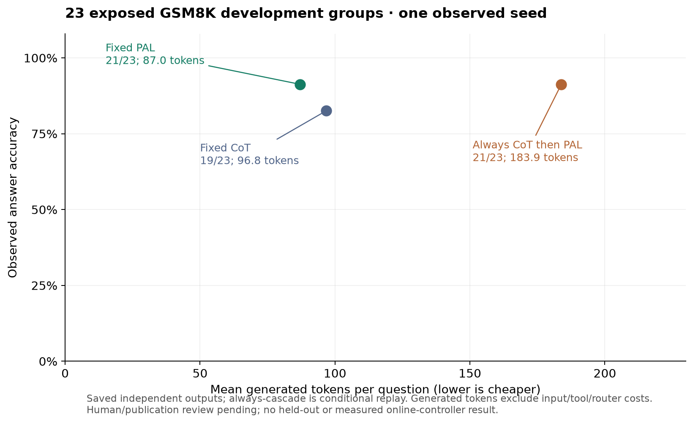

# Research comparison brief

## Current decision brief — 2026-10-23

This section proposes paper framing and interpretation of existing comparisons;
it is not a new preregistration, approved model budget or execution freeze.
Historical October 4 measurements below retain their original scope. RAT
implements the reasoning method and the headless harness evaluates it
reproducibly, as fixed in [project scope](project_scope.md).

The useful question is: **when does choosing a recipe and then paying for
another strategy improve the accuracy–generated-token tradeoff on a fixed
small model?** An incorrect initial answer is not enough reason to escalate:
the next strategy can also fail. A correct initial answer can be replaced by
an incorrect one. Predicting correctness and predicting the benefit of another
attempt are different tasks. This motivates the existing routing/stopping
evaluation; it does not establish that the current signal or controller works.

### What the closest references already cover

Primary methods were checked on October 23 in the specific versions linked
below. This is a focused comparison of three existing references, not an
exhaustive novelty search or a reproduction of their experiments.

| Reference | Existing mechanism | Consequence for this project |
| --- | --- | --- |
| [Route to Reason, v1, §2 and Appendix A.1](https://arxiv.org/html/2505.19435v1) | Predicts performance and generated length to select a model/strategy from the query. Appendix A.1 also evaluates strategy routing within one model. | A fixed model and strategy selection alone cannot establish novelty. Our logistic/Ridge entry predictor is an internal adapted baseline, not a reproduction of the paper's MLP router. |
| [BEST-Route, v1, Algorithm 1 and §4](https://arxiv.org/html/2506.22716v1) | Chooses model/sample count from predicted match probabilities and estimated cost before sampling, then selects by a proxy reward model. | Distinguish upfront compute allocation from decisions made after observing a strategy output. Its reward scores and price-based costs do not transfer to our exact-answer accuracy or generated-token utility. |
| [Adaptive-Consistency, §3](https://aclanthology.org/2023.emnlp-main.761.pdf) | Stops repeated sampling using the stability of the majority answer; the reported method uses a Beta stopping criterion. | Output-dependent stopping also has prior work. Our ladder changes complete strategy recipes; it is not this within-recipe sampling rule. Agreement stability is not proof that the answer is correct. |

The proposed contribution remains a controlled evaluation of entry selection
plus output-dependent stopping in the declared setting, with rescue/harm and
cost analysis and an implementation in RAT. These implementation differences
are reasons to compare, not evidence of a first or superior algorithm. No
baseline below should be named after an external paper unless its method and
evaluation are actually reproduced. Keep the broader
[related-work catalog](related_work.md) for context.

### What each existing comparison can answer

Source inspected: `fit_policies`, `entry_training_data` and `evaluate_records`
in `experiments/research_study.py`. These are proposed interpretations of
comparisons already implemented, not new measured effects.

| Comparison | Question it answers | Interpretation limit |
| --- | --- | --- |
| Full policy vs one-shot router | Does the complete entry-plus-stopping system improve the declared utility over selecting one recipe upfront? This remains the existing H1 comparison. | The predictors are fitted to different targets: ladder outcome versus single CoT outcome. It is not an isolated stopping ablation. |
| Full policy vs entry without escalation | What does allowing the ladder to continue change while keeping the full predictor's initial choice? | `entry_without_escalation` reuses `full_choice`; it is not a separately optimized one-shot router. The result is conditional on this predictor and fitted stopping policy. |
| Full policy vs ladder only | What does entry routing change relative to always entering the fitted ladder? | Both can use ladder stopping; the choice also changes access to ReAct/PAL. It is not an isolated test of embedding quality. |
| Full policy vs fixed CoT, SC, candidate selection, ReAct and PAL | Is the adaptive system useful relative to the available fixed recipes? | Recipe differences mix prompts, sampling, tools and costs. They do not isolate the causal contribution of tools. Choose the primary fixed reference on development data before viewing held-out outcomes; keep all fixed rows visible. |

The evaluator currently includes those five fixed strategies; DIRECT is a
pilot option, not a fixed arm in the main `STRATEGIES` tuple. Do not silently
add it to the main study or claim it was evaluated there. Adaptive-Consistency
is prior art, not an implemented comparison in this evaluator. Adding either
requires an explicit protocol decision, not just a new table label.

For RQ2, the existing contrasts support component analysis of entry choice and
escalation under the conditions above. Tool recipes can be described, but a
claim about the separate tool contribution would require a controlled
comparison with that intervention isolated. Recommendation: keep that causal
claim open rather than expanding the current batch with another experiment.
This clarifies interpretation without changing RQ1/H1, fitting, seeds or lambda.

### What can enter the paper today

| Evidence already available | Supported use | Claim still unavailable |
| --- | --- | --- |
| [Historical confidence gate report](../audit/confidence_signal_gate_report.json) and [decision rule](../prereg/decision_rule_signal.md) | Describe the failed historical logprob-signal gate and the restriction on threshold fitting for that signal. | All confidence signals fail universally, or verifier/agreement escalation has therefore succeeded. |
| [Measured GSM8K development pilot](gsm8k_development_results_20261004.md) | Motivation and failure examples from 23 exposed groups. PAL has complementary successes and failures; code execution success does not establish answer correctness. | Held-out GSM8K performance, controller benefit, or an isolated tool effect. The proposed October 4 fixed-baseline measurement below has already been completed. |
| [Reviewed runtime/harness bridge](../audit/rat_cot_quick_unification_20261022/research_bridge/codex_review/closeout/review.md) and [integration tests](../tests/test_online_reasoning.py) | The reviewed synthetic fixtures check route/stopping/cost parity, preprocessing binding and execution-double label isolation; 79 independent software tests passed at the recorded snapshot. | Model-quality evidence, fresh native UI acceptance or equivalence of every runtime configuration. The separate checker dry-run remains subject to its own review. |
| [Candidate data report](../data/procedural_research_v1/report.md) and [artifact index](research_artifact_index.md) | Describe candidate split/group counts, provenance and pending review. | Reviewed publication data, independent semantic test-gold approval or a completed main study. |

No new model inference, data release, held-out content inspection, statistical
test or policy fitting was performed for this brief. The linked offline GSM8K
analyses reconcile counts and generated-token costs with pinned raw records;
they perform no new semantic gold review. Historical confidence/candidate status
retains the scope of its cited artifacts. Software evidence, application
acceptance and measured quality must remain distinct.

### Stopping-signal shortlist — offline diagnostic, 2026-10-23

The following is a proposed order of investigation, not an approved stopping
rule. It preserves the failed historical signal gate and the current campaign
budget. Source semantics were read from `qwen_mlx_backend.py`,
`scripts/verifiers.py` and the existing agreement review.

| Signal | When available / what it checks | Current evidence and proposed role |
| --- | --- | --- |
| Parse, truncation and tool-execution failure | After an invoked output/tool; does not establish semantic correctness. | Keep as guardrails. Budget exhaustion/cancel/deadline remain terminal execution limits, not permission to escalate. Clean markers are not an answer-validity certificate. |
| Task-scoped checker | After an answer/public artifact/witness, within a declared grammar and checker scope; no reference gold at inference. | Priority for development validation. Preserve valid/invalid/unknown and coverage. Arithmetic equation consistency alone does not verify the problem interpretation or final answer. A checker that solves the task also needs a query-only solver baseline and CPU costs. |
| Agreement / SC vote share | Only after generating the compared samples/strategies. | Candidate comparator/auxiliary signal; charge every required call. Existing four-arm agreement reanalysis is exploratory and is not a cheap pre-generation gate. See [agreement protocol](agreement_reanalysis_protocol_20261008.md). |
| Backend confidence | CoT uses the backend's generation heuristic; SC returns vote ratio; candidate selection returns selector confidence. | These are different quantities, not interchangeable correctness probabilities. The current composite is not automatically validated by another signal's report. No new threshold fitting on historical failed logprob signals; no replacement approved by this shortlist. |
| ContradictionAuditor report | Worker postprocessing of answer/source evidence. | Observational heuristic in current implementation, not the policy's stopping signal. Do not describe it as a learned or validated stopping verifier. |

A [new offline diagnostic on the already exposed 23-group pilot](../audit/rat_cot_quick_unification_20261022/independent_review/stopping_signals/README.md)
rechecks stored correctness and costs without a model call or fitting:

| Stored-output strategy/path | Correct / 23 | Mean generated tokens |
| --- | ---: | ---: |
| Fixed CoT | 19 | 96.8 |
| Fixed PAL | 21 | 87.0 |
| CoT then PAL on observed parse/length/tool failure | 19 | 96.8 |
| CoT then PAL unconditionally | 21 | 183.9 |

The failure-marker rule was considered after reading historical results; it
is exploratory, not preregistered. It triggers zero times. All four CoT errors
have successful parse/normal completion and stored confidence above 0.94.
PAL rescues those four but harms two initially correct answers; its tool
executes successfully on both wrong answers too. This supports checking signal
coverage and the marginal benefit of escalation separately from correctness.
It does not validate a checker or rule out every confidence/agreement signal.

The two cascade rows sum the calls in independent saved outputs; PAL still
receives the original query, not the CoT answer. Costs exclude prompts/tool/
router overhead and do not measure online latency. There is one observed seed,
23 exposed independent groups and pending human review; there is no held-out
controller win, new significance test, policy fit or campaign authorization.
Keep direct entry to PAL and the fixed-PAL baseline in scope rather than
assuming every query should first pay for CoT.

### Concrete checker eligibility packet — 2026-10-23

The [existing signal review now includes a concrete checker packet](../audit/rat_cot_quick_unification_20261022/independent_review/stopping_signals/README.md#gói-kiểm-chứng-checker-đã-chuẩn-bị--2026-10-23).
Proposed first scope: the existing Game-of-24 public expression checker, with
four declared input numbers and exact arithmetic; no private reasoning or gold
input. Reuse `valid/invalid/unverifiable`. Unknown coverage must stay visible,
and any escalation remains subject to budget/cancel/deadline limits. This is
an eligibility investigation, not a selected main-study signal or active policy.

Seventeen authored G24 contract cases match their expected statuses, and the
existing verifier module has 38 passing tests. A separate retrospective check
of all eight CoT outputs at cap 1,024 in the saved mixed-family development
pilot yields four valid, one invalid and three unverifiable. These are eight
exposed groups, one seed; no new inference, fitting or held-out inspection.

The checker and historical procedural scorer share `check24`, so agreement
with stored correctness is not independent verifier validation. The packet
requires an independent reference for validation and a query-only solver
baseline with CPU costs. No matched fallback outcomes are available for this
slice, so no checker-gated rescue/harm or controller benefit has been measured.
Simple arithmetic rationale consistency and a valid ordering witness have
narrower guarantees than final-answer correctness; do not transfer their
`valid` labels across those scopes.

The packet now adds an independent audit reference: expected exact values are
attached while constructing binary expressions, cross-checked by a separate
token/precedence-stack interpreter without production AST/check24 labels.
Across four authored operand tuples, 11,089 distinct expressions and 11,579
checker calls including input-order/multiset controls show no acceptance
mismatch. These are dependent synthetic software cases, not benchmark questions,
a proof for all inputs, or a measured controller result.

The independent interpreter confirms the four accepted saved development
expressions. Its other four results are unverifiable under its narrower input
grammar, versus production's one invalid/three unverifiable; no full status
agreement or independent 100% precision/recall claim follows. The review index
links eight existing exposed development questions/solutions in the original
packet, with query/number bindings checked and human/source review pending.
Next decisions concern that review and a bounded development measurement;
this work enables no model call or new execution freeze.

### Marginal value of another recipe — exact development accounting

The [reproducible marginal-cost analysis](../audit/rat_cot_quick_unification_20261022/independent_review/stopping_signals/marginal_value.json)
adds exact accounting to the existing pilot, without selecting a rule or lambda.
It verifies all historical manifest hashes, reconciles the derived per-ID table
with raw labels/costs/groups and checks paired gain/cost identities. It reads
only the already exposed pilot and preserves its artifacts. No new policy,
model run, significance test, confidence interval or test-set estimate is produced.

| Saved-output condition | Correct / original groups | Calls on selected paths | Total generated tokens | Mean generated tokens |
| --- | ---: | ---: | ---: | ---: |
| Fixed CoT | 19/23 | 23 | 2,227 | 96.8 |
| Fixed PAL | 21/23 | 23 | 2,002 | 87.0 |
| Always CoT, then independent PAL | 21/23 | 46 | 4,229 | 183.9 |

The last row is conditional replay: the saved PAL answer was generated from
the original query, without the CoT output. It is not a targeted repair run.
Consequently it ends with exactly the fixed-PAL answers while paying for every
CoT call. Its generated-token count is **2.1124 times** that of fixed PAL in
this sample. This is an accounting consequence of the path, not a measured
latency slowdown or a general verdict on sequential reasoning.

For the existing utility definition, with nonnegative penalty lambda:

```text
U(PAL) − U(CoT) = 2/23 + lambda × 225/23000
U(always CoT→PAL) − U(PAL) = −lambda × 2227/23000
```

Thus PAL has higher observed accuracy and fewer generated tokens than CoT on
these particular outputs. Always escalating ties fixed PAL at lambda=0 and
loses utility for every lambda>0 under this token scope. This does not select
the main-study lambda/fixed comparator, establish statistical superiority or
show full-inference-cost dominance: PAL prompt and execution costs remain
outside the generated-token axis. The primary fixed comparator must still be
selected/frozen using its declared development role before validation/test.

The cost of mistaken escalation is visible by stratum:

| CoT→PAL outcome on the same group | Groups | Change in number correct | Extra PAL generated tokens if all in this stratum escalate |
| --- | ---: | ---: | ---: |
| Initially wrong, then right | 4 | +4 | 338 |
| Initially right, then wrong | 2 | −2 | 194 |
| Both right | 17 | 0 | 1,470 |
| Both wrong | 0 | 0 | 0 |

These strata use evaluator correctness **after outcomes are known**. They are
diagnostic labels, unavailable to the controller at inference. They must not
become an oracle gate, fitted rule or prospective policy result. No subset was
chosen to optimize this table. Neutral escalation can be costly even if the
fallback is correct; a general classifier of initial-answer correctness also
does not establish the marginal benefit of the next recipe on new questions.

For any declared escalation set S in this two-recipe saved-output setting:

```text
Δaccuracy versus CoT = (rescues selected − harms selected) / n
Δgenerated tokens = sum of PAL tokens for every group in S
Δutility versus CoT = (rescues selected − harms selected) / n
                    − lambda × sum(PAL tokens in S) / (1000 × n)
```

An inference-time gate may use only its permitted query/current-output signal;
the above post-hoc labels may only score it. All selected fallback calls count,
including neutral/wrong outputs and failures. These identities motivate reporting
rescue, harm, coverage and cost together, instead of interpreting error-detection
accuracy or tool success alone as controller value. They do not amend H1,
authorize a new signal, or bypass the historical failed confidence gate.



The figure is descriptive: 23 exposed groups, one observed generation seed,
human/publication review pending. SVG and PNG exports are beside the JSON.
The failure-marker gate from the previous diagnostic triggers zero times and
therefore coincides with fixed CoT; it is omitted as a duplicate plotted point.

Reproduce into a new directory, with no model or fitting:

```bash
.venv/bin/python audit/rat_cot_quick_unification_20261022/independent_review/stopping_signals/analyze_marginal_value.py --output /private/tmp/rat-marginal-value-repeat
```

### Working manuscript paragraphs — method, motivation and limits

The Vietnamese text below is a draft for the method and development-analysis
sections. It is not an abstract claiming a completed main study, or an approved
publication statement. Its numbers refer only to the pinned pilot above.

> Nghiên cứu xem xét việc chọn chiến lược suy luận ban đầu và quyết định có
> trả thêm chi phí để chạy chiến lược tiếp theo trên một mô hình nền cố định.
> RAT là ứng dụng triển khai phương pháp; pipeline headless cung cấp môi trường
> đánh giá tái lập. Các chiến lược trong prototype là những recipe cụ thể:
> CoT, lấy mẫu nhiều lần rồi bỏ phiếu, chọn giữa các lời giải hoàn chỉnh, ReAct
> và PAL. Recipe mang tên legacy `TOT` thực hiện candidate selection, chưa phải
> tìm kiếm cây. Câu hỏi thực nghiệm là bộ điều phối có cải thiện đánh đổi giữa
> độ đúng và chi phí so với chiến lược cố định hoặc chọn một lần ở đầu vào hay không.

> Đánh giá cần giữ các nhóm bài toán độc lập giữa train, calibration và test.
> Stopping thresholds được fit trên calibration, entry predictor trên train,
> rồi so sánh các policy trên cùng outputs đã lưu của test theo protocol đã
> chốt. H1 hiện có so sánh utility của full policy với one-shot router; vì hai
> predictor được fit trên target khác nhau, đây là so sánh cả hệ, không phải
> một ablation chỉ riêng cơ chế dừng. Chi phí token được cộng trên mọi recipe
> đã chọn, bao gồm các samples và selector; token sinh được báo riêng với input
> và thời gian tool. Thời gian replay không thay cho latency online của RAT.

> Pilot development lịch sử gồm 23 nhóm GSM8K đã xem, một seed và cùng cap
> 1.024 token mỗi call, cho thấy lỗi giữa các recipe có thể bổ sung nhau.
> CoT đúng 19/23, PAL đúng 21/23; PAL cứu bốn câu CoT sai nhưng làm sai hai câu
> CoT đúng. Cả hai câu PAL sai vẫn thực thi code thành công. Một replay luôn
> chạy CoT rồi dùng output PAL độc lập giữ nguyên 21/23 đáp án đúng của PAL,
> trong khi tăng tổng token sinh từ 2.002 lên 4.229. Vì vậy, khả năng phát hiện
> lỗi, giá trị của một lần chạy thêm và chi phí của lần chạy đó phải được đánh
> giá riêng. Tín hiệu chỉ kiểm cú pháp, kết thúc sinh hoặc tool execution chưa
> đủ chứng minh độ đúng đáp án hay lợi ích của escalation.

> Những số liệu này dùng để hình thành thiết kế và phân tích lỗi, chưa chứng
> minh controller thắng trên held-out data. Kiểm thử bridge đã xác nhận các
> contract phần mềm được thử, gồm parity trên fixtures và binding preprocessing;
> đó là loại bằng chứng khác với chất lượng mô hình. Human/source review, cấu
> hình thực nghiệm chính và tín hiệu stopping được phép dùng vẫn cần được chốt
> theo protocol. Đóng góp đang được kiểm chứng là đánh giá có đối chứng về
> điều kiện hữu ích và thất bại của điều phối trong hệ RAT–CoT, chưa phải tuyên
> bố thuật toán đầu tiên hoặc kết quả vượt trội đã được xác lập.

For scope control, keep G24 as a checker-contract diagnostic for now. The
query-only solver baseline solves the eight exposed cases in the existing
packet; synthetic fallback fixtures cannot establish a reason to spend model
budget or a benefit on held-out questions. Keep that software task separate
from the decision about the main study's eligible stopping signal. There is
already a disjoint GSM8K development-validation candidate and protocol; do not
create another overlapping dataset to make a new pilot look fresh. This
recommendation changes no data approval, main-study scope, fitting, freeze or
execution authorization.

### Paper text and decisions that can be prepared now

Proposed neutral framing for the introduction:

> We study strategy selection and the decision to run another reasoning recipe
> under a declared generated-token penalty on a fixed small language model.
> RAT is the application implementation, with a headless pipeline for paired
> evaluation. We examine whether the combined controller is useful relative
> to fixed recipes and one-shot routing, and where escalation rescues or harms
> answers. Its benefit remains to be established on reviewed held-out data.

Keep one primary H1 contrast and the existing separate accuracy/token reports.
Document family, original-group counts, observed seeds, parsing/truncation,
rescue/harm with denominators and uncertainty. Conditional replay estimates
are not online latency; generated tokens are not full inference cost. Never
select a winning lambda, baseline, family or example from the held-out results
and then present that choice as prospective.

The next review should resolve three concrete items, using Anti's method
mapping and the existing data packets:

1. Which stopping signal is actually proposed for the next campaign, and what
   development evidence permits its use? A generic confidence-capable runtime
   does not override the failed historical logprob gate. If this is unresolved,
   keep the campaign pending; do not fit a replacement on test outcomes.
2. Which candidate and fitting/calibration roles are approved, with human
   review, ownership and prior exposure recorded? Existing pools are not
   interchangeable. No new model collection is needed to prepare this review.
3. Which primary comparison, lambda, model/prompts/caps, observed-seed plan and
   precision/resource justification will be frozen? Candidate size is not a
   power calculation. Small or imprecise effects must remain inconclusive.

If the controller does not improve the tradeoff, report that outcome and its
failure conditions. The paper's validity must not depend on a positive result.
Stage 0 and model-budget authorization retain their existing scope.

The consolidated [decision card and collection envelope](research_plan.md#quyết-định-tiếp-theo--thiết-kế-có-thể-duyệt-2026-10-23)
now identify the pending signal/data/configuration decisions, distinguish
paired-accuracy power from utility precision, and keep the existing small
GSM8K development baseline ahead of an unapproved full collection. This is a
planning update, not a new experiment, parameter freeze or inference allowance.

## Historical reference points and next decision — 2026-10-04

The present evidence is a development prototype. It supports diagnosing
generation, scoring and confidence; it does not yet demonstrate a useful
controller or establish a new research contribution.

## What we can compare today

Same 24 exposed questions, same Qwen3-8B-4bit snapshot, seed 42, cap 1,024:

| Reference | Correct/questions | Mean generated tokens |
| --- | ---: | ---: |
| Always DIRECT | 10/24 (41.7%) | 116.8 |
| Always CoT | 15/24 (62.5%) | 324.9 |
| Choose the correct answer from those two, using gold labels | 16/24 (66.7%) | Not a deployable method |
| Always calculator/ReAct or PAL | Pending measurement | Pending measurement |
| Simple routing rule or the proposed learned controller | Pending measurement | Pending measurement |

The gold-informed ceiling leaves one question of accuracy headroom beyond
always-CoT when selecting from these two stored outputs at this cap. It does
not bound strategies that generate other answers or use tools. Cost savings
can still matter, but selecting between two wrong outputs cannot repair the
eight questions both strategies miss.
CoT uses approximately 2.8 times DIRECT's mean generated-token count here.
The prompt languages differ, and this small exposed set gives no held-out
estimate. Costs exclude prefill/full inference and controller overhead.

Confidence also needs a stronger reference. In the larger-cap CoT condition,
its score is higher for a correct output than a wrong one in 70 of 135 pairs
(ranking AUC 0.519, ties count half). Those pairs are not independent samples;
there are 24 questions. Raw token margin ranks at 0.711 and length/parse status
at 0.722 on the same data. This post-hoc inspection supplies candidates to
test on separate development groups, not validated feature improvements.
No calibration model or stopping threshold has been fitted.

The [offline assessment](../audit/pilot-reference-assessment-20261004/assessment.json)
rechecks the frozen raw answers/scores and hashes. Its manifest records zero
new model calls. A confidence probability needs reliability checks in addition
to ranking; Brier score alone mixes several properties, as described in the
[scikit-learn calibration documentation](https://scikit-learn.org/stable/modules/calibration.html).

To reproduce the assessment, first create the source-pinned checkout using the
[pilot reproduction recipe](development_pilot_results_20261004.md#reproduce-replay-and-analysis),
which defines `pilot_repo` and `pilot_checkout`. Then run:

```bash
PYTHONPATH="$pilot_checkout" python "$pilot_repo/scripts/assess_pilot_reference.py" \
  --run "$pilot_repo/audit/development-pilot-measured-20261004-runtimefix" \
  --audited-analysis "$pilot_repo/audit/development-pilot-measured-review-20261004" \
  --output "$pilot_checkout/audit/NEW_REFERENCE_ASSESSMENT"
```

This requires the recorded Python/package versions and refuses an existing
output directory. The current shared harness has later source changes; the
collection checkout is required for its replay hash checks.

## External reference points

Qwen's technical report Table 18 reports **87.4 on MATH-500** and **26.7 on
ZebraLogic** for Qwen3-8B in non-thinking mode. These are published evaluations
on different tasks and settings, not targets directly comparable with our
custom 24-question accuracy. The report also distinguishes thinking and
non-thinking evaluations. [Qwen3 report](https://arxiv.org/html/2505.09388v1#S4.T18).

The official model card recommends sampling settings and output allowances
different from this greedy, 1,024-token, four-bit pilot. A published-score
reproduction would need to match those choices rather than attributing a gap
to the controller. [Pinned Qwen3-8B model card](https://huggingface.co/Qwen/Qwen3-8B/blob/b968826d9c46dd6066d109eabc6255188de91218/README.md).

[GSM8K](https://github.com/openai/grade-school-math) supplies human-written
multi-step math word problems and predefined training/test files; its repository
includes an [MIT license](https://github.com/openai/grade-school-math/blob/master/LICENSE).
It is a candidate public anchor for a separate math experiment. Preparation
should start from training data only and preserve the official test for the
frozen evaluation. Dataset identity, grouping, gold extraction and review must
be recorded; public availability does not prove absence from model pretraining.

For the research approach, [Route to Reason](https://arxiv.org/abs/2505.19435)
already studies joint model/strategy routing, and
[BEST-Route](https://arxiv.org/abs/2506.22716) studies model/sample-budget routing.
Our candidate contribution is a controlled fixed-small-model study of entry
selection plus stopping. Its value and difference from prior work require
evidence; routing terminology or passing tests do not establish novelty.

## One next measurement, with a decision attached

Prepare a small, reviewed GSM8K **training-only development** sample and
compare English DIRECT, English CoT and English PAL on the same pinned model
and questions, with declared per-call caps and tool-turn limits. Sum generated
tokens across every PAL call and report tool time separately. This is a
separate math development experiment, not a replacement for the mixed-family
main study. Record fixed strategies before adding a router.
This answers whether tool-assisted execution creates a worthwhile alternative
to always-CoT. Sampling/default changes require a separately named protocol;
do not change language, decoder and confidence formula in one comparison.

The subsequent controller must beat a strong fixed strategy or a simple
input-based rule on accuracy–generated-token tradeoffs. Any fitted features,
rules and thresholds need disjoint fitting/validation groups before held-out
evaluation. If fixed PAL dominates the useful range, report that limitation and
narrow the controller claim. Stage 0 and publication review remain unchanged.

The next deliverable is one readable baseline table and a continue/narrow
decision tied to it. Add experiment infrastructure only to enable that result.
